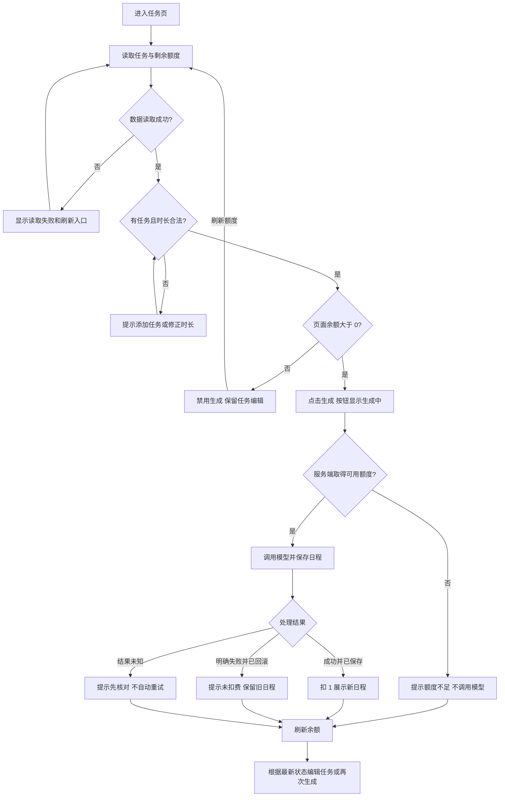

# 日程生成额度处理方案

用户在点击生成前，需要知道本次会不会扣额度；操作结束后，需要分清生成成功、明确失败和结果尚未确认。额度判断必须放在模型调用之前，否则即使页面提示正确，也可能产生无额度调用和并发透支。

方案保留现有任务页面，补齐额度展示、生成状态和结果反馈；服务端取得可用额度后才允许调用模型，日程保存成功后计费。需求、流程、开发拆解和验收案例已整理；本次为产品文档交付，以下案例尚未在本分支执行。

## 1. 目标与边界

适用场景：用户添加待办事项、填写可用时长，生成一份日程。新账号初始有 3 个额度，每成功生成并保存一份日程消耗 1 个。

| 规则 | 用户应获得的结果 | 对应验收 |
| --- | --- | --- |
| R1 成功扣 1 | 日程已保存才算成功，额度与结果保持一致 | C01、C04 |
| R2 无额度不调用 | 页面提示额度不足；绕过页面也不能触发模型 | C02、C05 |
| R3 明确失败不扣 | 模型失败后额度不变，可以修改任务后重试 | C03、C13 |
| R4 并发不透支 | 同账号的请求只能使用实际可用额度，余额不能为负 | C05、C06、C13 |
| R5 反馈可理解 | 看得到状态、是否扣费和下一步；旧结果不会被误认成本次成功 | C07–C11 |

范围遵循 [TASK.md](TASK.md)：单服务、单数据库、本地模拟模型；保留现有任务选择规则。不增加支付、订阅、每日额度恢复、Token 计价、跨账号防刷、跨请求结果复用或崩溃自动补偿。没有额度补充入口时，不展示充值或升级按钮。

本方案补充的输入边界：至少有一条任务，可用时长为 1–24 的有限数。已完成任务是否参与生成仍按现有逻辑处理，不在本次改动中重新定义。

## 2. 额度与请求规则

1. 页面展示的是服务端确认的余额。加载中或读取失败显示“—”，不能显示为 0。
2. 点击前说明“成功生成消耗 1 个额度”。生成中禁用按钮，不重复提交；不提前展示已扣费。
3. 服务端根据当前用户的真实余额取得生成资格。同账号并发争用最后一个额度时，只允许一个请求先进入模型调用；若它成功用完额度，其他请求提示额度不足；若它失败释放额度，等待中的请求可继续使用。
4. 模型成功、日程保存和额度结算一起完成，才向用户报告成功。模型明确失败或保存失败，应撤销本次额度占用，不留下半份结果。
5. 不把任何报错都解释为“未扣费”。请求超时或响应丢失时，服务端可能已经成功，页面只能提示结果未确认。
6. 成功、失败、手动刷新和窗口重新获得焦点时查询最新余额。刷新只读数据，不触发生成、不扣额度；查询重试也不得变成生成重试。
7. 不自动重试生成。用户再次发起的是一个新请求，成功后可以再次扣费；不承诺复用前一次结果。

服务端采用何种锁或事务由开发决定，但需证明两点：未取得额度的请求没有 `mock-ai.started`；余额扣减与结果保存不会只完成其中一项。不能仅靠按钮禁用或先读余额、再单独扣减来满足规则。

## 3. 用户流程

这里有两次额度判断：页面判断用于提示，服务端判断用于决定能否调用模型。即使页面还显示 1，另一个标签页已经用完额度，本次请求也应被服务端拒绝。

## 4. 页面与文案

额度放在生成按钮附近，与顶部余额使用同一数据来源。按钮下方固定说明“每成功生成一份日程，消耗 1 个额度”，让用户在点击前看到规则。

| 状态 | 展示与按钮 | 用户下一步 |
| --- | --- | --- |
| 数据加载中 | 余额“—”；生成按钮禁用 | 等待加载 |
| 无任务或时长不合法 | 禁用生成；提示“请先添加任务”或“时长需在 1–24 小时之间” | 添加任务或修正时长 |
| 可生成 | 显示余额；按钮“生成日程” | 发起生成 |
| 生成中 | 按钮“生成中…”并禁用；旧结果标为“上次成功日程” | 等待结果，可阅读旧日程 |
| 成功 | 提示“生成成功，已消耗 1 个额度”；展示新日程，刷新余额 | 查看日程，或修改任务再次生成 |
| 额度不足 | 按钮“额度已用完”并禁用；提示“可继续编辑任务，本练习暂不提供额度补充” | 编辑任务、阅读本页已有日程或刷新余额 |
| 模型明确失败 | 提示“生成失败，本次未扣费”；保留任务和上次成功日程 | 检查任务后重试；模拟环境需移除含 `[fail]` 的任务 |
| 结果未确认 | 提示“暂时无法确认结果，请先刷新并核对额度。再次生成可能再次消耗额度” | 先刷新，再决定是否发起新生成 |
| 额度读取失败 | 余额“—”；提示“额度读取失败，请刷新重试”；禁用生成 | 点击“刷新额度” |

- 加载失败、额度不足和输入错误应有页面内提示，不只依赖会消失的通知。
- 失败时不清空任务、不清空已显示的日程，但旧结果必须明确标注为“上次成功日程”。
- 只有确认已回滚的失败才能承诺“本次未扣费”；网络错误不使用这句文案。
- 不在成功通知中写可能已过期的余额，余额位置在查询完成后单独更新。
- 不承诺刷新页面后恢复上次日程；当前范围只要求失败时保留本页已有结果，不增加历史日程管理。

## 5. 开发任务拆解

P0 均为本轮必须完成的任务。先确认服务端的额度规则，再接入页面，最后按案例联调。

| 编号 | 责任角色 | 任务与现有入口 | 依赖 | 完成条件 |
| --- | --- | --- | --- | --- |
| D1 | 服务端 | 在 `src/demo-ai-app/operations.ts` 处理身份、输入和任务边界 | 无 | 非法请求不调用模型、不扣额度；对应 C08 |
| D2 | 服务端 | 在模型调用前取得额度，保证结算与 `PlanResult` 一致；沿用现有数据模型 | D1 | 无额度无调用，失败无扣费，同账号并发不透支；对应 C01–C06、C13 |
| D3 | 服务端 | 提供当前账号余额查询，区分无额度、明确失败和未知错误；在 Wasp 中声明操作 | D2 | 余额来自数据库，不能由客户端指定别人的账号；对应 C09、C12 |
| D4 | 前端 | 修改 `src/client/App.tsx`、`src/demo-ai-app/DemoAppPage.tsx`，统一余额与按钮状态 | D3 | 加载、失败、0 额度展示不同；生成中不重复提交；对应 C02、C07、C10 |
| D5 | 前端 | 接入成功、失败和未知结果提示，保留并正确标记旧日程；实现刷新 | D4 | 提示能说明扣费与下一步，刷新不触发模型；对应 C03、C09–C11 |
| D6 | 测试与开发 | 使用独立账号验证余额 0、1、3；提供并发调用和保存失败的可控测试方式 | D2–D5 | 逐项记录余额、结果数和模型调用数；关键案例有可重复执行方式 |
| D7 | 产品与测试 | 按文案表核对页面，检查旧结果是否易误认、零额度后是否仍可编辑 | D4–D6 | 完成 C07–C11，验收记录逐项说明实际结果与未完成项 |

参考入口：[服务端操作](src/demo-ai-app/operations.ts)、[任务页面](src/demo-ai-app/DemoAppPage.tsx)、[顶部余额](src/client/App.tsx)、[模拟接口](src/demo-ai-app/mockAi.ts)、[数据模型](schema.prisma)。不修改 `.wasp/` 生成文件。

## 6. 验收案例

以下为待执行案例，不代表功能已经通过。使用隔离测试账号；每个案例单独记录初始/最终余额、生成结果数和模型调用数。`mock-ai.started` 计一次调用，同一次调用的日志通过 `callId` 对应；测试期间避免混入其他请求。

| 编号 | 前置条件 | 操作 | 可观察预期 |
| --- | --- | --- | --- |
| C01 成功 | 余额 3，有普通任务 | 生成一次 | 调用 1 次；新增并保存 1 份日程；余额 2；提示成功消耗 1；显示新日程 |
| C02 额度不足 | 余额 0，有任务 | 查看页面，再绕过按钮直接请求生成 | 页面生成禁用且可编辑任务；直接请求也被拒绝；调用 0 次，余额与结果数不变 |
| C03 明确失败与重试 | 余额 1，有普通任务及含 `[fail]` 的任务 | 生成失败，删除失败任务后再生成 | 首次调用 1 次、无新结果、余额仍为 1；提示未扣费并保留旧结果；重试成功后累计调用 2 次、余额 0、新增结果 1 份 |
| C04 保存失败 | 余额 1，有普通任务；测试环境可模拟保存异常 | 让模型成功，但保存结果失败 | 请求不得显示成功；余额恢复为 1，无新增结果；数据库异常不能冒充模型明确失败 |
| C05 最后额度竞争 | 同账号余额 1，有普通任务 | 用两个标签页或并发脚本同时发起 2 个请求 | 恰好 1 个成功、1 个额度不足；调用 1 次，余额 0，新增结果 1 份；失败页刷新为 0 |
| C06 多额度竞争 | 同账号余额 3，有普通任务 | 并发发起 5 个正常请求 | 3 成功、2 个额度不足；调用 3 次，余额 0，结果 3 份 |
| C07 连续点击 | 余额足够，有普通任务 | 在生成返回前快速连点 | 页面只提交一次，显示生成中并禁用按钮；返回后恢复操作；成功只扣 1 |
| C08 输入边界 | 登录账号余额 1 | 分别测试无任务、时长 0/25/非数字，再测试未登录请求 | 页面有明确修正提示；服务端也拒绝；均不调用模型、不扣额度、不产生结果 |
| C09 刷新与读取失败 | 有余额且有任务，页面已展示余额 | 手动修改测试余额后刷新；再停止后端并刷新，恢复后重试 | 刷新只查询、不扣费、不调用模型；读失败显示“—”并禁用生成，不显示 0；恢复后显示真实余额 |
| C10 跨标签页 | 两页登录同一账号，初始余额 1 | 第二页成功生成，再切回第一页；同时测试第一页缓存未刷新时直接请求 | 切回后余额更新为 0；即使显示仍滞后，服务端也拒绝新请求且不调用模型 |
| C11 结果未知与旧结果 | 页面已有成功日程，有剩余额度 | 让一次生成在提交后丢失响应，或中断网络 | 提示结果未确认，不能声称未扣费；不自动重试；旧结果标为“上次成功日程”；用户能刷新核对，并知道再次生成可能再扣额度 |
| C12 账号隔离 | 两账号各 1 额度，各有不同任务 | 分别生成，并尝试在请求中传入另一账号标识 | 余额和日程只属于当前登录账号；两账号各自结算，不能查询或消费别人的额度 |
| C13 失败后释放额度 | 同账号余额 1，有普通任务和含 `[fail]` 的任务；测试工具可暂停首个请求 | 首个请求取得资格后暂停；删除失败任务，发起第二个请求；确认第二个正在等待后释放首个 | 首个明确失败，第二个随后成功；调用 2 次，余额 0，结果 1 份；失败不留下不可用额度 |

通过标准：所有 P0 规则均有实际结果；成功、无额度、明确失败和并发场景必须检查模型日志与数据库，不能只看页面。未执行项如实标记，不用“预计通过”替代结果。

## 7. 交接说明

- 已完成：需求规则、用户流程、页面状态与文案、开发拆解、验收案例的文档检查；各交付入口见 [SUBMISSION.md](SUBMISSION.md)。
- 待完成：由开发按 D1–D7 实现，再由产品和测试执行 C01–C13，记录实际结果。
- 已知限制：不做跨请求幂等，客户端在响应丢失时不能准确判断某一次请求是否成功；余额可能因其他并发请求变化。页面需明确这种不确定性，不能靠自动重试掩盖。
