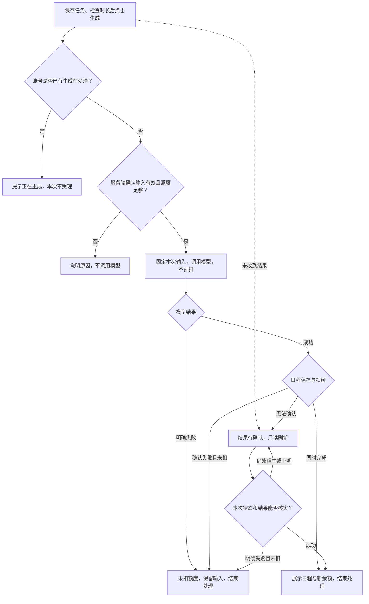

# 日程生成：额度处理改进方案

用户点一次“生成日程”，需要知道三件事：能不能生成、这次扣没扣额度、失败后该怎么继续。现在的主要问题是额度检查晚于模型调用，同账号的两个请求也可能用同一份旧余额通过检查。

这次将检查移到调用之前，并让同账号一次只处理一项生成。日程保存成功才扣 1 个额度；明确失败不扣，结果不明时先查询。需求、流程和开发任务已整理，应用代码尚未修改。验证记录见 [ACCEPTANCE.md](ACCEPTANCE.md)。

## 先改哪里

以下判断来自仓库代码阅读，基线为 `114aeb2`，尚未运行验证。

| 现状 | 本次要补的内容 |
|---|---|
| [先调用模型，再检查额度](https://github.com/bybzhwbzhh88/task-planner-interview/blob/114aeb28f6368e96c08a25627ac094b8d102fd1b/src/demo-ai-app/operations.ts#L48-L77) | 余额不足要在调用前结束请求，不能让用户等完才被告知无法生成 |
| 额度判断使用请求中的旧余额；同一段代码未见账号级的忙碌检查 | 两个请求争最后 1 个额度时，只能放行一个；页面禁止连点不足以保护其他标签页 |
| [页头已有剩余额度](https://github.com/bybzhwbzhh88/task-planner-interview/blob/114aeb28f6368e96c08a25627ac094b8d102fd1b/src/client/App.tsx#L9-L17)，[生成区已有加载状态](https://github.com/bybzhwbzhh88/task-planner-interview/blob/114aeb28f6368e96c08a25627ac094b8d102fd1b/src/demo-ai-app/DemoAppPage.tsx#L188-L214) | 保留这些能力，在按钮旁说明消费规则，补上刷新失败、额度不足和结果不明的下一步 |
| [保存日程和扣额已经放在同一事务中](https://github.com/bybzhwbzhh88/task-planner-interview/blob/114aeb28f6368e96c08a25627ac094b8d102fd1b/src/demo-ai-app/operations.ts#L57-L77)；[模型明确失败会先抛错](https://github.com/bybzhwbzhh88/task-planner-interview/blob/114aeb28f6368e96c08a25627ac094b8d102fd1b/src/demo-ai-app/mockAi.ts#L10-L15) | 保留已有的成功扣额方式。不能把“模型失败也会扣额度”写成已发现的问题；需要完善的是失败提示与结果核对 |
| [已有按账号查询日程的能力](https://github.com/bybzhwbzhh88/task-planner-interview/blob/114aeb28f6368e96c08a25627ac094b8d102fd1b/src/demo-ai-app/operations.ts#L181-L195)，页面本次结果主要放在本地状态中 | 补上刷新后找回本次结果的入口，避免已成功却误以为失败，再生成一次 |

## 方案取舍

**同账号先做一项，其他请求立即提示稍后再试。** 这样既能挡住跨页面重复操作，也不会把用户的误点放进后台队列，稍后连续扣费。代价是：即使还剩 3 个额度，同账号也不能同时生成两份日程。这是本方案的产品取舍，不是题目规定的唯一方案；当前请求结束后，新的请求仍可独立生成、独立扣额，不合并结果。

另一种选择是按额度预占，允许多项同时生成。它更适合批量需求，但需要解释“可用额度、处理中占用、失败释放”几种状态。本轮沿用成功后扣额，先把当前单次生成流程做好。若后续确有批量需求，再评估并行或显式排队。

**把“成功”定在日程可找回、扣额已完成的时刻。** 仅有模型返回成功还不够。保存明确失败时，用户没有拿到可用日程，不收这次额度；浏览器没有收到响应，也不能反推服务端失败。

范围遵循[题目说明](https://github.com/bybzhwbzhh88/task-planner-interview/blob/114aeb28f6368e96c08a25627ac094b8d102fd1b/TASK.md)：单服务、单数据库。保留现有任务选择逻辑，不扩展支付、订阅、每日赠送、跨账号防刷、Token 计费或服务崩溃补偿。

## 处理规则

| 编号 | 约定 | 验收 |
|---|---|---|
| R1 | 新账号仍为 3 个额度。页面显示服务端最新余额，读取失败显示“—”或“上次确认 N 个”，不能显示假 0。页头和按钮附近如同时显示余额，必须来自同一次状态读取。 | AC01、AC02 |
| R2 | 服务端在调用模型前取得该账号本次处理权，再读当前余额；这一段不能让两个请求同时通过。处理权持续到调用与保存结束，成功或明确失败后释放；浏览器断开不提前释放。其他重叠请求立即返回繁忙，不调用、不排队、不扣额。不同账号可同时使用。 | AC07–AC10、AC15 |
| R3 | 账号空闲但余额为 0 时，不调用模型。页面仍可编辑任务、刷新状态、查看已经确认的日程；不展示尚不存在的充值或额度恢复入口。 | AC03、AC04 |
| R4 | 处理中不预扣；本次结果已保存且扣除 1 个额度后，才确认成功。成功扣额与保存必须同时成立，余额不能为负。后续刷新失败不能把已经确认的成功改成失败。 | AC02、AC03、AC13 |
| R5 | 模型明确失败，或结果保存明确失败且确认未扣额时，保留输入和上次日程，允许手动重试。不能仅凭一条模型成功日志认定完成，也不能把未明确的异常归为“未扣额度”。 | AC05、AC06、AC10、AC13 |
| R6 | 断网或响应超时先显示“结果待确认”，不自动重试、不自动退额。只读查询本次生成状态、对应结果和余额；查不到记录或余额未变都不能单独证明失败。确认成功则展示结果，确认失败且未扣额才允许重试；仍不明就保留提示与刷新入口。 | AC12 |
| R7 | 首次进入、回到页面、生成结束、手动刷新时更新状态；提交时服务端仍重新检查。读取期间禁用生成，旧页面余额不能作为放行依据。刷新只读，不触发生成。 | AC01、AC02、AC11、AC12 |
| R8 | 沿用登录要求。生成前完成本页任务保存；页面和服务端都检查至少有一条任务、时长为 1–24 小时且符合 0.5 小时步长。受理时固定已保存任务和提交时长；此后的编辑用于下一次，旧响应不能覆盖新输入。每次主动再生成都是新请求。 | AC06、AC14、AC16 |

R2 中的“处理权”是整个部署中的账号约束，不能只在一个页面或某个进程中成立。具体实现由开发确定，但必须通过直接并发请求的验收。

R6 需要补充可按本次生成标识查询的能力，并让页面刷新后仍能关联该次请求。查询范围限当前账号，至少区分处理中、成功、明确失败和无法确认；这不是已有完整功能，也不等于重复请求复用。服务不可查询时保留待确认，不承诺自动恢复时限。

## 用户看到的流程



图中的账号检查和放行属于一次受理过程；每个进入模型的请求都必须先完成该过程。网络中断后的分支是页面状态，服务端继续完成原请求。

操作区布局示意如下，仅说明信息位置，不代表已实现的界面：

```text
待办事项                         今天可用时长 [ 2 小时 ]

剩余额度：3 个                                  [刷新状态]
每成功生成一份日程消耗 1 个额度

[                       生成日程                       ]

这里显示本次操作状态和下一步，不仅依赖短暂弹窗
下方保留上次日程；本次确认成功后展示新的结果
```

| 页面状态 | 文案与操作 |
|---|---|
| 生成中 | 按钮为“生成中…”且不可重复点击；提示“日程生成成功后扣除 1 个额度” |
| 成功 | “日程已生成，本次使用 1 个额度，剩余 N 个。”展示本次日程 |
| 余额为 0 | “当前没有剩余额度，暂时无法生成。你仍可编辑任务或查看已有日程。”已有日程可访问时才展示查看入口 |
| 其他页面正在生成 | “这个账号正在生成日程。本次没有新增生成，请稍后刷新查看。”提供“刷新状态” |
| 模型明确失败 | “这次没有生成成功，未扣额度。你可以稍后重试。”不把测试用的 `[fail]` 标记或内部报错显示给普通用户 |
| 日程保存明确失败 | “日程未能保存，本次未扣额度。请稍后重试。” |
| 结果待确认 | “暂时无法确认这次结果，请先刷新查看，避免重复生成。”保持提示、禁用再次生成；修改输入不能解除待确认 |
| 状态读取失败 | “状态暂时无法更新，请刷新重试。”余额显示“—”或上次确认值；若生成已确认成功，保留成功结果，单独提示刷新失败 |
| 任务未保存或输入无效 | 指出具体问题，例如“任务还未保存”“请先添加待办事项”“可用时长需为 1–24 小时，以半小时为单位” |

开始新生成时，旧结果标为“上次日程”，失败和待确认时继续保留；只有确认本次成功后才切换为“本次日程”。状态提示放在按钮附近，不能仅靠颜色区分，也不能随短暂弹窗消失。

## 开发任务与交接

本轮五项任务都是交付五条题目规则所必需的 P0，负责角色表示协作分工，不指定具体人员。

| 任务 | 负责角色 / 依赖 | 交付到什么程度 | 验收 |
|---|---|---|---|
| T1 状态与结果查询 | 前后端 / 无 | 约定本次生成标识、状态、结果和余额的查询方式；关联可跨页面刷新保留，数据按账号隔离，查询不产生新生成 | AC01、AC11、AC12、AC15 |
| T2 生成前检查 | 后端 / T1 的状态约定 | 完成登录、输入、账号忙碌和最新额度检查；重叠请求在模型调用前被拒绝；待保存编辑不发起生成 | AC04、AC07–AC10、AC14–AC16 |
| T3 完成与异常处理 | 后端 / T2 | 保留已有保存与扣额的一致处理；失败释放处理权；未知结果可查，浏览器断开不重复执行；固定本次输入 | AC02、AC03、AC05、AC06、AC10、AC12、AC13、AC16 |
| T4 页面反馈 | 前端 / T1，联调依赖 T2、T3 | 保留页头余额并补消费说明；实现上表、刷新后找回结果、旧日程标识及输入保留；状态未读到不能当作 0 | AC01–AC14、AC16 |
| T5 验收与回归 | 测试、产品 / T2–T4 | 按案例记录调用数、前后余额、结果和页面；准备可重复的并发与故障场景；修复后重跑对应案例 | AC01–AC16 |

先对齐 T1 的状态含义，T2/T3 与 T4 页面工作可据此展开，联调后执行 T5。开发接手时先确认“如何关联本次请求”和“如何证明两个请求确实重叠”，避免做到最后才发现无法验收。工期由开发结合环境与实现方式评估，不把招聘的 48 小时材料提交期限当成开发工期。

验收时，额度不足却仍有模型调用、出现负余额、明确失败扣额、扣额后找不到结果，任一项发生都不能交付。页面还必须说清结果和下一步，不能只验证余额数字正确。

批量生成、完整历史管理、长时间无响应后的自动恢复作为后续事项。是否需要并行生成，待本轮落地后结合繁忙拒绝记录和用户反馈判断。
