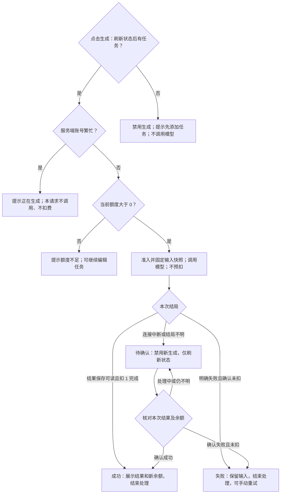

# 额度处理产品方案

**判断：**当前先调用模型再检查额度，零额度也可能消耗调用；单页按钮禁用不能约束同账号多页面请求。**方案：**服务端按账号控制生成入口，先查繁忙、再查当前额度；成功保存日程并完成扣费才算成功，明确失败不扣，结果不明先核对。**状态：**已完成需求、流程和任务拆解；未修改业务代码，未运行应用。现状来自源代码阅读，目标行为均待实现和验证。验收见 [ACCEPTANCE.md](ACCEPTANCE.md)，提交信息见 [SUBMISSION.md](SUBMISSION.md)。

## 1. 现状、目标与边界

静态依据固定在上游提交 `114aeb28f6368e96c08a25627ac094b8d102fd1b`：

| 已观察到的代码 | 产品影响 |
|---|---|
| [账号默认 3 额度](https://github.com/bybzhwbzhh88/task-planner-interview/blob/114aeb28f6368e96c08a25627ac094b8d102fd1b/schema.prisma#L10-L15) | 应让用户看见余额及消费规则 |
| [先调用，后按请求用户额度决定扣费](https://github.com/bybzhwbzhh88/task-planner-interview/blob/114aeb28f6368e96c08a25627ac094b8d102fd1b/src/demo-ai-app/operations.ts#L48-L77) | 零额度调用及并发透支风险需在入口解决；并发结果尚未实测 |
| [本页生成状态与异常提示](https://github.com/bybzhwbzhh88/task-planner-interview/blob/114aeb28f6368e96c08a25627ac094b8d102fd1b/src/demo-ai-app/DemoAppPage.tsx#L81-L113)、[按钮条件](https://github.com/bybzhwbzhh88/task-planner-interview/blob/114aeb28f6368e96c08a25627ac094b8d102fd1b/src/demo-ai-app/DemoAppPage.tsx#L188-L205) | 已有本页防重复交互，仍需账号级状态和明确下一步 |
| [模拟调用及失败触发](https://github.com/bybzhwbzhh88/task-planner-interview/blob/114aeb28f6368e96c08a25627ac094b8d102fd1b/src/demo-ai-app/mockAi.ts#L10-L15) | `mock-ai.started` 可核对调用数；含 `[fail]` 的任务可验证明确失败 |

用户故事：作为规划日程的用户，我希望生成前知道余额，生成后知道是否扣费；失败后能安全重试，多页面操作也不会意外透支。

范围沿用 [仓库任务要求](https://github.com/bybzhwbzhh88/task-planner-interview/blob/114aeb28f6368e96c08a25627ac094b8d102fd1b/TASK.md)：单服务、单数据库，保留现有任务与日程功能。本次交付产品文档；不做支付、订阅、每日恢复、跨账号防刷、Token 计价和服务崩溃自动补偿。未知结果核对仅覆盖服务仍可查询的情形。

## 2. 行为规则

| 编号 | 明确决定 | 验收 |
|---|---|---|
| R1 | 新账号 3 额度；登录后展示权威余额。有任务且账号空闲、余额大于 0 才允许生成；无任务禁用且不调用模型。 | AC01、AC14 |
| R2 | 同账号仅允许一个生成处理中。服务端入口先判繁忙，再读取当前余额；判定与准入不可被两个请求同时通过。后来请求立即返回繁忙，不排队、不调用、不扣费，即使额度充足。不同账号不互相阻塞；按钮禁用仅辅助。 | AC07–AC10、AC15 |
| R3 | 空闲且余额为 0 时直接拒绝，不调用模型；仍可编辑任务。不提供未实现的充值入口或恢复承诺。 | AC03、AC04 |
| R4 | 处理期间不预扣。对应日程已保存可读取，且恰好扣 1 后才返回成功；成功不取决于浏览器是否收到响应。刷新页面不重复扣费。 | AC02、AC03、AC12 |
| R5 | 模型明确失败不扣额度；日程保存明确失败且确认无本次结果也不扣额度，两者分别提示。结束本次处理并释放账号入口。旧日程保留，不能冒充本次成功。 | AC05、AC06、AC10、AC13 |
| R6 | 连接中断、超时或保存结局不明进入“待确认”，不能声称未扣或自动退款。只读核对本次状态、对应结果与余额，不只凭余额判断；确认成功则展示结果，确认失败且未扣则允许手动重试，仍不明则保持禁用。 | AC12、AC13 |
| R7 | 首次进入、恢复页面焦点、生成前及生成结束后读取权威状态。刷新期间禁用生成；跨页旧余额不能授权调用，最终以服务端入口为准。只读刷新不生成、不扣费。 | AC11、AC12 |
| R8 | 不自动重试。失败或待确认保留任务、时长及旧结果；确认后再点击为新请求，不要求跨请求复用。生成前先完成本页待保存的任务编辑，保存失败则不提交。本次输入快照取受理时该账号已保存任务＋本次提交时长；受理后编辑用于下次，返回结果不能覆盖后续输入。 | AC06、AC12、AC16 |

## 3. 流程与页面状态

提交前先完成待保存编辑。准入的两项检查属于同一个账号入口约束，不能被其他请求插入并重复准入。状态读取失败时保持禁用，不用缓存余额继续生成；尚未生成时提示“无法获取账号状态，请刷新后再生成”。待确认只提供只读刷新。

生成按钮上方固定显示“剩余额度：N 次｜成功生成一次消耗 1 次”。提示使用页面内持续状态；旧结果标“上次日程”，新成功结果标“本次日程”。

| 状态 | 按钮及文案 | 用户下一步 |
|---|---|---|
| 读取状态 / 无任务 | 禁用；“正在更新状态…” / “请先添加待办事项” | 等待读取 / 添加任务 |
| 保存编辑中 / 保存编辑失败 | 禁用；“正在保存任务…” / “任务未保存，请重试保存后生成” | 等待 / 重试保存 |
| 空闲且额度充足 | “生成日程”，可点 | 生成 |
| 本次处理中 | 禁用“生成中…”；“成功后才扣除 1 次额度” | 等待；可编辑下次输入 |
| 成功 | “已生成日程，消耗 1 次，剩余 N 次” | 查看；有额度可再次生成 |
| 额度为 0 | 禁用；“额度已用完，当前无法生成。你仍可编辑任务。” | 编辑任务 |
| 模型明确失败 | “本次生成失败，未扣额度。请检查任务后重试。” | 修改或手动重试 |
| 确认日程保存失败 | “日程未保存，本次未扣额度，可重试” | 手动重试 |
| 其他页面正在生成 | 禁用；“此账号已有日程正在生成，本次未发起生成。”；提供“刷新状态” | 等原请求完成后刷新 |
| 待确认 | 禁用；“暂时无法确认本次结果，请刷新状态后再操作。”；余额标“上次确认 N 次” | 点击只读“刷新状态”；未确认不重试 |

## 4. 开发任务与交接

以下均为待实现任务，P0 表示本次必需。能力描述不限定底层技术方案。

| 任务 | 优先级 / 依赖 | 完成标准 | 验收 |
|---|---|---|---|
| T1 账号与本次结果状态 | P0 / 无 | 提供当前余额、账号及本次生成状态、输入快照和对应可读结果；只读查询不触发生成，明确区分失败与未知。 | AC01、AC11、AC12、AC16 |
| T2 准入与额度拦截 | P0 / T1 | 同账号重叠请求仅一个准入；先判繁忙再判额度，无任务或零额度不调用；不同账号不互相阻塞。 | AC04、AC07–AC10、AC14、AC15 |
| T3 完成与异常收尾 | P0 / T1、T2 | 成功结果与扣费一致；明确失败不扣且释放入口；未知可核对，无自动重试或重复扣费。 | AC02、AC03、AC05、AC06、AC10、AC12、AC13 |
| T4 页面状态与文案 | P0 / T1–T3 | 落实上表，先保存编辑再生成、跨页刷新、保留后续输入和旧结果；按钮状态不能替代服务端拦截。 | AC01–AC07、AC09、AC11–AC14、AC16 |
| T5 验证与交接 | P0 / T2–T4 | 按验收表记录页面、余额、结果数量及调用日志；并发须有可重复方法；失败项带证据和待办。 | AC01–AC16 |

本次仅做源码阅读与方案走查；当前机器未安装 WSL，未运行应用或并发测试。接手者按 T1→T2→T3→T4→T5 实现，以 [验收表](ACCEPTANCE.md) 为检查入口；任何待确认结果未解决前不得记录“功能验收通过”。
