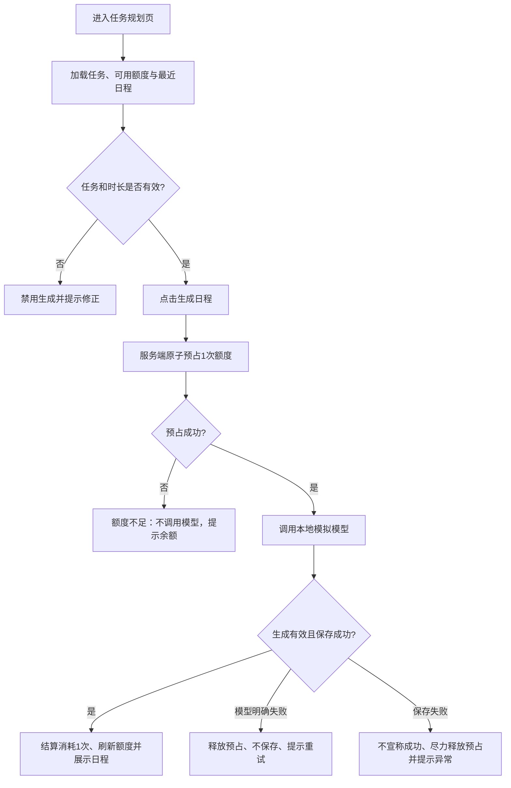

# 日程生成额度处理｜产品需求、流程与开发拆解

> **判断**：现有流程先发起模拟模型调用、后判断额度，且依据可能过期的用户额度判断是否扣减；仅修改按钮文案无法满足“零额度不调用、并发不透支”。  
> **方案**：服务端在调用模型前**原子预占 1 次可用额度**；生成且保存成功即结算为消耗，模型明确失败则释放预占。前端展示可用额度、处理状态和下一步操作。  
> **状态**：产品方案与验收设计已完成；**未修改项目代码、未运行应用或并发验证**。待开发按下方任务实施。

依据：[TASK.md](TASK.md)｜[README.md](README.md)｜[服务端实现](src/demo-ai-app/operations.ts)｜[前端页面](src/demo-ai-app/DemoAppPage.tsx)｜[模拟接口](src/demo-ai-app/mockAi.ts)｜[验收案例](ACCEPTANCE.md)

## 1. 目标、现状与边界

**目标**（均为 P0）：

1. 每个新账号初始有 **3 次额度**；仅每次**成功生成并保存**日程消耗 1 次。
2. 额度不足时服务端必须拒绝请求，**不得启动模拟模型调用**。
3. 模型明确失败时**不扣额度、不新增生成结果**，用户可修正后重试。
4. 同账号跨标签页或多请求并发时，**可用额度不为负，成功次数不超过可用额度**。
5. 用户在提交前、处理中、成功后、失败后，都能知道额度状态与下一步操作。

**现状（代码核对，非运行验证）**：

- `generatePlan` 先执行 `generateMockSchedule`，之后才判断 `context.user.credits > 0`，因此零额度仍可能出现 `mock-ai.started`。
- 额度校验使用请求上下文中的 `context.user.credits`；该值不能作为并发下的权威实时额度。当前虽用事务保存结果并递减额度，但**读取余额与判断是否有额度**不在原子条件内。
- 前端生成按钮在本标签页生成期间禁用，额度不足有 Toast；页面未展示实时剩余额度，成功后也没有扣减提示。`getPlanResults` 查询已存在但页面尚未使用。
- 页面时长输入为 1–24、步进 0.5，但服务端仅校验 `number`；应统一业务校验。

**范围**：单服务、单 PostgreSQL 数据库；本地模拟模型；同一请求只生成一个结果。添加、完成、删除任务不收费；并行的不同生成请求可分别收费，不需要请求间复用结果。

**不做**：支付/订阅/充值、跨账号防刷、Token 精细计价、模型输出质量评价、复杂重试队列、服务崩溃后的自动补偿。服务崩溃可能留下预占状态属于本轮已知风险，见第 6 节。

## 2. 核心业务规则（研发与测试共同依据）

| 编号 | 规则与产品决策 |
| --- | --- |
| R01 | 新注册用户初始可用额度为 3；额度数以服务端数据库为准，客户端仅展示，不做扣费裁决。 |
| R02 | 点击生成的有效前置条件：已登录、至少 1 条待办、今日可用时长在 1–24 小时内且为 0.5 小时的整数倍；前后端均校验。校验失败不预占、不调用模型。 |
| R03 | 合法请求进入服务端后，**先执行数据库原子条件预占**：仅在可用额度 ≥ 1 时将可用额度减 1。未预占成功返回额度不足（建议沿用 402），`mock-ai.started` 计数不增加。 |
| R04 | 成功预占后才调用模拟模型；不在约 500ms 的模型调用期间持续持有数据库行锁。并发请求都以原子条件竞争额度，而不是信任登录上下文或前端余额。 |
| R05 | 模型生成有效日程，且 `PlanResult` 成功持久化后，预占转为正式消耗 1 次；返回日程与最新可用额度，并更新页面。每个成功请求恰好落库一个结果。 |
| R06 | 模型明确拒绝、抛错或返回无效结果时，不落库 `PlanResult`，释放本请求预占的 1 次额度；返回可理解的失败提示。**明确失败 ≠ 网络断线后状态未知**。 |
| R07 | 同账号多请求并发不得透支；例如初始 3 次、5 个独立成功请求同时提交，最多 3 个可进入 `mock-ai.started`，其余应收到额度不足；最终可用额度为 0。 |
| R08 | 同一页面在生成中禁用重复提交；多个标签页、其他客户端仍由服务端 R03 保证正确性。前端余额过期时，以服务端返回的最新值与错误提示覆盖。 |
| R09 | 用户看到的“可用额度”表示**目前可再次发起生成的次数**。在请求处理中，已预占的 1 次暂时不可用；明确失败后恢复，成功后不恢复。提示文案应避免将“预占”误说为“已经扣费”。 |
| R10 | 用户刷新页面后可读取最新可用额度及近期日程；无论哪个标签页产生结果，均不能只依赖本地 React 状态。结果列表按本账号过滤。 |
| R11 | 客户端断网、超时或刷新时，不认定模型已失败，也不自动重试；提示“结果暂未确认”，引导刷新额度与最近日程进行核对，避免因用户连续重发而产生新的有效请求。 |
| R12 | 若模型成功但保存结果失败，应尽力释放预占，且不能向用户显示“生成成功”；数据库持续不可用或服务崩溃时不承诺自动补偿，记录为待人工核查风险。 |

**计费口径**：预占是额度暂时不可用，不是最终消费；“成功”以**模型结果有效且生成记录已保存**为准。模型显式失败不收费。一次独立生成只可结算一次。返回错误不能直接推断一定未扣费，网络未知状态需核对结果。

## 3. 用户流程与页面状态



**页面最小线框（文本原型）**：

```text
AI 任务规划                          可用额度：2 次
说明：每次成功生成日程使用 1 次额度；失败不收费。

[输入待办事项________________] [添加任务]
□ 整理周报                           1.0 小时  [删除]
□ 项目复盘                           1.5 小时  [删除]
今日可用工作时长       [8.0 小时]

[ 生成日程（成功后消耗 1 次额度） ]

状态区：
- 生成中：正在生成，已临时占用 1 次额度，请勿重复提交。
- 成功：日程已生成，本次使用 1 次额度，剩余 1 次。[查看本次日程]
- 失败：生成失败，本次未消耗额度。请修改任务或稍后重试。[重试]
- 额度不足：可用额度为 0，无法生成新的日程。

最近日程：[查看最近保存的生成结果]（只读，可在刷新后找回）
```

| 状态 | 操作控制 | 展示/提示 | 下一步 |
| --- | --- | --- | --- |
| 未登录 | 跳转登录 | 请先登录 | 登录后回到页面 |
| 无任务/时长无效 | 生成按钮禁用 | 请添加任务；时长为 1–24 小时、步长 0.5 | 修正输入 |
| 可用额度 > 0 | 可以生成 | 可用 N 次；成功生成使用 1 次 | 点击生成 |
| 正在生成 | 本标签页生成按钮禁用 | 正在生成；1 次额度临时占用 | 等待结果 |
| 成功 | 按最新额度重新启用（若 >0） | 成功、使用 1 次、余额 N；展示日程 | 查看结果或继续生成 |
| 明确失败 | 恢复操作 | 失败、不扣费、余额 N | 修改含 `[fail]` 的任务后重试 |
| 额度不足（含并发竞争失败） | 禁用生成直至额度变化 | 可用额度为 0；未发起生成 | 查看已有日程；当前版本无充值入口 |
| 网络/未知状态 | 不自动重试 | 请求状态暂未确认 | 刷新额度与最近日程，再决定是否新建请求 |

**文案约束**：避免使用“已扣费”描述预占；不展示“去充值/升级”入口，因为支付与订阅不在范围内。无论用户通过何种方式提交请求，后端必须落实相同的校验与额度规则。

## 4. 开发任务拆解与优先级

| 任务 | 优先级/依赖 | 交付内容和完成判定 | 对应验收 |
| --- | --- | --- | --- |
| T01 统一额度与结果查询 | P0，先做 | 提供仅当前账号可访问的最新额度；按创建时间倒序返回最近日程；页面刷新能恢复状态 | AC-01、AC-09、AC-11 |
| T02 补齐输入校验 | P0，可并行 | 任务非空、时长 1–24 且步长 0.5；前端禁止无效提交、服务端拒绝绕过校验；均不触发模型 | AC-06 |
| T03 原子预占 | P0，依赖 T01 | 调用模型前，用数据库**条件更新/事务**原子减 1；预占失败立即拒绝；不依赖 `context.user.credits` 判定 | AC-03、AC-05、AC-07、AC-08 |
| T04 成功结算/失败释放 | P0，依赖 T03 | 成功时保存一条 `PlanResult` 并确认消耗；模型显式失败时释放且不落库；存储异常不展示成功 | AC-02、AC-04、AC-10、AC-12 |
| T05 额度 UI 与提示 | P0，依赖 T01、T04 | 展示可用额度；处理中、成功、失败、额度不足、未知状态文案一致；提交状态与服务端同步 | AC-01～AC-06、AC-09、AC-11 |
| T06 可重复验收与日志 | P0，依赖 T03、T04 | 有可重复的同账号并发测试/脚本；统计 `mock-ai.started`、`succeeded`、`failed`，核对 `User.credits`、`PlanResult` | AC-02～AC-10 |
| T07 异常与恢复体验 | P0，依赖 T01、T05 | 刷新页面可找回最近生成结果；网络结果未知不自动重复请求；不得误提示“失败未扣费” | AC-09、AC-11 |
| T08 深化故障审计 | P1，可后置 | 持久化预占流水、超时预占人工核查入口、异常监控与崩溃后补偿设计 | AC-12（扩展） |

**建议实施顺序**：先统一服务端额度接口与判定（T01–T04），再接页面（T05、T07），最后执行含并发的自动化验收（T06）。T08 不阻塞本轮产品交付。

**研发实现说明（非限制唯一技术方案）**：可以通过 PostgreSQL `UPDATE ... SET credits = credits - 1 WHERE id = ? AND credits > 0 RETURNING ...` 进行原子预占；成功后创建结果，显式失败则对应加回。若用独立预占记录或事务状态机亦可，只要满足同一组可观察验收条件。模型调用期间不应占用长数据库事务。

## 5. 验收与交接

验收案例及操作步骤见 [ACCEPTANCE.md](ACCEPTANCE.md)，涵盖初始值、成功、零额度、模型失败、并发、重复提交、刷新与跨账号隔离。**本次仅完成产品定义，运行态结果全部标记为“未执行”**；后续开发应在该文件补充实际结果、日志/截图与脚本命令，再按 [README.md](README.md) 运行应用。

**完成定义（研发上线前）**：所有 P0 验收通过；同账号并发脚本能复现并验证请求数、余额与结果数；无额度模型调用为 0；明确失败不收费；页面状态与实际数据库一致；验收实测记录有证据可复现。

## 6. 假设、风险及未完成项

- **假设**：现有 `User.credits` 代表“当前可用额度”；预占也会暂时减少该字段。若后续要追溯每次占用/退款，应增加额度流水，本轮不要求完整账本。
- **假设**：`[fail]` 为确定的本地模型失败注入方式；`mock-ai.started` 是实际调用计数的唯一判定日志，同次日志用 `callId` 关联。
- **风险**：若服务在预占后直接崩溃，且未记录足够的持久化状态，可能留下未释放的预占。本任务明确不要求服务崩溃后的自动补偿；上线前需决定是否引入预占流水及人工修正流程。
- **风险**：模型已成功但响应链路丢失，客户端不能断言失败；应以服务端额度与 `PlanResult` 为准。
- **未完成**：未实现代码、未提供真实页面截图、未运行数据库/并发脚本；T08 为后续项。产品评审后若修改规则，应同步修订本文及 [ACCEPTANCE.md](ACCEPTANCE.md)，避免标准漂移。
