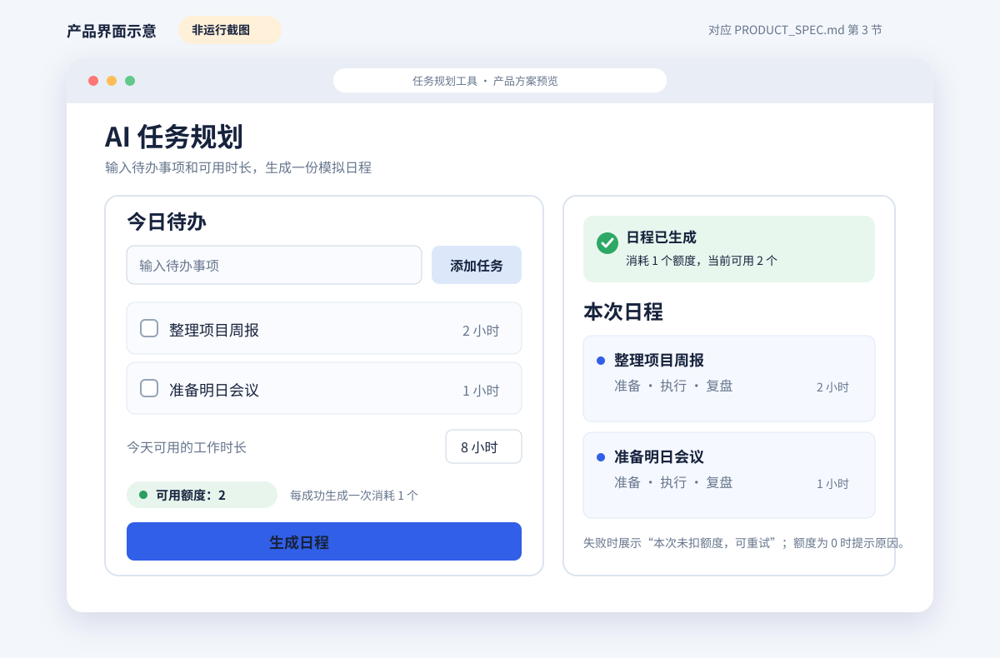
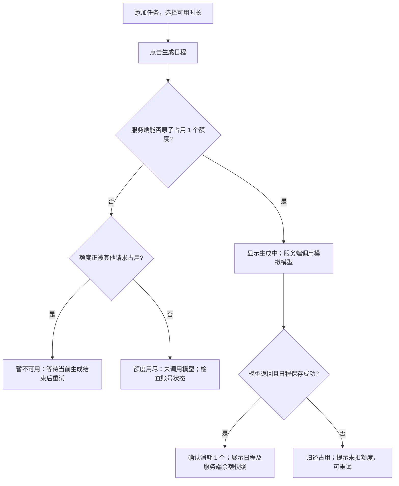

# 日程生成额度处理｜产品方案 v2

> 产品｜小罗｜152****7749 · 2026-10-22

## 1. 判断、方案与状态

当前服务端先调用模拟模型，后检查 `context.user.credits` 并扣减；零额度仍可能产生一次 `mock-ai.started`，两个并发请求也可能都看到同一份旧额度。本方案要求服务端在调用前**原子占用**一个可用额度，成功保存日程后确认消耗；模型明确失败则归还。页面展示服务端返回的剩余额度与明确的下一步。**本次交付为产品方案，代码未修改，运行验收未执行。**

依据：[题目规则](TASK.md)、[现有服务端操作](src/demo-ai-app/operations.ts)、[当前页面](src/demo-ai-app/DemoAppPage.tsx)、[模拟接口](src/demo-ai-app/mockAi.ts)。

## 2. 范围与口径

用户目标：点生成前知道能否生成；点生成后知道本次是否最终扣费，以及失败时如何继续。平台目标：零额度不产生模型调用、同账号并发不透支、每个成功结果与一次扣费对应。这些目标以第 5 节的可观察结果验收。

| 项目 | 决定 |
| --- | --- |
| 额度单位 | 一个新账号初始 3 个额度；一次成功生成并保存的日程消耗 1 个。任务数量、时长不改变单次消耗量。 |
| 成功 | 模型返回可用日程、服务端保存结果并确认扣减后，才向用户展示“生成成功”。 |
| 失败 | 额度不足、输入无效或模型明确失败均不形成成功日程，也不最终消耗额度。可回滚的数据库保存失败视为生成失败并归还占用；数据库状态暂不可查时显示“结果未确认”。 |
| 并发 | 同账号可用额度是所有标签页与请求共享的服务端状态。占用必须原子化；暂时被占用的额度不能再次被占用。最后额度正被其他请求占用时，提示“处理中，请稍后再试”，区别于额度真正用尽。 |
| 任务快照 | 每次生成使用服务端受理该请求时读取的该账号任务；生成期间的后续编辑不改变本次结果。 |
| 旧结果 | 新一次生成失败时，已有日程仍可查看，但必须标为“上次成功生成”，不能让用户误认作本次结果。 |
| 范围外 | 支付/充值、订阅、跨账号防刷、精确 Token 计价、跨请求结果复用、服务崩溃后的自动补偿。 |

“可用额度”指当前可以发起新生成的数量；处理中的占用不计入可用额度，也尚未最终扣除。页面余额是最近一次服务端快照；其他标签页可能使其变化，最终是否可发起仍由服务端判断。

## 3. 用户流程与页面文案

此图仅表示拟议页面状态；仓库未提供在线 Demo，本次没有启动本地服务或截取真实运行页面。

页面在生成按钮附近显示 `可用额度：N`，并按下表给出对应动作；不引导不存在的充值入口。

| 页面状态 | 给用户看的信息与下一步 |
| --- | --- |
| 无任务 / 余额加载失败 | 无任务时沿用“请先添加待办事项”；余额未取到时暂时禁用按钮并显示“额度暂不可查，请刷新”，不要把未知显示为 0。 |
| 生成中 | 本页按钮禁用；显示“生成中，1 个额度暂被占用，结果确认后才最终扣除”。其他标签页/直接请求仍由服务端判断。 |
| 其他请求占用最后额度 | 显示“该账号有日程正在生成，请等待结果后重试”；本次未调用模型、未扣额度。 |
| 额度真正用尽 | 按钮不可用；显示“额度不足，本次未调用模型；请检查账号状态”。 |
| 成功 | 展示本次日程及“已消耗 1 个额度，可用 N 个”；余额来自服务端，完成后刷新余额。 |
| 模型明确失败 | 显示“生成失败，本次未扣额度；请稍后重试或调整任务”。若旧日程留在页面，标为“上次成功生成”。 |
| 断网、超时或数据库状态暂不可查 | 显示“本次结果尚未确认，请刷新查看额度和最近日程；确认前不要连续重试”。此时不能承诺未扣额度。 |

“最近日程”入口可复用现有 `PlanResult` 查询，但需按创建时间倒序展示，并标出生成时间。若余额与最近结果仍不足以判断本次请求，界面继续保持“结果未确认”，而不是自动重发；首版不承诺跨请求精确追踪。页面重载后从服务端重取余额和结果，不沿用本地推测值。

## 4. 实现任务拆解（供开发接手）

| 任务 | 交付与依赖 | 完成判据 / 对应案例 |
| --- | --- | --- |
| T1 · P0 | 定义可用、处理中、已消耗的状态及原子占用/归还操作；在调用模拟接口**前**完成占用，并用数据库条件更新或等价事务约束 `可用额度 > 0`。 | 两个并发请求最多一个越过最后额度；可区分占用与耗尽；A2、A5、A6。 |
| T2 · P0 | 依赖 T1：整理生成的成功/异常闭环；模型成功且保存成功才确认扣减，明确失败和可回滚的保存失败时归还。 | 每个成功结果恰好扣 1，失败不扣、无孤立结果；A1、A3、A4、A7。 |
| T3 · P0 | 依赖 T1、T2：增加读取服务端可用额度、处理中状态及最近结果的接口；生成操作返回结果状态和余额快照。 | 结果按创建时间倒序，刷新可取到服务端状态；A1、A5、A8。 |
| T4 · P1 | 依赖 T3：更新页面状态与文案；保留任务和日程功能，区分本次与上次结果。 | 用户知道是否最终扣费及下一步；A2、A3、A5、A8、A9。 |
| T5 · P1 | 依赖 T1–T4：用日志、数据库记录及浏览器复核；补可重复执行的并发测试。 | A1–A9 记录操作、预期、实际和证据；未通过项单列。 |

建议由开发在 `SPEC.md` 中选定具体数据模型：例如维护“可用 + 处理中”的额度状态，或用原子预扣加失败归还；不要用页面禁用按钮或旧的 `context.user.credits` 代替服务端原子判断。保留占用与结果的关联标识，便于核对一次请求的结算。当前题目不要求进程崩溃后自动补偿，但需在技术交接中说明此边界。

## 5. 验收案例

共同观察点：`User.credits`/额度状态、`PlanResult` 数量、同一次调用的 `mock-ai.started|succeeded|failed` 日志，以及页面提示。执行前使用独立测试账号并记录初始值；`[fail]` 是仓库提供的模拟失败触发词。

| ID | 前置条件 | 操作 | 可观察的预期结果 |
| --- | --- | --- | --- |
| A1 成功 | 1 个额度，1 条普通任务，结果数为 R | 点击生成一次 | 1 次 `started` 与 `succeeded`；出现日程；结果数 R+1；可用额度 0；成功提示写明消耗 1 个。 |
| A2 额度不足 | 0 个额度，且无请求处理中；1 条普通任务 | 观察页面按钮及提示，再直接请求接口 | 页面阻止提交且说明额度用尽；接口不产生 `started`；结果数不变、额度仍为 0。 |
| A3 模型失败 | 1 个额度，任务含 `[fail]`，结果数为 R | 点击生成一次 | 1 次 `started` 与 `failed`；无新结果；可用额度恢复为 1；提示未扣、可重试。 |
| A4 失败后重试 | 承接 A3 | 删除 `[fail]` 任务，添加普通任务，再生成 | 1 次新的成功调用；新增 1 个结果；可用额度变为 0。 |
| A5 同账号并发 | 1 个额度，1 条普通任务，结果数为 R | 首请求出现 `mock-ai.started` 后、返回前，从第二标签页提交 | 总共只有 1 次 `started`、1 个成功结果；第二请求提示“已有生成进行中”，且未调用模型；最终可用额度 0，绝不为负。 |
| A6 并发失败占用 | 1 个额度，任务含 `[fail]` | 首请求出现 `mock-ai.started` 后、返回前，从第二标签页提交；首请求失败后手动重试 | 首次占用期间只有 1 次 `started`；第二请求提示等待；失败后额度恢复为 1，手动重试可发起新调用。 |
| A7 保存失败 | 1 个额度；注入可回滚的结果写入失败，数据库仍可读写 | 发起生成 | 不出现“成功”提示或新结果；额度归还为 1；页面提示未完成，可重试。 |
| A8 结果不确定 | 1 个额度，普通任务 | 请求发出后断网/使客户端超时，再恢复并刷新 | 页面先提示结果未确认；刷新后展示服务端余额和带时间的最近结果。仍无法判断时保持“未确认”，不声称“未扣”或自动重发。 |
| A9 旧结果不混淆 | 已有一次成功日程，另有 1 个额度；新增含 `[fail]` 的任务 | 再次点击生成，等待失败 | 旧日程若继续展示，标题明确为“上次成功生成”；本次失败提示未扣，不能出现新的成功提示或结果。 |

## 6. 验证与交接

- 已核对：`TASK.md` 的五项目标规则；当前 `operations.ts` 的调用顺序、旧额度判断、未排序的结果查询与 `mockAi.ts` 的成功/失败日志；现有页面只对 402 给出额度提示，失败时也未清除或重标旧日程。这是**代码阅读结论**，不是运行结果。
- 未执行：A1–A9 的数据库、浏览器和并发实测。本次是产品方向方案，不把预期写成已验证事实。
- 开发首先确认：额度的数据结构和占用标识；保存失败如何归还；余额与最近结果的接口返回；并发脚本如何识别同一个测试账号。实现调整后同步更新本方案与验收记录。
