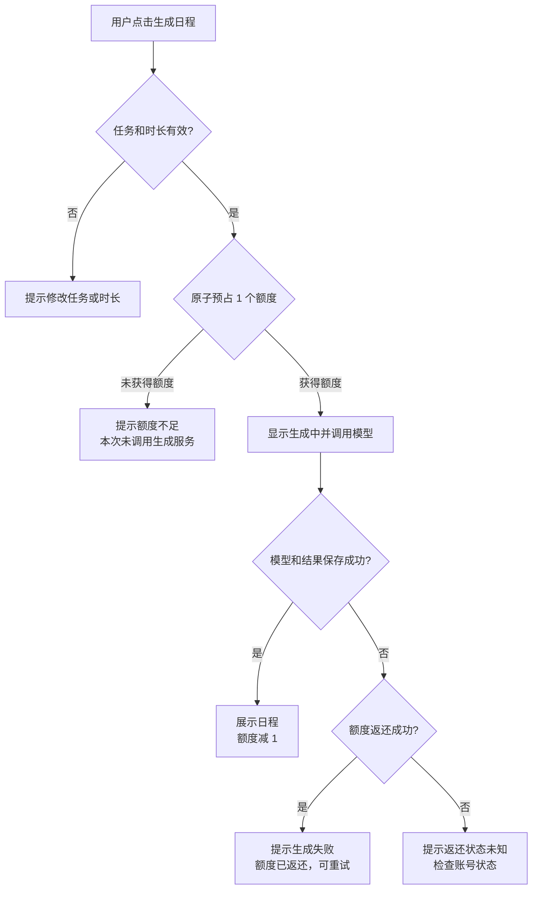

# 额度处理产品方案

## 判断、方案与完成状态

当前流程把额度判断放在模型调用之后，用户即使没有额度也要等待一次无效生成；并发请求还可能透支。失败提示没有说明是否扣费，用户无法判断应该重试还是先处理额度。

方案采用“调用前预占、失败返还”：服务端先原子预占一个额度，成功后才调用模型；模型或结果保存失败时返还。界面围绕“是否发起调用、是否扣费、下一步做什么”提供明确反馈。

当前已完成需求规则、用户流程、低保真原型、研发拆解和验收案例，并附带可运行实现与自动化验证。标准 Wasp/PostgreSQL 环境的最终集成复验尚未运行，限制与命令记录在 [技术规格](SPEC.md)。

## 目标与范围

### 用户目标

- 有额度时顺利生成日程，并立即知道剩余额度。
- 没有额度时无需等待，明确知道本次没有发起模型调用。
- 生成失败时知道额度没有损失，可以放心重试。

### 业务规则

| 场景 | 是否调用模型 | 额度变化 | 用户结果 |
| --- | --- | --- | --- |
| 生成成功 | 是 | -1 | 展示日程和成功提示 |
| 请求时额度为 0 | 否 | 不变 | 阻止生成并提示检查额度 |
| 模型或保存明确失败 | 是 | 预占后返还，最终不变 | 提示失败且可以重试 |
| 同账号并发请求 | 不超过可用额度数 | 不得小于 0 | 获得额度的请求继续，其余提示不足 |
| 返还状态无法确认 | 是 | 状态未知 | 不承诺已返还，提示检查账号状态 |

### 不在范围

- 支付、订阅、充值入口和额度套餐。
- 跨账号防刷、Token 计价和请求结果复用。
- 服务进程崩溃后的自动补偿；后续可通过额度流水和超时回收解决。

## 用户流程



并发时，每个请求都经过同一个“原子预占”节点。最后一个额度只能被一个请求获得，其他请求在模型调用前进入额度不足分支。

## 页面原型

### 有额度

```text
┌──────────────────────────────────────────┐
│ 任务规划实验室                  剩余额度：3 │
├──────────────────────────────────────────┤
│ [输入待办事项________________] [添加任务] │
│                                          │
│ □ 完成竞品分析                    1 小时  │
│ □ 整理用户反馈                    1 小时  │
│                                          │
│ 今天可用的工作时长                 [8]    │
│                                          │
│              [ 生成日程 ]                │
└──────────────────────────────────────────┘

成功反馈：日程已生成。本次生成已消耗 1 个额度。
```

### 无额度

```text
┌──────────────────────────────────────────┐
│ 任务规划实验室                  剩余额度：0 │
├──────────────────────────────────────────┤
│              [ 生成日程 ]（禁用）        │
│ 额度已用完，本次不会发起生成。            │
│ 请检查账号状态。                          │
└──────────────────────────────────────────┘
```

### 失败反馈

```text
生成失败
本次额度已返还，请稍后重试。        [关闭]
```

返还无法确认时不展示“已返还”，改为：“生成失败，额度返还状态暂时无法确认，请检查账号状态。”

## 交互与文案

| 状态 | 控件 | 反馈文案 | 下一步 |
| --- | --- | --- | --- |
| 无任务 | 生成按钮禁用 | 请先添加待办事项 | 添加任务 |
| 生成中 | 按钮禁用并显示加载图标 | 生成中… | 等待结果 |
| 成功 | 恢复按钮，展示日程 | 本次生成已消耗 1 个额度 | 使用日程或再次生成 |
| 额度不足 | 按钮禁用 | 本次未调用生成服务，请检查账号额度 | 检查账号状态 |
| 可补偿失败 | 恢复按钮 | 本次额度已返还，请稍后重试 | 重试 |
| 返还未知 | 恢复按钮 | 额度返还状态无法确认，请检查账号状态 | 刷新额度或人工检查 |

前端禁用用于减少误操作，服务端额度判断仍是唯一可信结果，以覆盖多标签页和直接请求。

## 数据与观测

服务端保留同一次模型调用的 `callId`，并记录：

- `mock-ai.started`、`mock-ai.succeeded`、`mock-ai.failed`：判断是否真正调用及模型结果。
- `credits.reserved`、`credits.refunded`：跟踪正常预占和失败补偿。
- `credits.reservation-failed`、`credits.refund-failed`：定位数据库异常和需人工检查的额度。

建议后续关注生成成功率、额度不足拦截量、失败返还率和返还异常数。本题不新增埋点平台，日志足以完成验收。

## 开发任务拆解

| 优先级 | 任务 | 产出 | 完成定义 |
| --- | --- | --- | --- |
| P0 | 原子额度预占 | 服务端条件更新 | 并发请求不能把额度扣为负数 |
| P0 | 成功与失败处理 | 保存结果、失败返还 | 成功扣 1；模型或保存失败最终不扣费 |
| P0 | 服务端参数保护 | 小时范围、空任务校验 | 无效请求不预占、不调用模型 |
| P0 | 用户状态反馈 | 成功、额度不足、失败、返还未知文案 | 用户能判断扣费结果和下一步 |
| P0 | 自动化验证 | 核心测试和数据库并发用例 | 成功、额度不足、失败、并发可重复验证 |
| P1 | 额度流水与崩溃补偿 | 独立记录和回收任务 | 不属于本次范围，作为生产化后续项 |

详细的实现设计、文件入口和运行命令见 [SPEC.md](SPEC.md) 与 [README.md](README.md#额度验证)。

## 验收案例

| 编号 | 前置条件 | 操作 | 可观察的预期结果 |
| --- | --- | --- | --- |
| PA-1 | 额度 3；存在普通任务 | 点击生成 | 一次 started 和 succeeded；展示日程；新增一个结果；额度显示 2；提示已消耗 1 个额度 |
| PA-2 | 额度 0；存在任务 | 从客户端或直接请求生成 | 返回额度不足；没有新的 started；无新结果；额度仍为 0；提示本次未调用生成服务 |
| PA-3 | 额度 1；任务包含 `[fail]` | 点击生成 | 同一 callId 出现 started 和 failed；无新结果；额度恢复 1；提示已返还并可重试 |
| PA-4 | 额度 1；存在普通任务 | 同时发起 5 个请求 | 1 个成功、4 个额度不足；只有 1 次 started 和 1 个结果；最终额度 0 |
| PA-5 | 额度 1；无任务或时长不在 1–24 | 发起生成 | 返回输入错误；不预占、不调用模型、不创建结果 |
| PA-6 | 模拟额度返还写入失败 | 发起会失败的生成 | 不展示“已返还”；提示返还状态未知并要求检查账号状态；服务端有 refund-failed 日志 |

核心测试已实际运行，PA-1 至 PA-4 对应的 8 个测试通过；PA-5 已实现但未在完整 Wasp Action 环境执行；真实 PostgreSQL 并发用例已提供，当前机器未配置数据库而跳过。完整证据见 [验证记录](SPEC.md#验证记录)。

## 取舍与交接

- 采用预占加返还，避免模型调用期间保持长数据库事务。
- 没有新增数据表或迁移，减少题目范围内的实现与部署成本。
- 可运行实现作为本方案的验证原型；若只继续产品工作，可直接依据本页流程、状态和验收案例拆分研发任务。
- 上线前需在标准 WSL2、Wasp 0.25.0、Node.js 24.14.1 和 PostgreSQL 环境完成框架编译与真实数据库并发复验。
