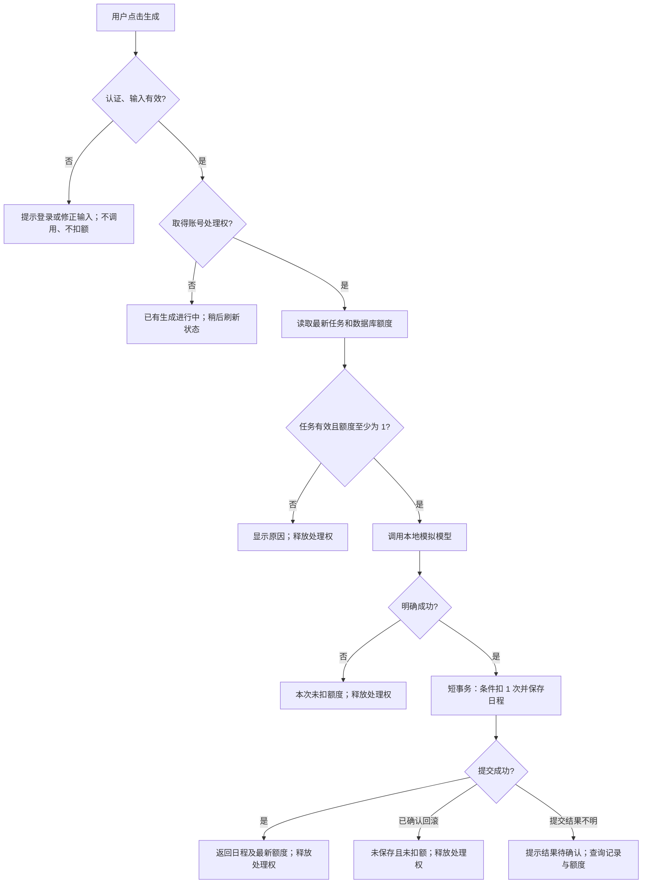

# 日程生成额度处理 · 产品方案

当前问题是额度判断发生在模型调用之后，且并发请求可能依据旧额度分别扣费。方案是在调用前校验最新额度，同账号同时只受理一个生成请求，保存日程与扣额同时完成；页面明确展示额度、结果和下一步。本次完成产品设计与静态走查，尚未实现或运行功能测试。

## 1. 用户问题与目标

用户希望知道“还能生成几次”“这次是否扣费”“失败后怎么办”。产品需同时保证：成功一次扣 1 次，无额度不调用，模型明确失败不扣额，并发不透支。原始要求见 [TASK.md](TASK.md)。

| 现状证据 | 用户或业务影响 | 本次决定 |
| --- | --- | --- |
| [operations.ts](src/demo-ai-app/operations.ts) 先调用模型，再检查 `context.user.credits` | 无额度仍浪费调用；请求快照可能过期 | 在受理区内从数据库读取最新额度，检查通过后才调用 |
| 同文件扣减没有额度条件，同账号请求可同时进入 | 剩 1 次时多个请求可能都扣减 | 服务端按账号互斥；保存与条件扣减放在同一短事务 |
| [DemoAppPage.tsx](src/demo-ai-app/DemoAppPage.tsx) 只有生成中和错误提示 | 用户不知道剩余次数；“检查账号状态”没有具体行动 | 常驻额度说明，分状态反馈，提供可执行动作 |
| [mockAi.ts](src/demo-ai-app/mockAi.ts) 用抛错表示明确失败 | 不能只处理返回 null 的分支 | 捕获模拟失败，转成稳定的业务错误 |

## 2. 范围与口径

- 每个新账号 3 次额度，沿用 [schema.prisma](schema.prisma) 默认值。额度按账号共享，跨页面、跨设备共用。
- “成功”定义为模型返回有效日程，且日程已保存、1 次额度已扣除并提交成功。只收到模型结果还不算成功。
- 刷新、查看已保存日程、编辑任务不扣额。用户明确再次生成，视为新请求，成功则另扣 1 次；不自动重试生成。
- 本期不做支付、补充额度、每日重置、订阅、跨账号防刷、跨请求结果复用及服务崩溃自动补偿，不展示充值或明日恢复入口。
- 沿用现有任务选择逻辑，不改完成任务是否参与规划的规则。生成使用受理时读取的任务快照；期间其他页面的修改在下次生成生效。
- 产品补充约束：至少有一条任务；总工作时长为 1–24 小时且步长为 0.5。前后端均校验；错误输入不调用、不扣额。

## 3. 核心决策：同账号同时只处理一次

选择“忙碌时拒绝新请求，不排队”。日程生成频次低、模拟耗时约 500ms，串行受理便于解释和验证；排队会让用户一次操作后产生延迟扣费，预扣再退款则增加额度状态和补偿成本。本期接受同账号无法同时生成多份日程的限制，不合并请求，也不复用结果。

服务端先完成认证及参数校验，再尝试取得账号处理权。被占用时直接返回“已有日程正在生成”，无新增模型调用、无新增扣额。取得后读取最新任务及额度；不足时返回额度不足；满足条件才调用。处理权覆盖检查、调用和保存，并在所有正常及异常退出路径释放。

开发建议：当前单服务范围可使用按 userId 管理的进程内互斥集合，检查和占用之间不得存在异步间隙；部署前确认只有一个服务进程。若采用多 worker，必须改成数据库级协调后再发布。不要让数据库事务跨越模型等待。最终事务使用 `credits >= 1` 条件扣减，并与 `PlanResult` 创建一起提交；条件不满足则整个事务回滚，不保存免费结果。

这不是仅靠按钮禁用防并发：另一页面或直接请求仍须被服务端拦截。额度读取失败时停止生成，不能把未知额度当作 0 或沿用缓存放行。

## 4. 流程



请求断网或响应丢失不等于服务端失败，不得显示“未扣额度”。服务端继续处理并最终释放处理权；页面显示“暂时无法确认结果，请刷新状态查看日程和额度”，提供只读刷新，不自动补发生成。数据库提交结果不明同样先核实，不盲目再次扣费或宣称退款。

## 5. 页面线框与状态文案

沿用当前单页，额度区在生成按钮前常驻展示，结果区保留上一份已保存日程。页面进入及点击“刷新状态”时读取当前额度、账号是否处理中及最新已保存日程；正常生成响应后重新查询。跨页面无需实时推送，旧页面提交时仍由服务端校验。

```text
AI 任务规划
[待办输入________________] [添加任务]
□ 完成需求方案          [1] 小时
今天可用的工作时长       [8] 小时

剩余生成次数：3 次                   [刷新状态]
每成功生成一份日程消耗 1 次；生成失败不扣次数。
[             生成日程 · 消耗 1 次             ]
（状态说明在此展示，成功/失败后持续可见）

最近一次已保存日程 · 生成时间
……日程内容……
```

| 状态 | 展示与主按钮 | 用户下一步 |
| --- | --- | --- |
| 额度读取中或读取失败 | “正在读取额度”或“额度读取失败”；生成不可点 | 失败时点击“刷新状态” |
| 无任务 / 时长无效 | 具体输入错误，生成不可点 | 添加任务 / 输入 1–24 小时、以 0.5 为步长 |
| 就绪，剩余 N≥1 | “剩余生成次数：N 次”；“生成日程 · 消耗 1 次” | 点击生成 |
| 本页生成中 | “正在生成，成功后消耗 1 次”；禁用生成及本页任务/时长编辑 | 等待；仍可查看旧日程 |
| 其他页面正在生成 | “此账号已有日程正在生成，请稍后刷新状态”；生成不可点 | 点击“刷新状态”，处理结束后恢复按钮 |
| 成功 | “日程已生成，本次消耗 1 次”；展示最新权威额度和新日程 | 查看日程；额度大于 0 时可再次生成 |
| 无额度 | “剩余生成次数：0 次。额度已用完，你仍可编辑任务、查看已保存日程”；生成不可点 | 编辑任务、查看已有日程；无日程则显示空态 |
| 模型明确失败 | “生成失败，本次未扣额度。请稍后重试”；保留输入和旧日程 | 主按钮恢复，由用户主动重试 |
| 保存明确回滚 | “日程未保存，本次未扣额度。请重试”；不展示未保存的新结果 | 主动重试 |
| 网络异常 / 结果不明 | “暂时无法确认结果，请刷新状态查看日程和额度”；不承诺未扣额 | 只读刷新成功后检查最新记录；再次生成前提示成功将另扣 1 次 |
| 登录失效 | “登录已失效，请重新登录后查看结果” | 重新登录；不自动再次生成 |

状态优先级：登录失效 → 读取失败/结果不明 → 处理中 → 无额度 → 输入无效 → 就绪。处理中额度仍显示尚未扣除的当前值，不承诺该次数可立即使用。读取状态不能替代生成时的校验。

成功提示与额度区分开：若其他页面随后又生成一次，刷新显示更低余额是合理的，不能始终写死“剩余原值减一”。错误不能只靠瞬时 toast 或颜色说明；按钮禁用时旁边保留原因，状态区使用可被读屏感知的文本。

## 6. 交付边界与待决事项

已完成需求、流程、页面状态、开发拆解和验收设计；详见 [开发任务](PRODUCT_TASKS.md)、[验收与验证记录](ACCEPTANCE.md)。实现、真实并发测试、可用性测试和 PR 提交尚未完成。

本期只恢复“最新已保存日程”，不建设历史中心。没有请求级持久状态，多个页面产生不同任务时，最新日程不能精确证明某个断网请求的结果；页面只展示记录和额度，不替用户推断。若后续要求精确定位断网请求，再增加请求标识及状态查询；不把该扩展混入本期必做范围。

本方案没有通过真实用户研究验证，“一次只处理一个请求”是基于题目环境的设计假设。开发评审应确认单进程约束；上线前用验收案例证明账务不变量，而不是用按钮表现代替证据。
