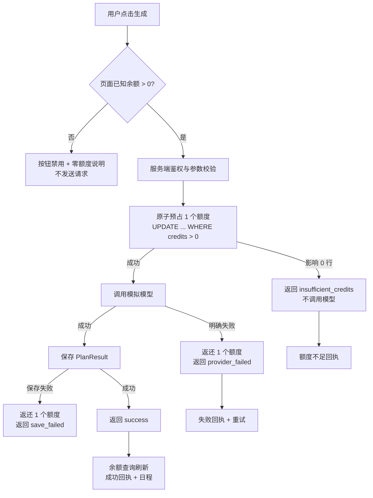
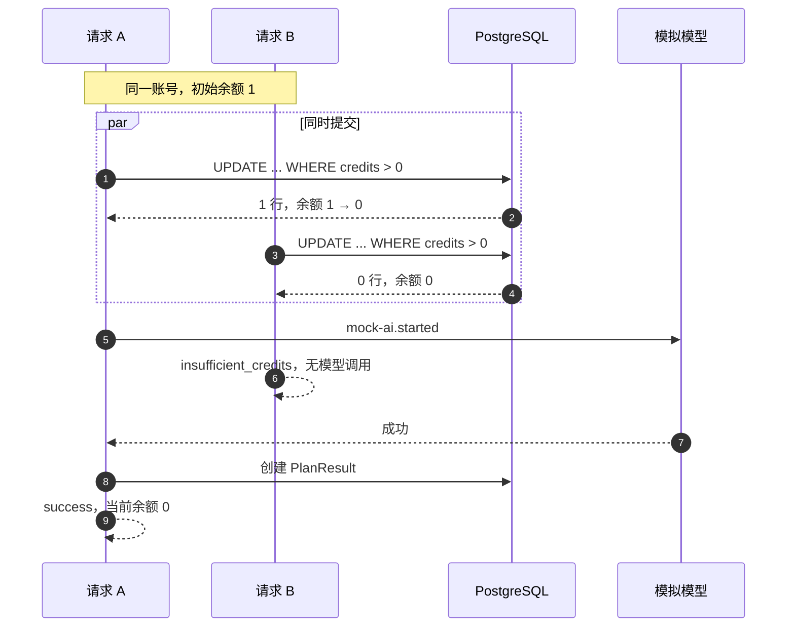

# 额度有据：一次生成，一次可解释的额度事务

> 应聘方向：产品 ｜ 交付状态：需求方案、交互原型、任务拆解与验收案例已完成；真实应用未修改，后端实现与真实验证未执行。
>
> 评审路径：读本页结论 → 打开 [交互原型](prototype/index.html) 跑 P1–P4 → 看 [验收案例](ACCEPTANCE.md) 的场景、截图与实现状态 → 按 [任务拆解](TASKS.md) 接手。

## 结论

现有额度有三个问题：先调用模型再检查额度；额度检查与扣减不是同一条原子写；用户看不到可信的余额变化与失败原因。三者叠加，会出现零额度仍调用模型、并发把余额扣成负数、失败后不知道是否扣费。

方案把一次生成当作一笔可对账的额度事务：**预检 → 预占 → 核销 / 返还**。服务端用单条条件写预占额度，失败自动返还；用户拿到一张说明结果、余额和下一步的额度回执。并发安全靠数据库条件写，不靠前端按钮。

本期只做产品方向：方案、交互原型、开发任务拆解与验收案例。原型由页面内模拟器驱动，不等同于真实后端或真实并发验证；真实实现按 [TASKS.md](TASKS.md) 完成，证据回填到 [ACCEPTANCE.md](ACCEPTANCE.md)。

## 1. 现状判断

| 现状 | 影响 | 证据 |
| --- | --- | --- |
| 先请求任务、调用模型，再检查额度 | 余额为 0 仍会发起一次模型调用，产生无意义成本与等待 | [operations.ts:48-55](src/demo-ai-app/operations.ts#L48-L55) |
| 用请求开始时的 `context.user.credits` 判断，随后无条件 `decrement` | 同账号并发时两个请求都读到 1，都通过判断，余额最终可为 -1 | [operations.ts:67-71](src/demo-ai-app/operations.ts#L67-L71) |
| 余额从 `useAuth` 缓存读取，生成后没有明确的刷新路径 | 用户可能看到旧余额，无法确认本次是否扣费 | [App.tsx:15](src/client/App.tsx#L15) |
| 额度不足只提示“检查账号状态”，模型失败显示原始英文错误 | 用户不知道是否扣费、能否重试、下一步做什么 | [DemoAppPage.tsx:91-109](src/demo-ai-app/DemoAppPage.tsx#L91-L109) |

现状中“模型失败不扣额度”只是因为扣费发生在调用成功之后。这个顺序一旦为了拦截无效调用而调整，失败返还就必须成为显式流程，否则会把原来的浪费问题换成扣费错误。单纯在调用前加一个 `if` 不够：判断和扣减必须由同一条原子写完成。

## 2. 目标与边界

### 目标

把额度处理从“一个扣减动作”变成用户能理解、工程能验证的事务：

- 用户在操作前知道余额与成本。
- 余额不足时一定不会发起模型调用。
- 成功恰好扣 1；失败净扣 0。
- 同账号并发不透支，余额永不为负。
- 每个结果都有回执，说明发生什么、是否扣费、下一步。

### 规则

| 编号 | 规则 | 验收 |
| --- | --- | --- |
| R1 | 操作前显示当前余额和“每次成功生成消耗 1 个额度”；仅剩 1 个时提示这是最后一次 | AC-01, AC-06 |
| R2 | 成功生成净扣 1 个额度，返回日程，回执与页头显示服务端当前余额 | AC-01, AC-07 |
| R3 | 预扣失败即额度不足：不调用模型，不保存日程，不扣额度；前端预检只改善体验，服务端仍是最终判断 | AC-02, AC-04 |
| R4 | 模型明确失败或结果保存失败时自动返还本次预占，净扣 0 | AC-03 |
| R5 | 同账号并发请求中，成功数不超过预扣前的可用额度，任何时刻 `credits >= 0` | AC-04, AC-05 |
| R6 | 每次结果说明发生了什么、是否扣费、下一步；未知错误不谎称“未扣费” | AC-06, AC-08 |

### 非目标

- 支付、订阅、套餐、自助充值或定价。
- 跨账号防刷、跨天额度恢复或过期策略。
- 精确 Token 计价、按任务数或时长计价。
- 服务崩溃后的自动补偿、持久化额度流水、历史回执。
- 请求级幂等键、重复提交去重（前端禁用按钮仍保留）。
- 跨标签页实时同步；跨设备并发只保证服务端不透支。
- 跨请求复用生成结果。

### 假设

- 每成功生成一次日程消耗 1 个额度，不区分任务数、时长或模型用量。
- 额度为整数，由外部管理员补充；本应用不提供自助补充入口。
- 单服务、单 PostgreSQL；请求是合法的不同生成任务，而不是自动重试。
- 真实模拟模型约 500 毫秒返回；原型为便于观察使用 650 毫秒。任务含 `[fail]` 时明确失败。
- 用户可能在多个标签页操作同一账号；页面余额允许短暂不同步，以服务端为准。
- 回执只保存在当前页面会话；刷新后以余额与日程数据为准，持久化流水列为后续。

## 3. 核心机制：额度事务

| 阶段 | 系统行为 | 用户感知 |
| --- | --- | --- |
| 预检 | 页面读取余额；余额为 0 时禁用按钮并说明原因。服务端稍后仍会重新判断 | 知道能不能生成、本次成本、成功后剩多少 |
| 预占 | 鉴权与参数校验后，用一条条件写扣减 1 个额度；影响 0 行即拒绝，不调用模型 | 按钮进入“生成中”；不暴露内部预占术语 |
| 核销 | 模型成功且日程保存成功后保留扣减，返回日程 | 成功回执：扣除 1，显示当前余额与日程 |
| 返还 | 模型失败或日程保存失败时加回本次预占，返回失败结果 | 失败回执：本次未扣除，已自动返还；可重试 |

### 3.1 预占是整条链路的闸门

预占以一条数据库条件写完成，不能用“先读余额，再判断，再更新”：

```sql
UPDATE "User"
SET credits = credits - 1
WHERE id = :userId AND credits > 0;
-- affected rows = 0  => 额度不足，不调用模型
```

PostgreSQL 会串行化同一行的更新。先到的请求把 1 扣成 0；后到的请求的条件不再成立，影响 0 行。因而不需要应用层锁，单服务、单库下也不需要额外队列。

### 3.2 主流程



页面预检只决定“是否值得发请求”，不承担安全职责；服务端在预占这一步重新判断。

### 3.3 并发：余额 1，两个请求



两个请求谁先到达都对称：恰好一个条件写成功，另一个影响 0 行。不会出现“两个请求都调用模型、都成功、余额为 -1”。

### 3.4 不变量

- **I1** 任何可读时刻 `credits >= 0`。
- **I2** 模型调用次数不超过预占成功次数；被拒绝的请求不产生 `mock-ai.started`。
- **I3** 单次尝试的净额度变化只能是 0 或 -1；唯一 +1 是返还自己的预占。
- **I4** 无外部补额时，对账成立：`初始额度 - 预占次数 + 返还次数 = 当前余额`。当全部尝试都正常结算（成功，或失败后返还成功）时，也等价于 `当前余额 = 初始额度 - 成功次数`；未知异常且返还失败时不适用。
- **I5** 额度不足的尝试不产生 `PlanResult`。

## 4. 界面状态与文案

### 4.1 状态机

```text
可用 N≥1 --预占成功--> 生成中 --模型与保存成功--> 已核销（N-1）
                              \--模型或保存失败--> 已返还（N）
可用 N=0 --提交--> 已拦截（N=0，无模型调用）
生成中 --并发竞争失败--> 已拦截（另一请求已用掉可用额度）
```

回执只描述一次尝试：预占是否成功、是否核销、是否返还、当前余额与下一步。

### 4.2 状态与文案

| 状态 | 用户看到 | 下一步 |
| --- | --- | --- |
| S1 可生成（N≥1） | 页头余额；`每次成功生成消耗 1 个额度，当前剩余 {N} 个。` 仅剩 1 个时追加 `这是最后 1 个额度；本次成功后额度将用完。` | 生成日程 |
| S2 生成中 | 按钮禁用并显示“生成中…”；`正在生成，成功后扣除 1 个额度；失败会自动返还。` | 等待 |
| S3 成功 | 日程区替换为本次结果；回执标题“本次生成成功”；`日程已生成，已扣除 1 个额度；当前余额 {N} 个。` | 查看本次日程；余额为 0 时提示补充额度 |
| S4 已知额度为 0 | 常驻警告：`额度已用完。生成按钮已停用；继续生成不会发起请求，也不会扣除额度。请联系管理员补充额度后刷新页面。` 按钮文案“额度已用完”且禁用 | 联系管理员补充额度后刷新页面 |
| S5 提交后额度不足（含并发落败） | 回执标题“本次未发起生成”；`额度不足，本次未发起生成，也未扣除额度；当前余额 {N} 个。请联系管理员补充额度后刷新页面重试。` 按钮同步进入禁用 | 补充额度后刷新页面 |
| S6 模型或保存失败 | 回执标题“本次生成失败”；`生成失败，本次未扣除额度，1 个额度已自动返还；当前余额 {N} 个。` 提供“重试本次生成”；旧日程标为“上次日程” | 重试本次生成 |
| S7 未知错误 | 回执标题“本次未完成”；变动“待确认”；`生成未完成，额度状态待确认。请刷新页面查看余额；如余额有扣减但未生成日程，请联系管理员。` | 刷新页面核对余额；仍有问题联系管理员 |

### 4.3 额度回执

每次尝试的回执必须包含：

| 字段 | 示例 | 说明 |
| --- | --- | --- |
| 结果 | 本次生成成功 / 本次生成失败 / 本次未发起生成 / 本次未完成（待确认） | 不只用颜色或图标表达 |
| 本次变动 | −1 额度 / 净扣 0 · 返还 1 / 净扣 0 / 待确认（未知错误） | 失败必须明确“已返还”，而不是只写失败；未知错误不得猜写 0 |
| 当前余额 | 当前余额 2 个 | 取余额查询结果，不用请求开始时的缓存；未知错误可提示刷新后核对 |
| 凭证 | `SIM-P1-A1` | 与日志中的 attemptId 对齐 |
| 下一步 | 查看本次日程 / 检查任务后重试 / 补充额度后刷新页面 / 刷新页面核对余额 | 每类结果必须有一个可执行下一步 |

### 4.4 展示与可访问性

- 页头余额来自 `getCreditBalance` 查询；生成动作完成后，依赖 User 实体的查询失效并刷新。余额加载中显示“—”，不先显示 0。
- 结果使用常驻的 `role="status"` / `aria-live="polite"` 区域，不只依赖 toast；错误文本不能仅用颜色区分。
- 生成中禁用主按钮并保留键盘焦点；失败回执中的“重试本次生成”可键盘操作。
- 已知余额为 0 时禁用主按钮，但任务仍可编辑；补充额度后刷新即可继续，不丢失输入。
- 发起新尝试时，把已有结果标题改为“上次日程”；只有本次成功才替换并改回“本次日程”，避免把旧结果误认为新结果。
- 确认弹窗不作为默认方案：成本与最后 1 个额度在按钮上方持续可见，避免用打断代替清晰。

## 5. 接口与实现约定

本节是交接给技术实现的约束，不是已实现事实。详细步骤见 [TASKS.md](TASKS.md)。

### 5.1 余额查询

新增 `getCreditBalance` 查询，要求登录，返回：

```ts
{ credits: number }
```

在 `demo-ai-app.wasp.ts` 中声明 `entities: ["User"]`。页头与回执余额只使用该查询，不直接使用 `useAuth().user.credits`。`generatePlan` 同样声明 User 实体，设计意图是成功返回后让依赖该实体的查询失效并刷新余额。**Wasp 0.25 的具体失效时机必须在 T1/T2 中验证**；若自动失效不足以覆盖失败返还或并发结果，客户端在结算后显式重新获取 `getCreditBalance`，不能把缓存值当作权威余额。

### 5.2 生成结果

`generatePlan` 的预期业务结果通过稳定的结果对象返回：

```ts
type GeneratePlanResult =
  | { status: "success"; attemptId: string; schedule: GeneratedSchedule }
  | { status: "insufficient_credits"; attemptId: string }
  | { status: "provider_failed"; attemptId: string }
  | { status: "save_failed"; attemptId: string };
```

不在返回值中承诺 `creditsRemaining`：并发下某个响应的余额快照会过期，容易误导。余额统一由 `getCreditBalance` 读取。

预期业务结果不抛出 HTTP 错误，原因有三点：额度不足与模型失败本就是需求内的正常分支；客户端需要稳定的 `attemptId` 与结果类型；Wasp 在 action 正常结束后失效同实体查询，余额才能自动刷新。未登录返回 401，参数错误返回 400，未知异常返回 500。未知异常不得被包装成“未扣费”。

### 5.3 服务端顺序

1. 鉴权；校验 `hours` 为数值。缺失、字符串或其他类型返回 400；本期不新增业务范围限制。
2. 读取用户任务。
3. 生成 `attemptId`，记录尝试开始。
4. 单条条件写预占 1 个额度；影响 0 行则记录拒绝、返回 `insufficient_credits`，**不调用模型**。
5. 调用模拟模型。明确失败：返还本次预占，返回 `provider_failed`。
6. 创建 `PlanResult`。保存失败：返还本次预占，返回 `save_failed`。
7. 返回 `success` 与日程。余额由查询刷新。
8. 未知异常：记录日志并抛出 500；客户端展示“额度状态待确认”。预占后发生未知异常时尽力返还，并按实际结果记录 `quota.refunded`（`reason: "unknown_error"`）或 `quota.refund.failed`；用户结果仍为待确认，不把未知异常包装成已知失败，也不记录 `quota.settled`；若返还本身失败，不得谎称已返还。

### 5.4 日志

所有事件输出 JSON 行，至少包含 `attemptId`。验收依赖 `mock-ai.started` 计数：

| 事件 | 关键字段 | 用途 |
| --- | --- | --- |
| `quota.attempt.started` | attemptId | 请求进入 |
| `quota.reserved` | attemptId | 条件写预占成功 |
| `quota.rejected` | attemptId, reason | 条件写影响 0 行；`reason: "insufficient_credits"`；无模型调用 |
| `mock-ai.started` / `succeeded` / `failed` | attemptId, callId | 现有观测口径，一次 started 即一次调用 |
| `plan.saved` | attemptId | 日程保存成功 |
| `plan.save.failed` | attemptId, error | 保存失败，进入返还 |
| `quota.refunded` | attemptId, reason | 返还已确认；reason 为 `provider_failed`、`save_failed` 或 `unknown_error` |
| `quota.refund.failed` | attemptId, reason, error | 应返还但更新失败，或未知异常后的尽力返还失败 |
| `quota.settled` | attemptId, status | 已返回领域结果的最终状态；拒绝、成功和明确失败（`provider_failed` / `save_failed`）都必须记录 |

未知异常并返回 500 的尝试不记录 `quota.settled`：它没有可对用户承诺的领域结局，用户看到的是“待确认”。返还的实际结果仍以 `quota.refunded` 或 `quota.refund.failed` 记录，供支持核对。

日志与回执使用同一个 `attemptId`，便于用户反馈问题时对应支持记录。

### 5.5 数据模型

本期不需要迁移：沿用 `User.credits`、`PlanResult` 与现有 `Task`。不新增额度流水表、幂等键或补偿任务；这些在“风险与后续”中单列。

## 6. 验收索引

完整案例与证据见 [ACCEPTANCE.md](ACCEPTANCE.md)。

| 案例 | 覆盖 | 原型证据 | 真实实现 |
| --- | --- | --- | --- |
| AC-01 | 成功生成、净扣 1、余额与日程更新 | P1 已走查通过 | 未实现，未验证 |
| AC-02 | 额度为 0：页面拦截；直连请求也不调用模型 | P2 已走查通过（模拟） | 未实现，未验证 |
| AC-03 | 模型明确失败：返还、净扣 0、可重试；保存失败同路径 | P3 已走查通过（仅模型失败；保存失败未覆盖） | 未实现，未验证 |
| AC-04 | 并发 1 额度 + 2 请求：1 成功、1 拒绝、1 次调用、不为负 | P4 模拟路径通过；单线程模拟，不是并发证据 | 未实现；真并发待 T6 |
| AC-05 | 并发 3 额度 + 5 请求：3 成功、2 拒绝、不为负 | 未覆盖 | 未实现，未验证 |
| AC-06 | 回执、最后 1 个额度、下一步与旧结果标注 | 成功/零额度/失败/旧日程已走查；S5、S7 回执未触发；见 ACCEPTANCE | 未实现，未验证 |
| AC-07 | 生成后余额自动更新；刷新后与数据库一致 | 同一会话内更新通过；刷新持久化不适用 | 未实现，未验证 |
| AC-08 | 未登录/非法参数不扣额度；未知错误不谎称未扣费 | 代码含 S7 文案与客户端兜底，未触发；鉴权/参数不适用 | 未实现，未验证 |

产品交付阶段只验证原型的交互与模拟结果；真实后端、真并发、数据库与日志断言均未执行。ACCEPTANCE.md 分开记录“原型证据”和“真实实现状态”，不把模拟器结果当作生产证据。

## 7. 决策记录

| 决策 | 选择 | 放弃的方案与原因 |
| --- | --- | --- |
| 扣费时机 | 调用前原子预占，失败返还 | 先生成后扣费：额度不足或并发落败时仍会调用模型，违反 R3 |
| 并发控制 | 单条条件更新 | 应用层锁、按用户串行队列：引入等待与额外设施；单服务单库下数据库已足够 |
| 失败返还 | 模型失败与保存失败都返还 | 只处理模型失败：用户拿不到日程却扣费 |
| 结果传输 | 领域结果对象，余额另查 | 用 402/502 承载所有业务结果：客户端难以稳定拿到 attemptId 与原因，错误分支也不会刷新余额查询 |
| 余额来源 | `getCreditBalance` 查询 | 直接展示 `useAuth` 缓存：生成后不能保证更新；在结果中返回余额：并发快照易误导 |
| 回执持久化 | 本期仅会话内展示 | 新增额度流水表、历史回执：超出本题范围；需要时可升为 V3 |
| 幂等 | 仅前端禁用按钮 | 请求级幂等键：题目允许不同请求代表不同任务，崩溃补偿也不在范围 |
| 失败重试 | 用户手动重试 | 自动重试：会改变 `mock-ai.started` 口径，也让一次用户动作产生不可见多次调用 |

## 8. 风险、未完成与后续

| 风险 | 影响 | 当前取舍 |
| --- | --- | --- |
| 预占后进程崩溃、未返还 | 用户损失 1 个额度 | 题目明确不要求崩溃补偿；日志保留 attemptId，可作为后续对账依据 |
| 返还写失败 | 余额可能错误、用户看到“待确认” | 抛出未知错误，不谎称已返还；需人工核对日志与余额 |
| 多标签页余额短暂不同步 | 页面显示可能旧于数据库 | 服务端原子判断仍是准绳；刷新或下一次动作后收敛 |
| 预占期间另一请求被拒，随后返还 | 被拒请求当时看到余额 0，稍后余额恢复 | 允许用户重试；不引入排队等待，避免把额度问题扩成调度系统 |
| 预期失败以 200 业务结果返回 | HTTP 监控不能按状态码统计失败 | 事件日志与结果状态承担观测职责；由 TASKS T5 明确 |
| 回执不持久化 | 刷新后看不到失败凭证 | 以余额与日志为准；持久化回执列入后续 |
| 外部补额无自助入口 | 零额度用户只能联系管理员 | 符合本期无支付范围；文案给出明确下一步 |

### 尚未完成

1. 真实应用改造，按 `TASKS.md` 的 T1–T7 执行。
2. 真实 PostgreSQL 下的并发脚本与成功、失败、零额度证据。
3. 持久化额度回执/流水与崩溃对账（明确范围外，后续可做）。
4. 真实额度补充入口与获取说明（需另行定义业务规则）。

产品阶段已完成：需求与边界、离线交互原型、任务拆解、验收案例与浏览器走查截图。技术阶段尚未开始，仓库内应用源码未被修改。

### 后续可选方向

- **额度流水 V3**：`CreditEvent` 记录预占、核销、返还，支持历史回执与崩溃对账。
- **跨标签页同步**：通过 BroadcastChannel 或查询订阅减少“看起来透支”的困惑；不改变服务端安全模型。
- **请求幂等**：为自动重试与弱网补偿提供 attempt 级别的去重。
- **零额度继续工作**：本地基础排程或草稿保存，让用户不因额度中断任务整理；属于新产品能力，不在本期。
