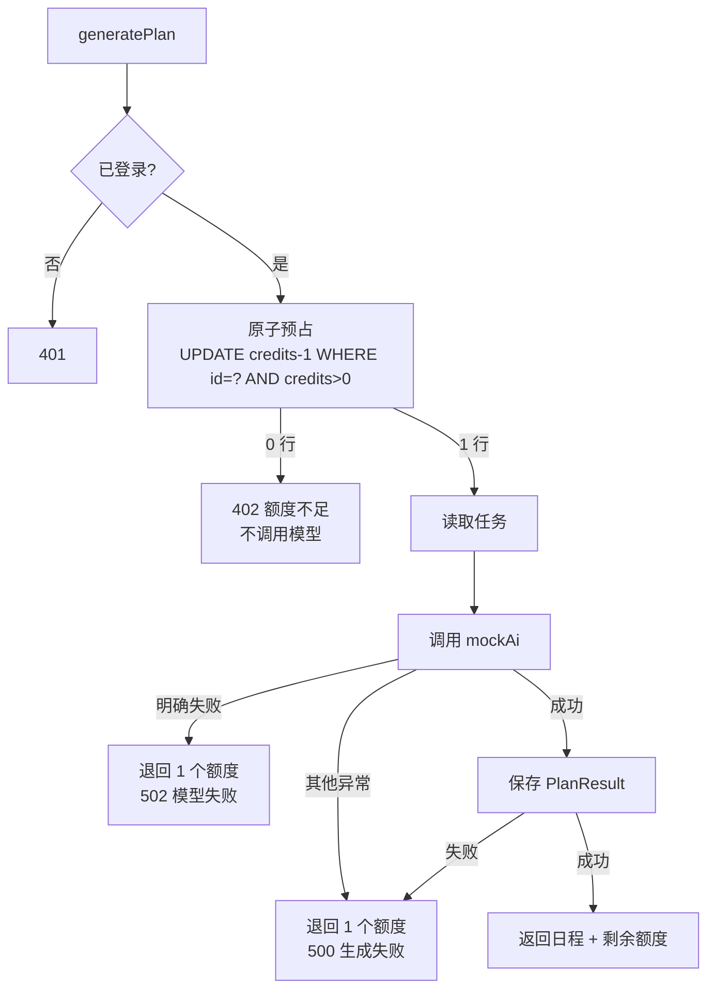

# SPEC：日程生成额度处理

> 方向：技术。状态：核心逻辑与单测已完成，完整 Wasp/Postgres 端到端未在本机运行（原因见 §7）。
> 交接入口：[VERIFICATION.md](VERIFICATION.md) · [SUBMISSION.md](SUBMISSION.md)

## 1. 判断与方案

初始实现的四个问题：

1. 用 `context.user.credits` 做内存判断，值可能已过期；
2. 先调用模型、后扣额度，额度为 0 时仍会发起模型调用；
3. 扣减没有数据库条件，并发请求都能通过 `credits > 0` 检查；
4. 页面不展示余额，失败提示没有说明是否扣费、下一步做什么。

方案是**先预占、再调用、失败退回**：

- 调用模型前，用一条带 `credits > 0` 条件的 `UPDATE` 原子预占 1 个额度；影响行数为 0 立即返回 402，不调用模型。
- 预占成功后才读取任务并调用 `mockAi`。
- 模型明确失败、结果保存失败等未交付结果的情况，退回 1 个额度。
- 成功时保存 `PlanResult`，返回日程和预占后的余额。
- 页面展示余额、扣费结果、失败原因和下一步。

关键不变量：

- `User.credits` 不会被并发扣成负数。
- 每次成功请求恰好消耗 1 个额度、产生 1 条 `PlanResult`。
- 每次失败请求净消耗 0 个额度（预占后退款失败除外，单独报错）。
- 没有预占成功就不会出现 `mock-ai.started`。

## 2. 范围与假设

范围内：

- 单服务、单 PostgreSQL，沿用 Wasp 0.25 + Prisma。
- 新账号默认 3 个额度，额度为整数。
- 模型为本地 `mockAi`；一次 `mock-ai.started` 代表一次已发起的接口调用。
- 一个请求就是一个独立生成任务，不复用其他请求结果。

明确不做：

- 支付、订阅、额度购买；
- 跨账号防刷、限流、设备指纹；
- 按 Token 计价、部分退款；
- 进程在“预占成功、结果落库前”崩溃的自动补偿。该窗口会少 1 个额度，需人工对账；这是已知取舍。
- 请求级幂等键。网络重试会被视为新任务，可能再次扣费。

假设：

- “成功生成一次日程”= 模型返回可用结果，且 `PlanResult` 成功落库并返回客户端。
- “模型明确失败”= `mockAi` 抛出带 `MOCK_AI_REJECTED` 错误码的异常（当前由包含 `[fail]` 的任务触发）。

## 3. 行为与流程



| 场景 | 模型调用 | 额度净变化 | 结果 |
| --- | --- | --- | --- |
| 成功 | 1 次 | -1 | 返回日程，保存 1 条结果 |
| 额度不足 | 0 次 | 0 | 402，不保存结果 |
| 模型明确失败 | 1 次 | 0 | 502，不保存结果 |
| 保存结果失败 | 1 次 | 0 | 500，不保存结果 |
| 未登录 | 0 次 | 0 | 401 |

## 4. 并发处理

生产代码在 [`src/demo-ai-app/operations.ts`](src/demo-ai-app/operations.ts)：

```ts
const [updateResult, user] = await prisma.$transaction([
  prisma.user.updateMany({
    where: { id: ownerId, credits: { gt: 0 } },
    data: { credits: { decrement: 1 } },
  }),
  prisma.user.findUnique({
    where: { id: ownerId },
    select: { credits: true },
  }),
]);
```

- 这是一条 `UPDATE ... WHERE id = ? AND credits > 0`。PostgreSQL 在 Read Committed 下让并发更新同一行排队；后到语句拿到锁后会重新检查条件，只有余额仍大于 0 才扣减。
- 不采用“先查余额再更新”，因为两步之间存在竞态。
- 余额读取放在同一事务：读取失败则扣减一起回滚，不会出现“扣了但没返回余额”的静默损失。
- 不在模型调用的 500ms 期间持有事务，避免长事务和锁等待；退款是独立的 `increment: 1`。
- 退款只退本次预占，不会把余额推到异常值；页面禁用按钮只是体验优化，服务端原子更新才是边界。

## 5. 实现拆解

| 文件 | 改动 | 目的 |
| --- | --- | --- |
| [`src/demo-ai-app/generate-plan.ts`](src/demo-ai-app/generate-plan.ts) | 新增与框架无关的编排、错误类型、仓储接口 | 额度状态机可单测 |
| [`src/demo-ai-app/operations.ts`](src/demo-ai-app/operations.ts) | Prisma 预占/退款/保存适配；`getCreditBalance`；402/502 映射 | Wasp 薄入口 |
| [`src/demo-ai-app/demo-ai-app.wasp.ts`](src/demo-ai-app/demo-ai-app.wasp.ts) | 注册 `getCreditBalance` | 页面读余额 |
| [`src/demo-ai-app/mockAi.ts`](src/demo-ai-app/mockAi.ts) | 明确失败改为带 `MOCK_AI_REJECTED` 的错误 | 区分模型拒绝与其他异常 |
| [`src/demo-ai-app/DemoAppPage.tsx`](src/demo-ai-app/DemoAppPage.tsx) | 余额、结果条、禁用与下一步 | 用户可理解、可行动 |
| [`tests/generate-plan.test.ts`](tests/generate-plan.test.ts) | 成功/不足/模型失败/保存失败/并发/退款失败 | 可重复验证 |
| [`VERIFICATION.md`](VERIFICATION.md) | 命令、预期、实际输出、未运行项 | 交接证据 |

实现顺序：先固定编排接口并用内存替身写测试 → 接 Prisma 原子预占 → 加余额查询与返回字段 → 改页面 → 跑测试并回填记录。实现中的调整见 [`docs/SPEC_CHANGELOG.md`](docs/SPEC_CHANGELOG.md)。

## 6. 验收案例

| ID | 前置条件 | 操作 | 可观察的预期结果 |
| --- | --- | --- | --- |
| AC-01 成功 | 额度 3，已有任务 | 调用 `generatePlan({hours:8})` | 1 次 `mock-ai.started`/`succeeded`；返回 `remainingCredits:2`；新增 1 条 `PlanResult`；页面显示“已扣 1，剩余 2” |
| AC-02 额度不足 | 额度 0，已有任务 | 页面查看；并直接调用服务端 | 页面显示 0、按钮禁用、提示补充额度；服务端返回 402；无 `mock-ai.started`；无新结果；余额仍 0 |
| AC-03 模型失败 | 额度 2，存在含 `[fail]` 的任务 | 调用 `generatePlan` | 1 次 `started` 后 `failed`；返回 502；余额仍 2；无新结果；页面说明未扣额度 |
| AC-04 并发 | 额度 1，已有任务 | 同时发 5 个请求 | 仅 1 个成功；仅 1 次 `mock-ai.started`；仅 1 条新结果；余额 0；其余 4 个为 402；无负数 |
| AC-05 保存失败 | 额度 2，模拟 `PlanResult` 写入异常 | 调用 `generatePlan` | 模型调用 1 次；额度退回 2；返回 500；无新结果 |
| AC-06 未登录 | 未登录 | 调用 `generatePlan` | 401；不预占、不调用、不写结果 |
| AC-07 双击 | 额度 1，快速点两次生成 | 连续点击 | 客户端只发 1 次请求；服务端仍只成功 1 次 |
| AC-08 重试边界 | 同一操作因网络失败后重试 | 重试 | 视为新任务，可能再次扣费；本期不提供幂等键，页面与文档已说明 |

## 7. 验证

- 自动化：`npm run test:quota`，覆盖 AC-01 至 AC-05、并发与退款失败；实际输出见 [VERIFICATION.md](VERIFICATION.md)。
- 类型检查：`npm run typecheck:quota`（仅核心与测试，不依赖 Wasp 生成目录）。
- 生产数据库语义：代码使用带 `credits > 0` 条件的单条 `UPDATE`；并发用例在内存模型中控制交错，不能替代真实 Postgres 压测。
- 完整页面/数据库：本机为 Windows，无 WSL、Docker、Postgres、Wasp CLI，未启动应用；AC-02 页面、AC-03 日志、AC-06 401 标为“未在本机运行”，需在 README 环境补测。

## 8. 取舍与待办

- 预占后崩溃损失 1 个额度：未实现自动补偿；后续可加预占流水 + 超时对账。
- 预占期间并发请求会看到临时减少的余额：若先到请求最终失败并退款，后到请求可能已经收到 402，需要重试。这是“先预占、后扣费”的可用性取舍。
- 退款失败会抛出 `CREDIT_REFUND_FAILED` 并记日志；用户可能少 1 个额度，需人工核对。
- 没有幂等键：网络重试可能重复扣费。
- 未做多实例压测；正确性依据单条条件更新，测试覆盖编排与请求交错，不覆盖数据库锁行为。
- `SUBMISSION.md` 的姓名/手机号待填。
