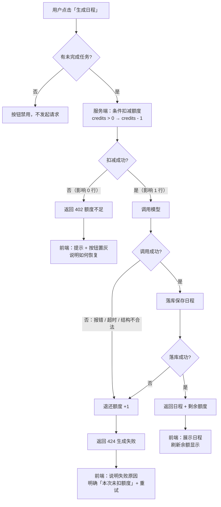
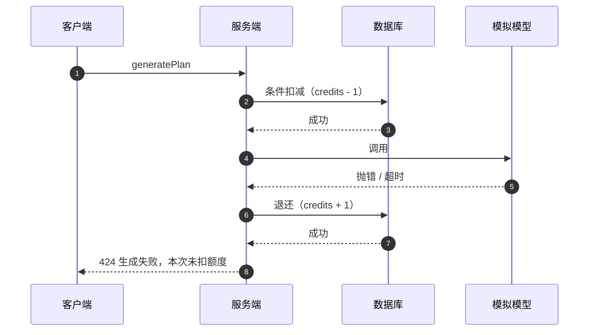

# 02 · 流程

三张图分别对应：正常链路、失败链路、并发链路。图中的「条件扣减」是本次改动的核心。

## 1. 主流程（含额度不足与模型失败）



**关键点**：`C` 是唯一决定「能否调用模型」的位置。它不只是读余额，而是一次带条件的写入，因此并发请求会在这里排队，而不是在调用之后才发现额度不够。

## 2. 并发链路（credits = 1，两个请求同时到达）

```mermaid
sequenceDiagram
    autonumber
    participant U as 用户
    participant A as 请求 A
    participant B as 请求 B
    participant DB as 数据库

    Note over DB: User.credits = 1

    U->>A: 生成日程
    U->>B: 生成日程（同时）

    A->>DB: UPDATE credits = credits - 1<br/>WHERE id = ? AND credits &gt; 0
    DB-->>A: 影响 1 行

    B->>DB: UPDATE credits = credits - 1<br/>WHERE id = ? AND credits &gt; 0
    DB-->>B: 影响 0 行

    A->>A: 调用模型 → 成功 → 落库
    A-->>U: 日程 + 剩余 0

    B->>B: 不调用模型
    B-->>U: 402 额度不足
```

**为什么这样能防透支**：两条 `UPDATE` 在数据库里是串行的。后一条执行时 `credits` 已经是 0，条件不成立，影响 0 行——请求 B 在调用模型之前就被挡下。整个过程不依赖应用层的加锁，也不依赖事务隔离级别。

## 3. 失败退还链路



**退还的边界**：退还发生在同一个请求的 `try/catch` 里。如果进程在「扣减成功」与「退还」之间崩溃，额度不会自动恢复——这属于 `TASK.md` 明确排除的「服务崩溃后的自动补偿」，在交接中记录为已知缺口。

## 4. 状态与文案对应

| 状态 | 触发条件 | 用户看到 | 用户能做 |
|---|---|---|---|
| 可生成 | `credits > 0` 且有未完成任务 | 按钮可点，显示「剩余 N 次」 | 点生成 |
| 生成中 | 请求已发出 | 按钮转圈并禁用 | 等待 |
| 额度不足 | 402 | 「额度已用完，本次未生成」 | 知道下一步找谁 |
| 生成失败 | 424 | 「生成失败，本次未扣额度」 | 点重试 |
| 生成成功 | 200 | 日程 + 余额减 1 | 继续生成或调整任务 |
