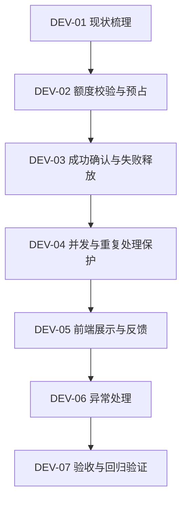

# 任务规划工具额度处理 — 研发任务拆解

**关联文档：** PRODUCT_REQUIREMENTS.md、PRODUCT_FLOW.md  
**文档状态：** 待开发与验证

## 1. 任务拆解目标

将额度处理需求拆分为可独立开发、验证和交接的任务，确保研发人员或 AI Coding Agent 能够根据明确的业务规则完成实现。

本次任务聚焦：

1. 额度校验与预占。
2. 成功扣减和失败释放。
3. 并发请求安全。
4. 前端额度展示与状态反馈。
5. 验收与回归验证。

不涉及支付、订阅、Token 精细计费等额外功能。

## 2. 任务总览

| 任务 ID | 任务名称 | 优先级 | 依赖任务 |
|---|---|---|---|
| DEV-01 | 梳理现有额度数据与生成接口 | P0 | 无 |
| DEV-02 | 实现额度校验与原子预占 | P0 | DEV-01 |
| DEV-03 | 实现成功确认与失败释放 | P0 | DEV-02 |
| DEV-04 | 实现并发安全与重复处理保护 | P0 | DEV-02、DEV-03 |
| DEV-05 | 完善前端额度展示与状态反馈 | P0 | DEV-03 |
| DEV-06 | 完善异常处理及状态恢复 | P1 | DEV-03、DEV-04 |
| DEV-07 | 完成验收与回归验证 | P0 | DEV-02～DEV-06 |

其中 P0 为必须满足的核心需求，P1 为在核心功能完成后进一步完善的体验与健壮性要求。

## 3. 详细研发任务

### DEV-01：梳理现有额度数据与生成接口

**目标：** 明确现有额度存储方式、生成接口及返回状态，尽量复用原有结构。

**开发内容：**

- 确认用户额度存储位置及初始化逻辑。
- 确认生成日程的请求入口。
- 确认模拟 AI 的成功与失败返回方式。
- 确认日程生成结果的保存位置。
- 确认现有额度更新逻辑及可能的并发风险。

**交付要求：**

形成简短的现状说明，明确需要修改的模块、接口及数据结构。

**完成标准：**

研发能够定位额度校验、模型调用、结果保存和额度更新四个关键环节。

### DEV-02：实现额度校验与原子预占

**目标：** 确保只有具备可用额度的请求才能调用 AI。

**输入：**

- 当前登录用户身份。
- 本次日程生成请求。
- 用户当前可用额度。

**处理规则：**

1. 服务端获取当前用户额度。
2. 判断可用额度是否大于 0。
3. 若额度不足，直接拒绝请求。
4. 若额度充足，以原子方式预占 1 个额度。
5. 预占成功后才允许调用 AI。
6. 预占失败时不得调用 AI。

**输出：**

- 预占成功：允许继续生成。
- 额度不足：返回明确的业务错误及当前可用额度。

**完成标准：**

- 额度为 0 时不调用模型。
- 同一额度不能被多个请求同时预占。
- 可用额度不出现负数。
- 前端无法绕过服务端额度限制。

### DEV-03：实现成功确认与失败释放

**目标：** 保证额度最终消耗与日程生成结果一致。

**处理规则：**

**生成成功：**

1. 模型返回成功。
2. 系统保存日程结果。
3. 确认消耗预占的 1 个额度。
4. 返回生成结果及最新余额。

**生成失败：**

1. 模型明确返回失败。
2. 释放本次预占额度。
3. 不保存失败的日程结果。
4. 返回失败信息及恢复后的余额。

**结果保存失败：**

按生成未完成处理，释放预占额度。

**完成标准：**

- 每次成功生成仅消耗 1 个额度。
- 明确失败不消耗额度。
- 同一请求不会重复确认或释放。
- 失败后用户能够重新尝试。

### DEV-04：实现并发安全与重复处理保护

**目标：** 防止同账号并发请求造成额度透支或重复扣减。

**场景一：并发请求**

前置条件：同一账号仅剩 1 个可用额度。

操作：两个请求同时发起日程生成。

预期：

- 仅一个请求可以成功预占额度。
- 另一个请求被拒绝，不调用模型。
- 成功请求最终只消耗 1 个额度。
- 额度不出现负数。

**场景二：重复处理**

同一请求的成功或失败结果被重复处理时：

- 不得重复确认额度。
- 不得重复释放额度。
- 不得重复创建同一请求的日程结果。

**完成标准：**

- 并发情况下额度始终正确。
- 每个请求最多产生一次最终额度结算。
- 模型调用数量不超过实际成功预占的请求数量。

### DEV-05：完善前端额度展示与状态反馈

**目标：** 让用户明确知道可用额度、生成进度及操作结果。

**功能要求：**

| 状态 | 页面行为 |
|---|---|
| 默认 | 展示可用额度，允许生成 |
| 生成中 | 按钮禁用，展示加载状态 |
| 成功 | 展示日程并刷新额度 |
| 失败 | 显示失败原因，允许重试 |
| 额度不足 | 禁用生成按钮并提示额度不足 |
| 结果待确认 | 提示正在确认，避免重复提交 |

**交互要求：**

- 额度展示应以服务端数据为准。
- 生成中禁止当前页面重复点击。
- 失败后保留用户已输入任务。
- 额度不足时不展示虚构的购买或充值入口。
- 生成结果和额度状态应保持一致。

**完成标准：**

用户无需查看日志，即可理解生成状态、额度变化及下一步操作。

### DEV-06：完善异常处理及状态恢复

**目标：** 降低异常情况下额度状态不一致的风险。

**需要处理的场景：**

- 模型明确返回失败。
- 生成结果保存失败。
- 网络中断。
- 请求超时。
- 页面刷新。
- 请求重复到达。

**处理要求：**

- 对明确失败的请求释放额度。
- 对结果不确定的请求保留可核查状态。
- 页面刷新后重新获取服务端状态。
- 不允许因重复处理造成多次扣减。
- 不要求本期实现跨服务分布式事务或服务崩溃后的完整自动补偿机制。

**完成标准：**

已明确结束的请求具有一致的额度结果；不确定状态可识别、可核查，不直接误判为成功。

### DEV-07：完成验收与回归验证

**目标：** 验证额度处理符合需求，不破坏现有任务规划功能。

**验证范围：**

- 正常生成。
- 额度不足。
- 模拟 AI 失败。
- 成功后余额变化。
- 同账号并发请求。
- 连续点击。
- 失败后重试。
- 页面刷新后的额度一致性。

**验证依据：**

`ACCEPTANCE_CASES.md`

**完成标准：**

- P0 验收案例全部通过。
- 无额度透支或错误扣减。
- 额度不足时未发生模型调用。
- 关键异常场景具备明确反馈。
- 验证结果和未解决问题得到记录。

## 4. 推荐开发顺序

建议优先完成服务端额度正确性，再处理页面交互，最后集中验证异常场景。

前端展示可在核心接口规则稳定后并行开发。

## 5. 研发交接约定

### 5.1 业务约束

- 新账号初始额度为 3。
- 每次成功生成消耗 1 个额度。
- 明确失败不消耗额度。
- 额度不足时不得调用模型。
- 同账号并发请求不得透支。
- 额度状态以服务端为准。

### 5.2 接口行为约定

以下为建议的业务返回字段，具体字段名由研发结合现有接口确定。

| 字段 | 含义 |
|---|---|
| success | 本次生成是否成功 |
| status | 生成状态 |
| remainingCredits | 当前可用额度 |
| message | 面向用户的提示信息 |
| schedule | 成功生成的日程结果 |

建议至少能够区分：

- SUCCESS：生成成功。
- INSUFFICIENT_CREDITS：额度不足。
- GENERATION_FAILED：生成失败。
- PROCESSING：请求处理中。
- PENDING_CONFIRMATION：结果待确认。

不要求为上述状态单独新增接口，应优先复用现有 API。

### 5.3 AI Coding Agent 交接要求

如果由 AI Coding Agent 继续开发，应遵循：

1. 先阅读 `PRODUCT_REQUIREMENTS.md` 和 `PRODUCT_FLOW.md`。
2. 检查现有项目结构及额度处理代码。
3. 优先复用现有接口和数据模型。
4. 按 DEV-01 至 DEV-07 的顺序实现。
5. 每完成一个核心任务，执行对应验收案例。
6. 不增加支付、订阅或其他无关功能。
7. 记录实际修改的文件、验证方式和未解决问题。

## 6. 风险与取舍

| 风险 | 影响 | 应对方式 |
|---|---|---|
| 并发请求同时读取额度 | 额度透支 | 原子预占 |
| AI 失败后未释放额度 | 用户额度损失 | 失败释放机制 |
| 重复处理生成结果 | 重复扣减 | 请求状态约束 |
| 前端额度未及时刷新 | 用户误解 | 服务端状态同步 |
| 结果保存失败 | 额度与日程不一致 | 保存成功后才确认消耗 |
| 超时后结果未知 | 错误扣减或重复提交 | 待确认状态及核查 |

## 7. 最终交付检查

- [ ] 已确认现有额度与生成逻辑。
- [ ] 已实现服务端额度校验。
- [ ] 已实现原子预占。
- [ ] 已实现成功确认与失败释放。
- [ ] 已验证并发请求不透支。
- [ ] 已实现必要的前端状态反馈。
- [ ] 已完成异常场景处理。
- [ ] 已执行并记录验收结果。

以上为研发完成检查项，不代表当前已实现或已通过测试。

---

**文档状态：** 产品侧任务拆解完成，待研发实施。

**下一交付物：** ACCEPTANCE_CASES.md — 验收案例。
