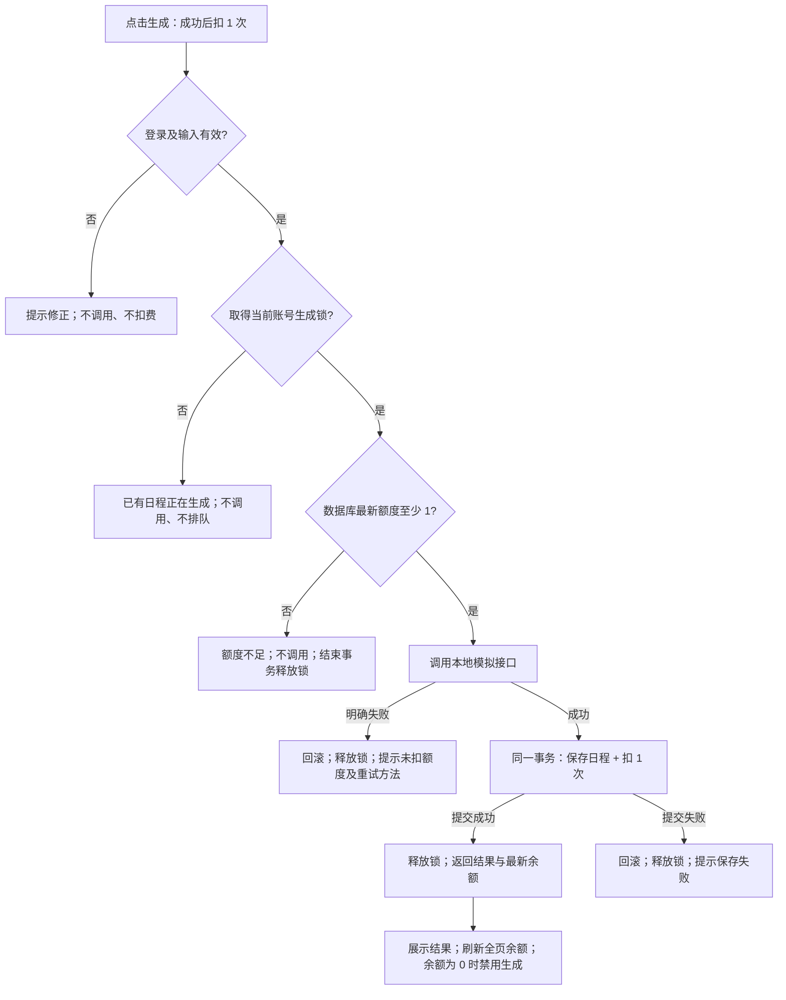

# 日程生成额度处理方案

当前问题是先调用接口、后检查额度，并用请求中的旧余额决定是否扣费。因此，无额度也会调用接口，同账号并发也可能重复使用同一份额度。本方案采用“同账号一次只生成一份日程、调用前检查最新额度、结果保存与扣费一起提交”。

**完成状态：产品方案、交互原型、开发拆解及验收案例已交付；业务代码未改，真实后端验收待开发后执行。** 验证状态见 [验证记录](VALIDATION.md)，提交信息见 [SUBMISSION.md](../SUBMISSION.md)。

## 1. 目标与边界

用户需要在生成前知道成本，在结束后知道结果和剩余额度，失败后知道如何继续。服务端需要阻止无额度调用与并发透支。

沿用题目规则：新账号 3 次额度；每次成功生成扣 1 次；明确失败不扣；额度不足不调用模型。只考虑单服务、单数据库。不同请求可生成不同结果，不要求跨请求复用。

本轮不做充值、订阅、额度赠送、跨账号防刷、Token 计价、服务崩溃后的自动补偿。不增加虚构的“充值”入口。无额度仍可编辑任务、查看已有结果。

**产品补充决定：** 同账号已有生成请求时，后续重叠请求直接返回“生成中”，不排队、不自动重试、不调用接口。这样用户不会因双击或多个标签页在后台排队消费额度。前一个请求结束后再次主动提交，视为新生成，成功会再扣 1 次。该限制按账号隔离，不阻塞其他账号。

## 2. 现状与依据

以下为源码核对，未把静态检查写成运行结论。核对基线：`114aeb28f6368e96c08a25627ac094b8d102fd1b`。

| 位置 | 可确认的现状 | 影响 |
| --- | --- | --- |
| [operations.ts](../src/demo-ai-app/operations.ts) 的 `generatePlan` | `generateMockSchedule` 在 `context.user.credits` 判断之前 | 0 额度请求也先调用接口 |
| 同上 | 根据请求上下文旧余额判断后，执行无条件 `decrement` | 多个请求可能都通过旧余额检查；缺少调用前的账号互斥与最新余额检查 |
| 同上 | 结果保存与扣费已放在同一事务中 | 保留这个正确边界，将调用前控制补齐 |
| [mockAi.ts](../src/demo-ai-app/mockAi.ts) | 约 500ms 后成功；任务含 `[fail]` 时抛异常；有 started/succeeded/failed 日志和 callId | 可构造明确失败，并用 started 计数核对是否调用 |
| [DemoAppPage.tsx](../src/demo-ai-app/DemoAppPage.tsx) | 本页生成时禁用按钮；402 提示“检查账号状态”；其他错误直接显示异常信息 | 本页按钮不能约束其他标签页；失败原因和下一步不够明确 |
| [App.tsx](../src/client/App.tsx) | 顶栏通过 `useAuth` 展示额度 | 新增生成结果后的权威余额刷新，避免只更新局部页面 |

## 3. 核心规则与成功定义

| 编号 | 规则 | 可观察结果 |
| --- | --- | --- |
| R1 | 成功 = 模拟接口成功，且日程结果与扣费事务提交成功 | 新增 1 条自己的 PlanResult，余额减少 1，页面展示本次结果 |
| R2 | 先取得账号生成锁，再从数据库读余额；余额 < 1 立即拒绝 | 返回额度不足；started 增量 0；余额、结果数不变 |
| R3 | 模型明确失败，回滚本次事务并释放锁 | started/failed 各增 1；余额、结果数不变；可以修正任务后重试 |
| R4 | 锁覆盖余额检查、调用和结果提交；未拿到锁的请求立即返回忙碌 | 重叠的第二个请求不产生 started；不能排队后自动扣费 |
| R5 | 生成过程中不先扣费，结束时以服务端余额为准 | 正在生成时余额可保持原值，显示“成功后扣 1 次”；成功后统一刷新 |
| R6 | 数据库保存或提交失败，不能只扣费或只保存结果 | 本次余额、结果数均不变；接口可能已成功调用，不能声称“未调用” |
| R7 | 响应中断或超时，只能说明客户端不知道结果 | 不显示“未扣额度”；先同步余额与结果，再让用户决定是否重新生成 |

R1 对“成功”的界定是本方案假设：只有可取回、已保存的日程才算成功。日志 `mock-ai.succeeded` 单独不能证明业务成功。R7 不承诺跨请求幂等或崩溃恢复。

## 4. 用户流程与服务端控制点

**建议的最小技术落点（供开发判断）：** 在 PostgreSQL 事务内按当前登录用户 ID 获取用户行锁，可采用 `SELECT ... FOR UPDATE NOWAIT`；拿到锁后读最新 `credits`。锁冲突在事务外映射为 409，不等待前一请求完成。确认额度后才调用 mock；保存结果与扣费仍在此事务内，提交或回滚自动释放锁。对同一用户行的互斥就是防止两次请求共享同一额度的步骤；不依赖前端按钮或 `context.user.credits`。

模型明确失败要抛出可识别错误并回滚；锁冲突后的事务不能继续操作。更新余额可附加 `credits >= 1` 条件及影响行数校验，作为防御性检查。不要在持锁事务内部用会重新获取同一行锁的独立数据库连接操作用户。

技术依据：[PostgreSQL 的 NOWAIT 语义](https://www.postgresql.org/docs/current/sql-select.html#SQL-FOR-UPDATE-SHARE)及[行锁释放规则](https://www.postgresql.org/docs/current/explicit-locking.html#LOCKING-ROWS)。这里只引用数据库语义，不代表已验证项目框架接口。

取舍：当前 mock 约 500ms，允许短时持有用户行锁以减少额外状态、退款与恢复逻辑。开发需为调用和事务配置匹配的时限并验证框架兼容性；未来改成长耗时外部模型时，应另行设计额度预留及恢复机制。本轮不要求修改数据模型。不要将这段建议当作已编译或已验证的代码。

## 5. 页面状态与文案

原型见 [prototype.html](prototype.html)。原型右侧的余额设置、故障开关、并发按钮、日志均为评审控件，不进入正式产品。正式页面沿用已有任务输入及日程布局，仅补充以下状态。

| 状态 | 生成按钮 / 余额 | 页面反馈与下一步 |
| --- | --- | --- |
| 余额读取中或失败 | 禁用；不把未知余额显示为 0 | “正在同步额度…”；失败时“额度暂时无法读取，请刷新重试” |
| 无任务 | 禁用；显示真实余额 | “请先添加待办事项” |
| 可生成 | “生成日程 · 成功后扣 1 次”；剩余 N 次 | 就地说明“成功生成消耗 1 次；明确失败不扣额度” |
| 本页生成中 | “生成中…”；禁用本页重复提交及本轮输入编辑 | “正在生成，成功后扣 1 次额度”；保留旧结果并标注“上次日程” |
| 生成成功 | “重新生成 · 成功后扣 1 次”；刷新余额 | “日程已生成，已消耗 1 次，剩余 N 次”；结果标注“本次日程” |
| 成功后耗尽 / 初始为 0 | “额度已用完”；禁用 | “当前无可用额度。你仍可编辑任务、查看已生成日程。” |
| 服务端判定不足（本页余额过期） | 同步为 0；禁用 | 同上一条；保留任务和旧结果 |
| 其他请求占用账号 | 请求返回后恢复当前页；再次提交仍须服务端检查 | “该账号已有日程正在生成，请等待完成后刷新查看。”；提供“刷新状态” |
| 模型明确失败 | 恢复生成；余额不变 | “本次生成失败，未扣额度。请检查任务后重试。”；本地测试删除含 `[fail]` 的任务再试 |
| 保存失败且确认事务已回滚 | 恢复生成；刷新余额 | “日程保存失败，未扣额度，请稍后重试。”；保留旧结果 |
| 网络中断 / 超时 / 无法确认提交结果 | 提供“同步状态”，同步完成前禁用生成 | “暂时无法确认生成结果，请先同步额度和已生成日程。”；同步不自动发起新生成 |

采用页面内持久提示（`role=status` / 错误用 `role=alert`），不只依靠短暂 toast 或颜色。显示结果时同时显示保存时间，便于区分本次与历史。所有余额引用同一服务端权威数据；生成结束、页面重新获得焦点和手动刷新时同步。无额度也允许用户查看自己的结果列表。

**结果不确定的恢复边界：** 同步需获取当前生成状态、余额和最近结果。如果仍在生成，继续等待；如果已结束，列出已保存结果及时间，让用户查看后再决定是否重新生成。不把“有一条最近结果”直接认定为当前请求成功；跨请求精确关联不在本轮要求内。若开发方案无法可靠返回当前生成状态，保留明确的等待与刷新提示，并将其列为待解决项，不能假装已恢复。

## 6. 服务端与前端交接约定

以下是期望契约，具体 Wasp 返回结构由开发在实现时确认。

| 场景 | 建议返回 | 前端动作 |
| --- | --- | --- |
| 成功 | 日程、已保存结果 ID/时间、提交时余额 | 替换本次结果；刷新额度查询，顶栏同步 |
| 未登录 / 输入错误 | 401 / 400 | 引导登录或修正；不调用模型 |
| 额度不足 | 402 + `QUOTA_EXHAUSTED` | 同步最新余额；展示无额度态 |
| 同账号正在生成 | 409 + `GENERATION_IN_PROGRESS` | 提示等待，允许同步状态；不自动重试生成 |
| 明确模型失败 | 502 + `MODEL_FAILED` | 提示未扣费，可修正后主动重试 |
| 保存失败且回滚已确认 | 500 + `SAVE_FAILED` | 提示未扣费，可稍后重试 |
| 无法确认结果 | 网络错误或未分类异常 | 不承诺未扣费，先同步状态 |

错误文案与状态码分别负责可读性和程序判断，不在前端匹配英文异常字符串。保留 mock 现有 callId 日志；建议补充请求标识、quota.rejected、generation.busy、plan.committed 等事件，记录结果 ID 与前后额度，便于复核。日志不包含密码、手机号或完整任务内容。统计成功率时以提交成功为准，不能用 mock 成功替代。

## 7. 优先级与交付判断

P0 是 R1–R6 和基础页面反馈，任一核心验收失败则不能称为额度处理完成。P1 是多标签页焦点同步及 R7 的恢复体验；进入本轮拆解，若未完成必须在提交说明中列出，不能将未确认状态显示为未扣费。详细任务及依赖见 [开发拆解](DEVELOPMENT.md)，逐项验收见 [ACCEPTANCE.md](ACCEPTANCE.md)。

评审重点：余额是否始终非负；0 额度或忙碌拒绝是否均不产生 started；每次业务成功是否恰好对应 1 次扣费与 1 条结果；用户是否能分辨失败、忙碌和结果未知，并有下一步。
