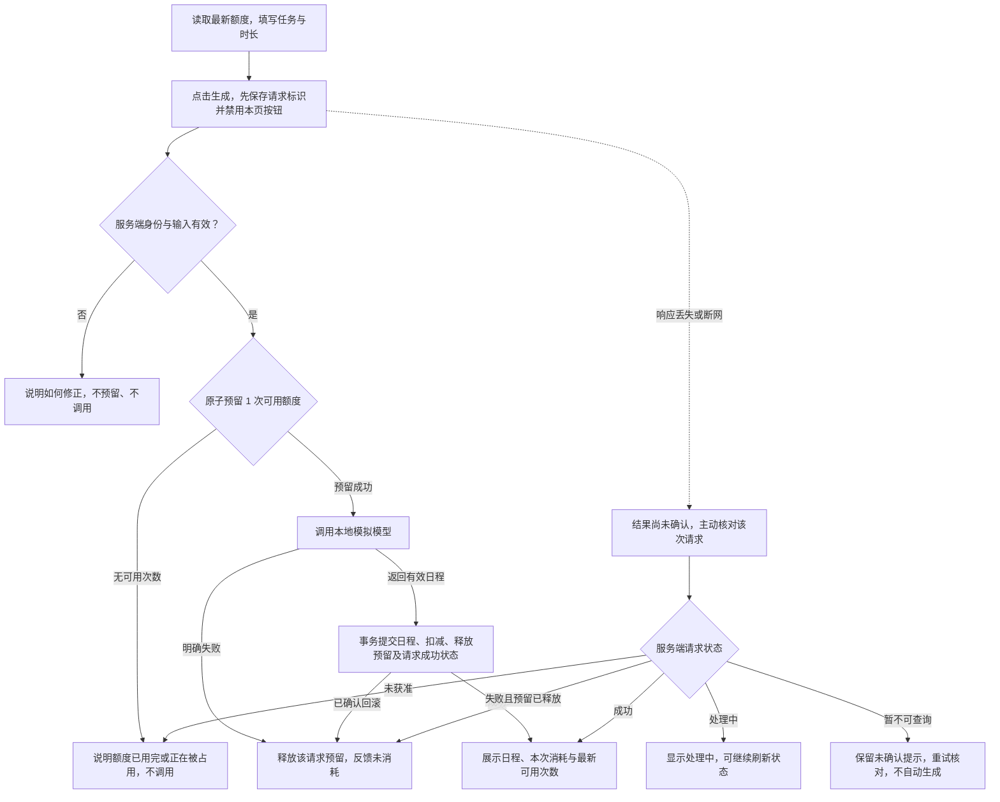

# 日程生成额度处理方案

当前问题是额度检查晚于模型调用，并发请求又可能使用同一份旧余额。方案是在调用前原子预留额度，成功保存日程时确认消耗，明确失败时释放预留。本文为产品方向交付草案：需求、流程、开发拆解、验收设计及[可点击原型](../prototype/README.md)已完成；原应用代码未修改，真实额度目标行为尚未运行验证。

## 1. 问题与范围

目标用户是已登录、已有待办任务、准备生成日程的用户。他需要在点击前知道还能生成几次，在完成后知道是否成功、是否扣额度及下一步能做什么。

源码核查基于提交 `114aeb28f6368e96c08a25627ac094b8d102fd1b`，不是运行复现：

| 当前行为与证据 | 用户影响 | 本轮决定 |
| --- | --- | --- |
| [`generatePlan`](../src/demo-ai-app/operations.ts) 先调用模型，后检查 `context.user.credits` | 没额度也发起调用，等待后才得知失败 | 所有生成请求先通过服务端额度准入 |
| 同一操作按请求上下文余额判断，再无条件 `decrement: 1` | 余额为 1 时，并发请求可能都通过，最终透支 | 准入必须是数据库原子条件变更，不能先读再写 |
| [`mockAi.ts`](../src/demo-ai-app/mockAi.ts) 遇到 `[fail]` 抛错，发生在扣减前 | 当前明确失败路径本就不会扣额度，应保留 | 预留后失败也要恢复可用额度 |
| [`App.tsx`](../src/client/App.tsx) 顶部已有剩余额度数字；[`DemoAppPage.tsx`](../src/demo-ai-app/DemoAppPage.tsx) 有加载态和 402 提示，但缺少本次扣费说明。服务端已保存 `PlanResult`，页面刷新后不读取已保存结果 | 能看到剩余数字，但缺少本次消耗及异常恢复说明；刷新后难以核对刚才是否成功 | 复用已有额度展示与结果存储，补充操作附近的额度状态、具体结果及刷新核对入口 |

本轮覆盖成功、额度不足、明确失败和同账号并发，以及这些结果的界面反馈。沿用新账号 3 次额度及每次成功消耗 1 次的规则，不改变日程内容、任务编辑及账号体系。

不做支付、订阅、额度每日恢复、跨账号防刷、Token 计价、多服务协调、跨请求结果复用或服务崩溃后的自动补偿。没有充值入口，也不承诺“明天恢复”。

## 2. 规则与取舍

| 编号 | 产品规则 |
| --- | --- |
| R1 | “成功”指有效日程已保存，且与其对应的 1 次扣减共同提交成功；仅模型返回成功不算完成。随后展示日程和“本次消耗 1 次”。 |
| R2 | 调用前原子预留 1 次可用额度。预留失败立即拒绝，不写生成结果，不产生 `mock-ai.started`。前端按钮限制不能替代此校验。 |
| R3 | 模型明确失败，释放该请求的预留；不扣额度，不新增日程，保留任务及先前日程。用户修正后可主动重试。 |
| R4 | 同账号的不同请求可以分别生成，但同时获准的请求数不能超过可用次数；不排队。一个成功请求只确认扣减一次，一个失败请求只释放自己的预留。 |
| R5 | 同一页面生成期间禁用生成按钮。每次主动生成先创建并本地保存新的请求标识，再发送请求；服务端将其与当前账号绑定。同账号同一标识的重复提交只拒绝，不改变原请求状态、不再次调用模型。完成后主动再点生成或重试须使用新标识，属于新任务，成功会再消耗 1 次。 |
| R6 | 页面初次加载、生成结束、重新获得焦点及点击“刷新状态”时获取服务端最新额度。尚未读到额度或读取失败时，不显示为 0，不允许直接生成；提供重试读取。 |
| R7 | 浏览器断网或响应丢失不代表模型失败。提示“结果尚未确认”，先核对该次请求状态，不能直接声称未扣，也不自动重发生成。 |
| R8 | 未登录、无任务或时长不合法时，在预留和模型调用前拒绝。时长与当前页面范围一致：1–24 小时、0.5 小时递增；任务加载中也不允许提交。 |

**额度口径。** `B` 是尚未消耗的额度，`H` 是处理中请求预留的次数，用户看到的“可用次数” `A = B - H`。新账号 `B=3、H=0、A=3`；完成存量预检与迁移后，始终满足 `0 ≤ H ≤ B`。原版有扣出负余额的风险，是否存在这类存量数据尚未核实，迁移前必须审计。

| 阶段 | 额度变化 | 用户理解 |
| --- | --- | --- |
| 准入 | 原子判断 `B-H ≥ 1` 并令 `H+1`，再调用模型 | 暂占 1 次，尚未确认消耗 |
| 成功落库 | 在同一事务中保存结果、`B-1`、`H-1`，记录请求成功 | 成功消耗 1 次；该次暂占转为已消耗 |
| 明确失败 | 该请求转为失败并释放预留 `H-1`，`B` 不变 | 未消耗；可用次数恢复 |
| 提交前已确认的保存失败 | 保存与扣减一起回滚，再释放该请求预留 | 未生成、未消耗；可重试 |

选择预留而非“生成后再扣”，是为了让最后一次额度也能在调用前裁决；不在模型调用期间保持数据库长事务。不新增同账号只能生成一次的限制：例如可用 3 次时，两个不同请求可以同时获准。

请求标识由客户端在点击时生成，按登录账号保存在本地，并随生成请求提交。服务端把登记该标识与预留放在同一个原子操作中，记录当前账号、处理状态及关联结果；拒绝准入也留下“未获准”的终态。同账号同一标识不能登记第二次，即使重放请求也不重复预留或调用。不同主动生成使用不同标识，不复用彼此的结果。

这一约定让单次生成接口即使响应丢失，也能被准确查询，无需拆成“先准入、再执行”两次调用。存储字段与接口名称由开发在技术 spec 中确定，但账号归属、同标识唯一性和上述原子性必须保留。

## 3. 主流程与异常流程



状态查询以发送前保存的请求标识读取当前账号的该次请求，不再次调用模型，刷新后仍可继续核对。若暂时查不到，可能请求尚未到达或准入尚未完成，仍显示“结果尚未确认”，不能判定未扣或把别的请求的结果当作本次结果。可以复用现有 [`getPlanResults`](../src/demo-ai-app/operations.ts) 展示最近已保存日程，但本次核对必须按请求标识关联，不新增完整历史记录页面。

服务端已提交成功但客户端未收到响应，仍按成功计费。事务提交结果不确定或数据库不可用时，也进入“结果尚未确认”，不能按已回滚处理。只有确认未提交并释放完成，才显示“未消耗”。

## 4. 页面状态与文案

保留现有任务输入、时长输入和日程区域；在生成按钮上方增加额度说明，在附近显示持久反馈。Toast 可辅助，关键结果不能只依靠短暂提示；状态变化用可被读屏识别的文本表达。

```text
今天可用的工作时长  [ 8 小时 ]
可用 2 次 · 另有 1 次正在生成
每成功生成一次消耗 1 次；失败不消耗。
[ 生成中… ]
本次已暂占 1 次额度，请等待结果。

最近一次已保存日程  · 生成时间
……已有内容保留，新日程保存成功后再替换……
```

| 状态 | 额度区与结果反馈 | 按钮与下一步 |
| --- | --- | --- |
| 正在读取额度 | “正在读取可用次数…” | 生成禁用；读取失败后显示“重试读取” |
| 可用且无请求处理中 | “可用 N 次”；显示计费规则 | “生成日程”；无任务时先添加任务 |
| 本页生成中 | 服务端额度；“本次已暂占 1 次额度，请等待结果” | “生成中…”禁用；不清空已有日程 |
| 成功 | “日程已生成，本次消耗 1 次”；展示最新可用次数及生成时间 | 仍有额度可“再次生成”；为 0 则禁用并说明原因 |
| 明确失败且释放完成 | “生成失败，本次未消耗额度”；保留已有日程 | 可“重试生成”；`[fail]` 测试场景需先删除或修改该任务 |
| 无可用额度，且 H=0 | “额度已用完。你仍可编辑任务、查看已保存日程” | 生成禁用；提供“刷新状态”，不引导充值或新建账号 |
| 无可用额度，且 H>0 | “暂时没有可用次数，有 H 次正在生成，请等待后刷新状态” | 生成禁用；“刷新状态”；不显示“额度已用完” |
| 页面余额过期，被服务端拒绝 | 更新为最新额度；说明本次未发起生成 | 按最新额度恢复或禁用生成，保留输入 |
| 结果尚未确认 | “连接中断，结果尚未确认。请先核对，避免重复生成” | 先显示“核对结果”；确认该次终态后再恢复生成 |

其他异常使用可操作的文案：未登录提示重新登录；输入不合法指出字段；服务器确认保存失败且释放完成后，提示“日程保存失败，本次未消耗额度，请重试”。不要直接展示内部异常堆栈。

跨标签页的额度不要求实时推送。失焦页面可短暂显示旧值，但重新聚焦或请求结束后刷新，且服务端不能接受超出额度的请求。旧响应不能覆盖较新的额度状态；读取失败时保留“正在核对”，不展示推算余额。

## 5. 开发拆解与交接

以下均为**待开发**任务；建议按顺序交付，D3/D4 在约定接口后可并行。文件是定位入口，不是已经实现的承诺。

| 编号 / 优先级 | 责任 | 具体任务与入口 | 完成条件 / 验收 |
| --- | --- | --- | --- |
| D1 / P0 | 后端 | 先提交技术 `SPEC.md`；按本文约定预留、请求状态和结果的关系；在 [`schema.prisma`](../schema.prisma) 及迁移中落实数据约束。迁移前审计负余额：发现即阻断上线，由维护者结合已有结果与调用记录逐账号核对，记录调整依据；无法确认则保持阻断。正常账号保留 `credits`，迁移后初始预留为 0 | 明确准入原子条件、终态只结算一次、失败释放方式和提交不确定的处理；通过 [M01 存量迁移验收](ACCEPTANCE.md)，不统一重置或自动归零旧余额 |
| D2 / P0 | 后端 | 改造 [`generatePlan`](../src/demo-ai-app/operations.ts)：校验 → 原子预留 → 模型 → 成功事务 / 失败释放；不得再用请求上下文旧余额裁决 | [AC01–AC08、AC10](ACCEPTANCE.md)；拒绝路径无模型启动日志 |
| D3 / P0 | 后端 | 在 [`demo-ai-app.wasp.ts`](../src/demo-ai-app/demo-ai-app.wasp.ts) 声明额度与请求状态查询；返回可用/暂占次数、明确失败/已成功/处理中/未获准状态及关联结果；日志关联账号、请求标识和模型 `callId` | 只允许查询本人数据；查询不产生模型调用；支持 AC07、AC09、AC11–AC14 |
| D4 / P0 | 前端 | 在 [`DemoAppPage.tsx`](../src/demo-ai-app/DemoAppPage.tsx) 落实状态表；发送前保存请求标识；刷新最新额度，保留旧日程，支持刷新后的请求核对和最近已保存结果展示 | AC01–AC04、AC07、AC09、AC11–AC12、AC14；业务结果用文本可理解，按钮有明确下一步 |
| D5 / P0 | 测试 / 开发 | 按 [验收文档](ACCEPTANCE.md) 准备隔离账号、调用计数与数据库记录；提供真实并发脚本，以及仅在测试中启用的调用屏障和保存失败注入 | 可重复验证调用数、额度、结果数及请求状态；不能只截图按钮禁用来证明并发安全 |
| D6 / P0 | 产品 / 测试 | 逐条记录实际结果，复核文案、恢复路径和权限；在 `SUBMISSION.md` 链接验证证据 | 未通过项有原因和后续负责人；未执行项不标为通过 |

开发接手时先阅读本文件与验收用例，再按仓库 [TASK.md](../TASK.md) 的技术方向要求先提交 spec，保留 Git 历史。[独立原型](../prototype/README.md)可体验正常生成、明确失败、最后一次、额度用完和结果待核对；其[交互检查](../prototype/VALIDATION.md)仅覆盖模拟界面，不代表以上后台任务已经实现。

## 6. 发布门槛与已知边界

真实应用的 P0 发布门槛是 M01 存量迁移预检及 AC01–AC14 全部有实际通过记录；M01 未执行、未通过或负余额缺少核对依据时均不得上线。额度不足时调用数为 0，并发时额度不为负，成功次数与扣减及结果数一一对应。界面能区分已成功、明确失败、暂占中和未知结果；未知结果不能被包装成“失败未扣”。验收设计中的预期值不是实际通过记录。

服务崩溃或数据库持续不可用可能留下预留，本轮不做自动补偿。状态长期无法查明时，由维护者按请求标识核对该账号请求、结果、预留及模型日志，在确认无在途请求后人工处理；不得让用户自行修改数据库或直接恢复为 3 次。页面应保留可复制的请求标识并引导联系本项目维护者；具体联系入口与人工核对步骤由开发补入运行说明。

本方案增加了持久预留及最小请求状态查询的开发量，换取调用前准入、失败释放和断网后可核对。若时间不足，先缩减表现形式（例如保留文字状态而不做额外动效），不删减额度正确性与可重复并发验证。
