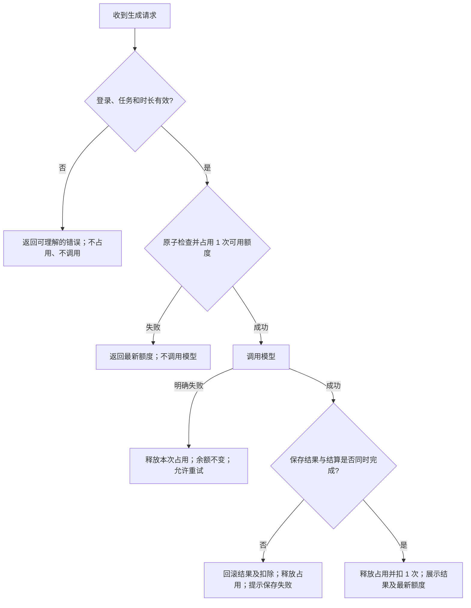
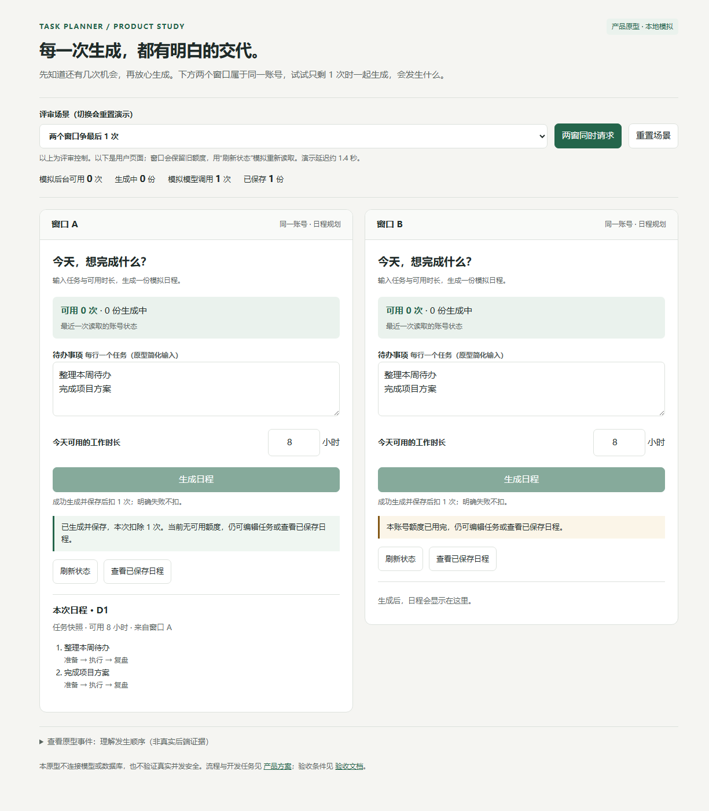

# 日程生成额度改进方案

判断：问题不只是少一条“额度不足”提示。当前服务端先调用模型，再检查请求携带的余额；多个窗口还可能同时相信同一份旧余额。方案是在调用前占用额度，生成结果保存成功后结算，明确失败则释放，并把这些状态解释给用户。

状态：产品方向方案与演示原型；未修改业务代码，后端行为待开发验收。验收与验证状态见 [ACCEPTANCE.md](ACCEPTANCE.md)，提交概览见 [SUBMISSION.md](../SUBMISSION.md)。

## 1. 背景与证据

题目规则以 [TASK.md](../TASK.md) 为准。新账号有 3 次额度；成功一次消耗 1 次，额度不足不调用模型，模型明确失败不消耗，同账号并发不能透支。

现状来自源码阅读，未在真实应用中复现：

- [operations.ts](../src/demo-ai-app/operations.ts) 的 `generatePlan` 先调用 `generateMockSchedule`，后判断 `context.user.credits`。零额度请求仍可能产生模型调用；请求里的额度也可能已经过期。
- 扣额度与保存结果已有事务，但缺少调用前的并发准入。把调用后的两次写入放进事务，本身不能阻止多个请求先调用模型。
- [DemoAppPage.tsx](../src/demo-ai-app/DemoAppPage.tsx) 已禁用当前页面的生成按钮，却不能约束另一个窗口；页面不展示余额，额度不足只提示“请检查账号状态”。
- [mockAi.ts](../src/demo-ai-app/mockAi.ts) 遇到 `[fail]` 会抛出异常，代码中的 `=== null` 判断接不住该失败。开发时需统一失败处理和用户提示。

## 2. 目标与边界

目标是让每次扣除都对应一份已保存、可查看的成功日程；让用户理解剩余机会和失败后的选择。验收目标：零额度的模型启动次数为 0；同账号任何时刻额度不为负；明确失败后的剩余额度与请求前相同；成功后同时出现结果与一次扣除。具体条件见验收案例，不虚构线上指标。

本轮保留现有任务输入、工作时长、登录和本地模拟模型；支持单服务、单数据库，跨窗口请求分别处理，不合并生成任务。不增加支付、订阅、自动补充额度、自动重试、跨账号防刷或服务崩溃后的自动补偿。完整历史管理不在范围内，只增加最近 5 份已保存日程的只读入口。

## 3. 用户与价值

| 用户情境 | 想完成的事 / 当前困难 | 方案如何帮助 | 完成后 / 替代方式 |
| --- | --- | --- | --- |
| 日常规划者 | 用任务和可用时间生成日程；现在不知道还能生成几次，失败后不知道是否扣除 | 点击前展示可用次数，明确告知每次成功扣 1 次，结果旁反馈结算 | 知道是否成功、是否扣除；无需反复尝试或手工排程来猜状态 |
| 在多个窗口操作的同一账号用户 | 在不同窗口安排不同任务；窗口里的余额可能过期 | 服务端统一控制占用，拒绝超出可用额度的请求，并返回最新状态 | 不会透支；无需自己记余额、限制只开一个窗口 |

价值主张：让用户在点击前知道代价、结束后知道结果，遇到失败时保有明确的下一步。

## 4. 规则与流程

### 4.1 什么算成功，什么算占用

“成功”指模型返回有效日程，且结果保存与扣额一并完成，之后用户能重新查看。模型返回成功但保存失败不算一次成功生成，不应最终扣额或留下半条结果。

- **剩余额度**：还没有被成功生成消耗的次数，初始为 3。
- **生成中占用**：已获得生成资格、尚未完成结算的请求数；占用不等于最终扣除。
- **可用额度 = 剩余额度 − 生成中占用**。页面展示“可用 X 次 · Y 份生成中”；只剩 1 次时两窗同时点，最多一个先拿到资格。
- 示例：开始时剩余 3、占用 0、可用 3；一份生成中为 3 / 1 / 2；成功后为 2 / 0 / 2；明确失败则回到 3 / 0 / 3。

### 4.2 服务端流程

阻止透支的位置是 D：检查和占用必须在服务端成为不可分割的一步。不能先读取余额、稍后再占用，不能只依靠页面按钮。以请求实际获得资格的顺序为准，不承诺用户点击时间的公平排序。

占用失败时，可用为 0 且有生成中请求，提示“额度正在使用”；可用为 0 且没有生成中请求，提示“额度已用完”。不自动排队；拒绝的请求没有模型调用，也不会在之后悄悄执行。

### 4.3 用户看到什么

| 状态 | 页面与操作 | 用户下一步 |
| --- | --- | --- |
| 额度查询中 / 查询失败 | “正在查询额度…” / “暂时无法查询额度，请刷新”；生成不可用，不把未知值当作 0 | 刷新额度，任务仍可编辑 |
| 有可用额度 | 显示可用次数；按钮“生成日程”；旁注“成功生成并保存后扣 1 次，明确失败不扣” | 添加任务、设置时长、生成 |
| 本页生成中 | 按钮“生成中…”并禁用；“正在生成，暂占 1 次额度”；保留上一份结果 | 等待；编辑任务只影响下次生成 |
| 成功 | 展示本次结果；“已生成并保存，本次扣除 1 次”；更新额度 | 查看日程；额度足够时再生成 |
| 模型明确失败 | “生成失败，本次未扣额度。请重试；若任务含 [fail]，请先删除该任务” | 保留任务、时长和旧结果，手动重试 |
| 结果保存失败 | “日程未保存，本次未扣额度，请重试” | 保留输入和旧结果，手动重试 |
| 最后额度正被另一请求占用 | “当前额度正在使用，请稍后刷新”；停止本次请求 | 刷新额度；不自动排队或重试 |
| 额度已用完 | “本账号额度已用完，仍可编辑任务或查看已保存日程”；生成不可用 | 编辑任务或查看最近日程，不展示充值按钮 |
| 网络中断、结果未知 | “暂时无法确认生成结果。请刷新额度并查看已保存日程，再决定是否重新生成” | 不承诺未扣；不自动重试。再次生成是新请求，成功会再扣一次 |

操作反馈使用持续可见的状态区，不能只有短暂 toast；动态消息对屏幕阅读器可读，不仅依赖颜色。生成按钮不可用时显示原因，键盘可操作刷新、重试和历史入口。

### 4.4 刷新与历史

进入页面、切回窗口、请求结束和额度拒绝后，重新读取服务端余额与占用情况；客户端旧值不能成为放行依据。不要求实时推送，短暂旧值允许存在，但被拒绝后要纠正。

调用前固定本次任务与时长快照。生成中编辑输入不改变本次结果。历史复用现有 `getPlanResults`，按创建时间倒序展示最近 5 份当前用户的已保存日程；打开历史不消耗额度、不调用模型。失败与刷新不清空已保存结果。不能确认网络中断的那次结果时，保留“结果未确认”提示，不能仅凭看到一条旧日程就声称本次成功。

## 5. 原型与评审方式

下载整个仓库后，可直接打开 [prototype/index.html](prototype/index.html)，不需要安装依赖，也不连接后端。

上方是评审用控制区，下面两个窗口模拟同一个账号。控制区不属于面向用户的正式页面。可切换初始额度、模型失败、保存失败和响应丢失；点击“两窗同时请求”体验一个额度被抢占的过程。刷新可以取回原型模拟服务端的余额和历史。

原型事件是 `prototype.*`，只解释流程；不能当作真实 `mock-ai.started` 日志或数据库证据。原型自动检查运行方式及实际记录见 [ACCEPTANCE.md](ACCEPTANCE.md)。

下面是原型实际截图：两窗争最后一次，窗口 A 已成功，窗口 B 刷新后看到额度已用完。

## 6. 开发任务拆解

| 任务 / 优先级 | 交付与具体位置 | 依赖 | 完成条件 |
| --- | --- | --- | --- |
| T1 额度准入与读接口 / P0 | 在 [operations.ts](../src/demo-ai-app/operations.ts) 及必要数据结构中维护余额和占用；新增额度读取操作，并在 [Wasp 配置](../src/demo-ai-app/demo-ai-app.wasp.ts) 注册 | 无 | 身份取自登录态；原子取得资格后才允许调用；余额与占用不能为负；不足返回最新状态；AC01–04、07–09 |
| T2 成功结算与失败释放 / P0 | 调整 `generatePlan`；让结果保存与扣 1 次同成同败，捕获模拟模型抛出的明确错误；释放本次占用一次 | T1 | 不用旧 `context.user.credits` 判断准入；失败不留结果不扣除；AC01、05–06、08–09 |
| T3 额度状态与操作反馈 / P0 | 调整 [DemoAppPage.tsx](../src/demo-ai-app/DemoAppPage.tsx)，展示可用/生成中、禁用原因、持续反馈、主动刷新和同页防连点 | T1–T2 | 刷新时机覆盖进入/切回/请求完成/拒绝；不自动重试；AC02–05、07、10–13 |
| T4 最近日程只读入口 / P0 | 复用 `getPlanResults`，按时间展示最近 5 份；保留旧结果 | T2 | 仅当前账号可见，零额度仍可查看，查看不调用模型；AC10、12 |
| T5 验证与交接 / P0 | 按 [验收表](ACCEPTANCE.md) 编写真实请求并发测试、保存日志与数据库前后对照，更新验证记录 | T1–T4 | 同时发出多个请求；断言模型调用数、成功数、余额及结果数，不能只测按钮；记录命令与实际结果 |

建议顺序：先完成服务端 AC01–09，再联调页面和历史，最后跑全部验收；修复与文档一起交接。数据库字段、原子操作和事务边界由技术实现设计确定；若选用其他并发方案，须说明如何满足同一组可观察结果。

## 7. 假设、取舍与交接风险

- 同一账号的不同请求是独立任务，有几份成功日程就扣几次，不做跨请求去重；同页防连点只用于减少误操作。
- 明确失败以服务端确认模型异常或结果保存失败为准。浏览器断网不是“模型失败”的证据，不能显示“未扣额度”。
- 并发不排队，减少用户离开后仍生成并扣额的意外。失败释放后由用户决定重试，恢复成本是一轮明确的手动操作。
- 服务进程在占用后崩溃可能遗留占用；按题目不做自动补偿。开发交接要记录人工核对方法，不能只把它隐藏在“系统错误”中。
- 初始 3 次不等于每天 3 次；没有刷新周期或充值需求。任务完成状态是否参与规划沿用现有行为，不在本轮改动。
- 本产品交付没有真实接口/数据库验收结果，不能据此标记额度缺陷已修复。实现者应以验收表补齐证据。
