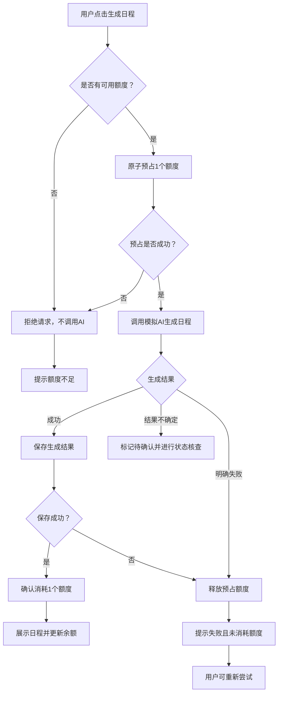
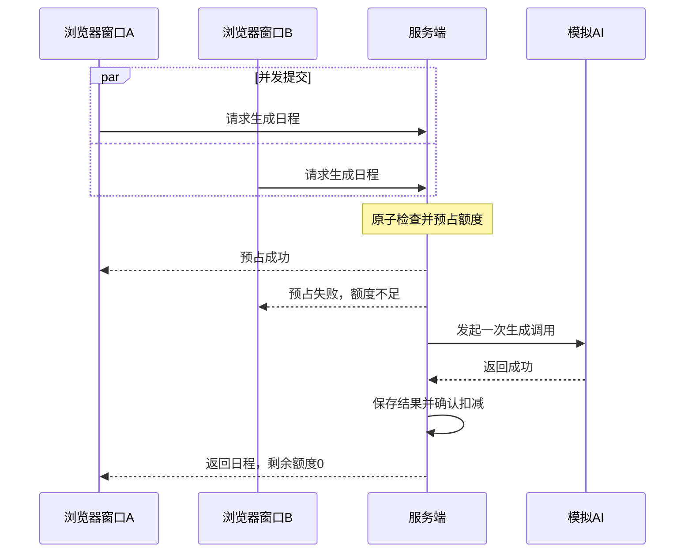

# 任务规划工具额度处理 — 业务流程与交互设计

**关联文档：** PRODUCT_REQUIREMENTS.md

## 1. 设计目标

围绕 AI 日程生成过程中的额度管理，设计清晰、可执行的业务流程。

重点解决以下问题：

- 用户如何知道当前剩余额度。
- 额度不足时如何阻止生成。
- AI 成功或失败时如何处理额度。
- 并发请求如何避免额度透支。
- 用户如何获得明确的操作反馈。

## 2. 核心业务流程



### 2.1 流程规则

1. 生成前由服务端校验可用额度。
2. 校验与预占必须保证原子性，避免多个请求使用同一个额度。
3. 预占成功后才能调用 AI。
4. AI 成功且日程保存成功后，确认消耗额度。
5. AI 明确失败或保存失败，释放预占额度。
6. 超时、网络中断等不确定状态需核查最终结果，不能直接认定成功或失败。

## 3. 关键业务场景

### 场景 A：正常生成

**前置条件：** 用户剩余 3 个额度，已添加待办任务。

**操作过程：**

1. 用户点击“生成日程”。
2. 系统成功预占 1 个额度。
3. 按钮进入生成中状态。
4. AI 返回成功，系统保存日程。
5. 系统确认消耗额度并展示结果。

**预期结果：**

- 剩余可用额度：2。
- 成功生成并展示日程。
- 页面提示：“生成成功，已消耗 1 个额度。”

### 场景 B：额度不足

**前置条件：** 用户剩余 0 个额度。

**操作过程：**

1. 用户进入任务规划页面。
2. 系统展示额度为 0。
3. 生成按钮不可用。
4. 即使绕过前端直接提交请求，服务端仍拒绝调用。

**预期结果：**

- 不调用 AI。
- 额度保持 0。
- 页面提示：“生成额度已用完，暂时无法生成新日程。”

### 场景 C：AI 生成失败

**前置条件：** 用户剩余 3 个额度，待办任务中包含用于模拟失败的 `[fail]` 标记。

**操作过程：**

1. 用户点击“生成日程”。
2. 系统预占 1 个额度。
3. 模拟 AI 返回失败。
4. 系统释放预占额度。
5. 页面展示失败提示。

**预期结果：**

- 最终剩余可用额度仍为 3。
- 用户原有任务不丢失。
- 用户可以修改任务后重新生成。
- 页面提示：“生成失败，本次未消耗额度，请重试。”

### 场景 D：并发请求

**前置条件：** 同一账号剩余 1 个可用额度，在两个浏览器窗口中同时发起生成请求。



**预期结果：**

- 最多只有一个请求成功预占额度。
- 未获得额度的请求不得调用 AI。
- 如果获得额度的请求成功，最终余额为 0。
- 如果该请求明确失败并释放额度，最终余额为 1。
- 任何情况下余额不得为负数。

说明：图中窗口 A 成功仅为示例，实际并发场景不指定哪个请求获胜。

## 4. 页面交互设计

本次仅调整现有任务规划页面的额度展示、生成按钮和状态反馈，不重新设计整体页面结构。

### 4.1 页面信息结构

```text
┌──────────────────────────────────────┐
│            AI 任务规划工具           │
├──────────────────────────────────────┤
│                                      │
│  当前可用额度：3 次                  │
│                                      │
│  我的待办任务                        │
│  ┌────────────────────────────────┐  │
│  │ 完成项目需求文档               │  │
│  │ 准备面试                       │  │
│  └────────────────────────────────┘  │
│                                      │
│         [ 生成我的日程 ]             │
│                                      │
│  生成成功后消耗 1 个额度             │
│                                      │
└──────────────────────────────────────┘
```

该结构为建议交互示意，不代表当前项目已实现此布局。

### 4.2 页面状态定义

| 页面状态 | 额度展示 | 按钮状态 | 用户反馈 |
|---|---|---|---|
| 默认 | 当前可用额度 | 可点击 | 生成成功消耗 1 次 |
| 生成中 | 展示预占后的可用额度 | 禁用 | AI 正在生成日程 |
| 生成成功 | 更新实际余额 | 根据余额决定 | 生成成功，已消耗 1 次 |
| 生成失败 | 恢复可用额度 | 可重试 | 生成失败，未消耗额度 |
| 额度不足 | 显示 0 | 禁用 | 额度已用完 |
| 状态待确认 | 以服务端可用额度为准 | 暂不允许重复提交同一请求 | 正在确认生成结果 |

## 5. 交互细节

### 5.1 额度展示

- 在生成按钮附近展示可用额度。
- 额度变化后及时刷新。
- 额度数据以服务端返回结果为准。
- 不依赖前端自行计算最终余额。

### 5.2 生成按钮

- 默认：显示“生成我的日程”。
- 生成中：显示“生成中…”，禁止重复点击。
- 额度不足：按钮禁用。
- 生成失败：恢复可点击状态。
- 生成成功：根据剩余额度决定是否允许再次生成。

### 5.3 反馈提示

| 事件 | 提示文案 |
|---|---|
| 生成中 | 正在为你生成日程，请稍候… |
| 生成成功 | 日程生成成功，已消耗 1 个额度 |
| 生成失败 | 生成失败，本次未消耗额度，请重试 |
| 额度不足 | 生成额度已用完，暂时无法生成新日程 |
| 请求处理中 | 当前请求正在处理中，请勿重复提交 |
| 状态待确认 | 正在确认生成结果，请稍后查看 |

## 6. 边界与异常处理

### 6.1 重复点击

同一页面发起请求后，生成按钮立即进入禁用状态，避免用户连续点击。

但服务端仍必须独立校验额度，不得依赖前端按钮状态保证额度安全。

### 6.2 页面刷新

刷新后重新获取服务端保存的额度和日程结果，不应通过前端本地状态恢复或推算最终余额。

### 6.3 结果保存失败

AI 返回成功但日程保存失败时，本次生成视为未完成，不确认消耗额度，并提示用户重试。

### 6.4 网络中断或超时

当服务端无法确定 AI 最终执行结果时，应标记请求为待确认状态，核查后再决定确认扣减或释放额度。

不允许在结果未知时盲目重复扣减。

## 7. 设计取舍与交接说明

**本期优先实现：**

- 额度展示与服务端校验。
- 成功扣减、失败释放。
- 并发请求控制。
- 生成状态及异常提示。

**本期不涉及：**

- 充值、支付、订阅。
- 额度自动恢复。
- Token 精细计费。
- 完整页面视觉重构。

**交接给研发的关键约束：**

1. 额度校验与预占必须原子执行。
2. 只有生成并保存成功才最终消耗额度。
3. 同一请求不能重复扣减或释放。
4. 额度不足时不得调用模型。
5. 前端展示以服务端状态为准。

**交接给测试的重点：**

- 检查额度变化是否符合预期。
- 检查失败后额度是否恢复。
- 检查额度不足时模型是否未被调用。
- 检查并发请求是否产生透支。
- 检查页面状态与服务端实际额度是否一致。

---

**文档状态：** 业务流程及交互方案初稿。

**下一交付物：** DEVELOPMENT_TASKS.md — 开发任务拆解。
