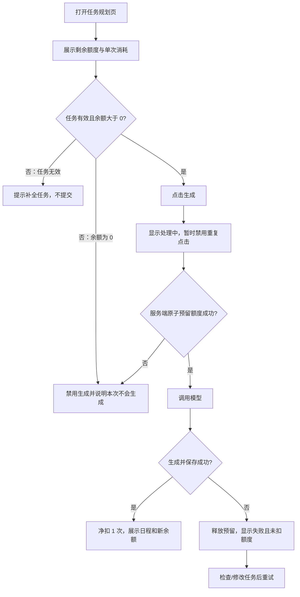

# 业务流程与交互

## 主流程



## 页面线框

```text
任务规划实验室                              剩余额度：2 次

待办事项
[任务列表、任务内容与时长设置]

[生成日程（成功后消耗 1 次）]

状态反馈区
处理中：正在生成日程，请稍候…
成功：日程已生成，剩余 1 次额度。
失败：日程生成失败，本次未扣额度。检查任务内容后重试。
额度不足：额度不足，本次未生成日程。额度补充后可继续使用。
```

## 状态与交互约定

| 状态 | 控件与反馈 | 后续动作 |
| --- | --- | --- |
| 可生成 | 显示余额及“成功后消耗 1 次” | 用户可发起生成 |
| 输入无效 | 生成按钮不可用；指出缺失/无效字段 | 修正任务 |
| 处理中 | 按钮禁用；显示处理中；不接受本页面重复点击 | 等待本次结果 |
| 成功 | 展示日程和请求完成后的最新余额 | 查看或调整日程 |
| 额度不足 | 服务端拒绝；页面说明本次未生成；不调用模型 | 等待补充；若无自助入口，联系管理员 |
| 模型明确失败 | 说明本次未扣额度；隐藏原始异常详情 | 修改任务后重试 |
| 服务异常/结果未知 | 不承诺已退款；显示可理解的错误和联系支持提示 | 查询状态后再决定是否重试，避免重复扣额 |

余额以服务端结果为准，请求完成后刷新。重复点击的前端防护不能替代多标签页、重试和并发情况下的服务端校验。若后续提供充值/申请入口，应在额度不足提示旁提供真实可用的操作，不在本次假设该入口存在。
