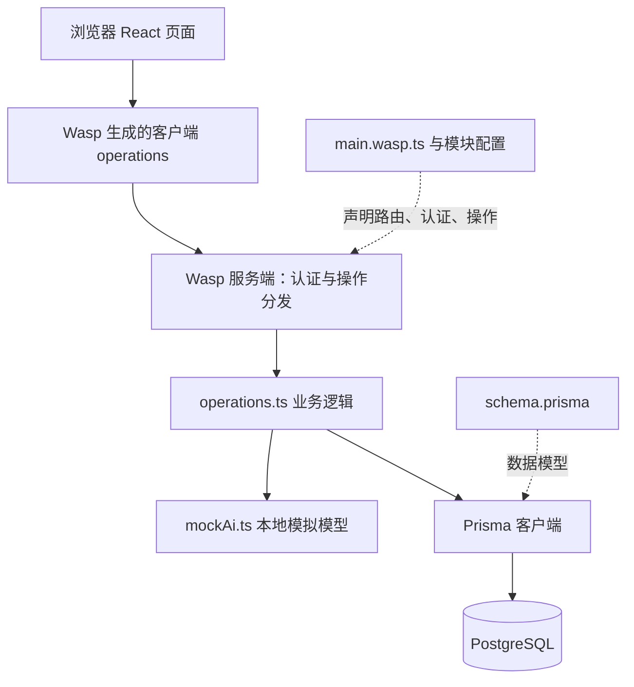

# 项目导读与运行说明

这是一个已提供登录、任务管理和本地模拟日程生成的全栈小项目。作业聚焦额度处理；业务规则、方案、任务及验收标准在 [SPEC.md](../SPEC.md) 中维护。

状态：2026-10-21 原项目已运行，浏览器基线、迁移、编译和两项 TypeScript 检查均通过。实际版本、证据与已知缺陷见 [运行记录](BASELINE_RUN.md)。设计提交已独立保留，额度功能现已实现并完成本地验证；当前结果见 [VERIFICATION](VERIFICATION.md)，重复运行见 [QUOTA_RUN](QUOTA_RUN.md)。

## 1. 环境要求与各组件作用

| 组件 | 本项目要求或声明 | 作用 |
| --- | --- | --- |
| Linux / WSL2 | Windows 按仓库说明使用 WSL2，项目放在 Linux 文件系统 | 运行 Wasp 及其开发监听。不能把 `/mnt/d/...` 当作 Linux 文件系统。 |
| Node.js | 24.14.1 或更新的兼容版本；`.nvmrc` 指向 24 | 运行前后端开发工具与服务。建议本作业保持 Node 24。 |
| Wasp CLI | 固定 0.25.0 | 根据 TS 配置生成客户端、服务端、认证和数据库客户端，并统一启动。 |
| PostgreSQL | 仓库没有锁定数据库主版本 | 保存账号、会话、额度、任务、日程。记录实际测试所用版本即可。 |
| Docker | 使用 `wasp start db` 时需要可访问的引擎 | 启动开发用 PostgreSQL。若自备数据库，可不使用此方式。 |
| React / TypeScript | React `^19.2.1`、TypeScript `^6.0.3` | 页面组件与类型检查。 |
| Prisma | 清单声明 5.19.1，结合 Wasp 生成客户端 | 数据模型、迁移、数据库读写及事务。不要照搬新版 Prisma 的不同 API。 |
| Vite / Tailwind | Vite `^8.1.0`、Tailwind `^4.1.18` | 前端开发服务、构建与样式。 |
| Zod / Vitest | Zod `^4.3.6`、Vitest `^4.1.9` | 输入校验；已有测试依赖，但当前仓库没有相应验收脚本。 |

依赖范围来自 [package.json](../package.json)，实际安装结果由锁文件及 Wasp 生成内容决定。本项目没有 `npm run dev` 脚本，使用仓库指定的 Wasp 命令。

无需 API Key、真实大模型账号或第三方模型服务。[模拟模型](../src/demo-ai-app/mockAi.ts) 在本机运行。

## 2. 首次运行顺序

### 2.1 本机正式目录和 Git

唯一正式源码已迁移到 `/home/ying/实习小作业/task-planner-interview`，通过 D 盘“实习小作业”中的“正式项目（Ubuntu）”快捷方式打开。Windows 路径为 `\\wsl.localhost\Ubuntu\home\ying\实习小作业\task-planner-interview`。

当前分支 `chore/original-baseline` 已恢复上游历史；个人 Fork 尚未连接。旧解压源码已移除，原 ZIP 仅作归档。数据库原子预占方案已实现，设计提交与后续实现提交按顺序保留；原始基线与新额度验收分别记录。

### 2.2 使用已配置的 Linux 工具

在 Windows PowerShell 用 `wsl -d Ubuntu` 进入 Ubuntu，每个新终端执行：

```sh
source /home/ying/实习小作业/env.sh
cd /home/ying/实习小作业/task-planner-interview
node --version
npm --version
wasp version
```

实际为 Node 24.14.1、npm 11.11.0、Wasp 0.25.0。工具安装在作业目录 `.tools` 内，不依赖 Windows npm，也未采用 nvm。依赖已经按原锁文件安装，无需重复安装或升级。

### 2.3 日常启动与停止

以下命令可直接在 Windows PowerShell 中使用：

```powershell
wsl -d Ubuntu -- bash /home/ying/实习小作业/start.sh
wsl -d Ubuntu -- bash /home/ying/实习小作业/status.sh
wsl -d Ubuntu -- bash /home/ying/实习小作业/stop.sh
```

`start.sh` 启动数据库及前后端，等待就绪；再次执行即可重启。`stop.sh` 停止本项目服务并保留数据。前端 `http://localhost:3000`，API 3001。前台运行方式、日志和证据见[运行记录](BASELINE_RUN.md)。

### 2.4 数据库与配置

Docker 引擎可访问，但镜像源超时/限流，因此采用 README 支持的自备 PostgreSQL。实际为 PostgreSQL 16.15，地址 `127.0.0.1:55432`，数据位于 `.environment/pgdata`。

`.env.server` 已配置连接且受 Git 忽略；不要用示例覆盖。已有初始化迁移和新增 `20261021133000_quota_reservation` 均已应用，日常重启无需迁移；以后模型变化时再执行 `wasp db migrate-dev`。

本机当前安排不使用 `wasp start db`，也不额外启动第二份项目数据库。


### 2.5 体验与检查

1. 打开 `/signup` 注册，默认额度 3；注册/登录成功后进入 `/demo-app`。
2. 添加一条普通任务，设置当天可用时长，点击“生成日程”。
3. 添加包含 `[fail]` 的任务再次生成，观察失败；删除它后恢复普通场景。
4. 用 `wasp db studio` 查看 `User`、`Task`、`PlanResult`。调成 0、1、3 进行测试时，先等待请求结束，修改后刷新页面。
5. 观察服务端 `mock-ai.started`、`mock-ai.succeeded`、`mock-ai.failed`；同一次模型调用由 `callId` 关联。

依赖准备后执行原仓库基础检查：

```sh
wasp compile
npx tsc --project tsconfig.src.json --noEmit
npx tsc --project tsconfig.wasp.json --noEmit
```

基础检查不等于额度业务验收；业务验收按 [SPEC.md](../SPEC.md) 逐项执行。`wasp db studio` 是开发工具，不是产品给用户的额度管理入口。

## 3. 原始基线功能（实现前）

| 功能 | 源码中的实际行为 |
| --- | --- |
| 注册、登录、退出 | 用户名密码认证由 Wasp 提供；受保护页面未登录时跳到 `/login`。 |
| 任务管理 | 新增、删除任务；修改完成状态和预计时长；按当前登录账号隔离数据。 |
| 当天时长 | 页面默认 8 小时，输入框标注 1～24；当前服务端只检查数值类型，范围约束待补。 |
| 日程生成 | 等约 500 毫秒，为每条任务固定生成“准备、执行、复盘”，默认优先级 medium。 |
| 时间分配 | 将当天时长平均分配到任务的三个步骤；当前模拟器没有用任务预计时长进行智能优化。 |
| 失败触发 | 任一任务描述含 `[fail]` 就抛异常，不是返回 `null`。 |
| 任务筛选 | 当前读取该账号全部任务，包含标记完成的任务；本作业不扩展此语义。 |
| 结果保存 | 成功日程以 JSON 字符串存入 `PlanResult.content`；有查询操作，但页面只展示本次本地响应，没有历史列表。 |
| 额度展示 | 页头展示来自 `useAuth()` 的 `user.credits`；本轮实测成功后会自动刷新，失败和跨标签页一致性仍需专项验证。 |
| 外观 | 支持深浅色切换、Toast、生成加载状态与本页按钮禁用。 |

这是一套确定性模拟流程；没有真实 LLM 推理、Agent 自主循环、工具选择或 RAG。作业要体现的是模型调用周边的业务控制、验证和交接能力。

本节用于理解作业初始状态；当前额度处理已改进，详见 SPEC 和 VERIFICATION。

## 4. 架构与调用链



| 入口 | 阅读重点 |
| --- | --- |
| [main.wasp.ts](../main.wasp.ts) | 项目入口、Wasp 版本、页面路由、认证和业务模块组合。 |
| [auth.wasp.ts](../src/auth/auth.wasp.ts) | 用户名密码认证，失败跳转及成功跳转。 |
| [demo-ai-app.wasp.ts](../src/demo-ai-app/demo-ai-app.wasp.ts) | action/query 声明与关联实体；新增查询时在此声明。 |
| [App.tsx](../src/client/App.tsx) | 页头、余额、退出、主题、Toast 容器和页面出口。 |
| [DemoAppPage.tsx](../src/demo-ai-app/DemoAppPage.tsx) | 任务表单、生成按钮、错误反馈和日程展示。 |
| [operations.ts](../src/demo-ai-app/operations.ts) | 认证、校验、任务查询、模型调用、结果保存与扣费。 |
| [mockAi.ts](../src/demo-ai-app/mockAi.ts) | 调用日志、延迟、确定性结果、明确失败。 |
| [schedule.ts](../src/demo-ai-app/schedule.ts) | 日程结构、类型与 Zod schema。 |
| [validation.ts](../src/server/validation.ts) | 参数解析失败映射为 400。 |
| [schema.prisma](../schema.prisma) | 用户、任务、日程结果模型。 |
| [migrations](../migrations) | 数据表与 Wasp 认证相关表的初始化。 |

`wasp/client/*`、`wasp/server/*`、`wasp/entities` 是 Wasp 生成的接口，不是漏下载的源码。`.wasp/` 是生成目录，应修改源配置后重新生成；不要直接编辑生成文件或把它们提交。

当前额度增加 `GenerationAttempt` 状态表及可空唯一的结果关联。生成入口依次执行预占短事务、模型调用、确认或释放短事务；不依赖进程队列。

原始核心数据关系：`User` 一对多 `Task`，`User` 一对多 `PlanResult`。`User.credits` 默认 3；`Task` 有描述、预计时长字符串和完成状态；`PlanResult` 保存日程 JSON 与时间。登录所需的 `Auth`、`AuthIdentity`、`Session` 由 Wasp 认证机制管理，初始迁移中可看到这些表。

原始生成链路：

```text
点击生成 → generatePlan({ hours }) → 登录/参数检查 → 读取任务
→ 调用模型 → 检查 context.user.credits → 事务保存结果并扣减 → 页面展示
```

原始问题（本轮已修复）：额度检查顺序太晚；余额可能过期；扣减缺少当前余额条件；模型抛错未被映射为明确的业务失败。现有事务保证其内部保存与扣减的原子性，但没有覆盖模型调用前的并发准入。

## 5. 下一步与资料

本地 D1～D6 已完成，AC01～AC23 的实际结果见 VERIFICATION，所有验证入口和必要运行说明见 QUOTA_RUN。独立审查补强已完成；身份和北京时间2026-10-23 17:38截止已确认。个人Fork及分支推送已完成，已提交 [PR #3](https://github.com/bybzhwbzhh88/task-planner-interview/pull/3)，当前状态见SUBMISSION。新增AC24的实际结果见VERIFICATION第5节。

- [仓库 README](../README.md)、[作业要求](../TASK.md)、[提交模板](../SUBMISSION.md)。
- [Wasp 0.25 安装与 WSL 说明](https://wasp.sh/docs/0.25/quick-start)：包括 Node 要求及 Linux 文件系统要求；CLI 使用本仓库固定版本。
- [Wasp 0.25 数据库说明](https://wasp.sh/docs/data-model/databases)：访问时核对页面版本；开发数据库、自备数据库的两种方式。

新版本文档可能改变 API；开发以仓库版本、实际生成类型和对应版本资料为准，不做无关升级。
