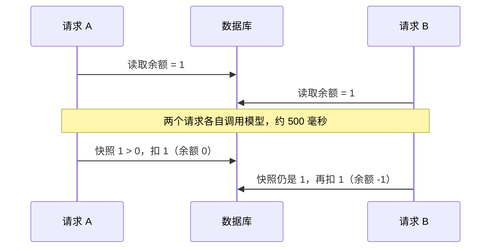
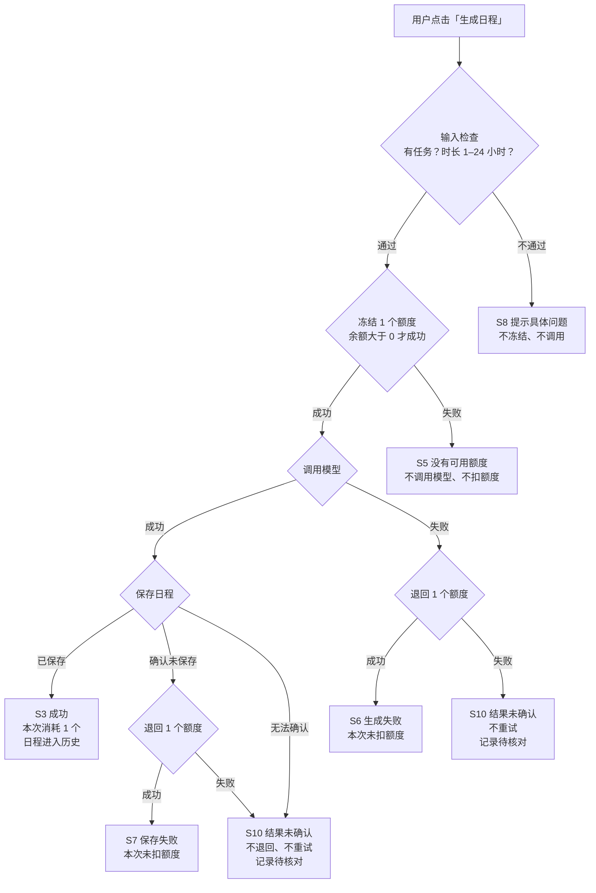
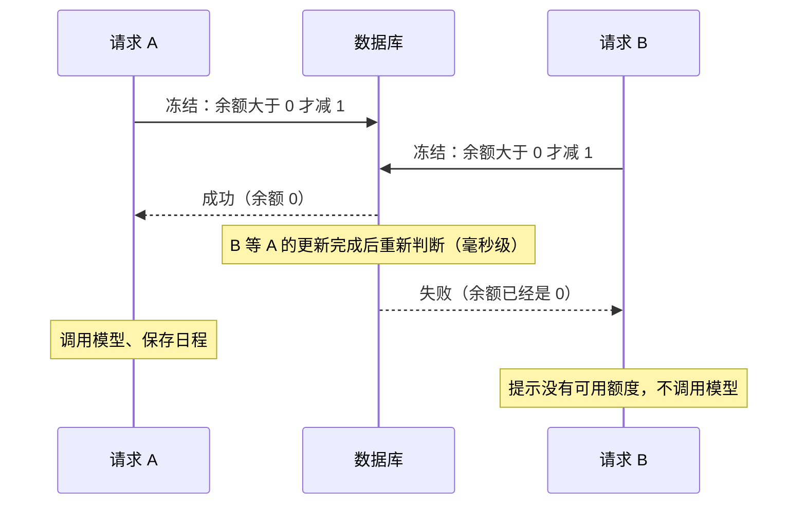

# 额度处理改进方案

产品方向交付。文档索引：方案（本文）｜[原型](02-prototype/README.md)｜[任务拆解](03-tasks.md)｜[验收案例](04-acceptance.md)

## 结论

**问题判断**：现在生成日程是先调模型、后查额度，而且查的是请求刚进来时读到的余额。所以额度为 0 也会调用模型，同一账号的并发请求还能把余额扣成负数。用户这边也有缺口：模型失败时只看到英文技术报错，额度不足的提示没有下一步，生成过的日程刷新页面后就找不回了。

**方案**：额度改为"先冻结、后结算"。调用模型前先冻结 1 个额度：余额大于 0 才能冻结成功，判断和扣减由数据库一步完成。日程保存成功，这 1 个额度就算正式消耗；模型失败或确认没有保存时，退回这 1 个额度；退回失败或无法确认结果时，不自动退回，如实告诉用户，并留下记录供人工核对。每种结果都告诉用户发生了什么、扣没扣额度、接下来能做什么。

**完成状态**：需求方案、流程、原型、任务拆解、验收案例已完成。按产品方向要求，没有改代码。现状问题来自代码阅读；当前代码在各验收案例下的表现见[基线对照](04-acceptance.md#基线对照)，目前都是代码推断，没有实际运行。

## 术语

| 术语 | 含义 |
|---|---|
| 可用额度 | 余额 `User.credits`。冻结中的额度已经从中减掉，所以它就是此刻还能用的数量 |
| 冻结 | 调用模型前，直接从余额里减 1，不单独记录"冻结中"的额度 |
| 成功 | 日程已保存，用户随时能在历史日程里找回。这时不需要再写任何数据，冻结时减掉的 1 就是这次的消耗 |
| 退回 | 模型失败，或确认日程没有保存时，把减掉的 1 加回余额。每个请求最多退回一次 |
| 结果未确认 | 退回失败、无法确认日程是否已保存，或出现其他意外错误。不自动退回、不自动重试，记录下来供人工核对 |

冻结期间，其他页面看到的可用额度也会少 1。

## 现状问题

| # | 问题 | 原因 | 违反规则 |
|---|---|---|---|
| 1 | 额度为 0 仍调用模型；任务正常时，结果丢弃后才返回额度不足 | `generatePlan` 先[调用模型](../../src/demo-ai-app/operations.ts#L49)，后[检查额度](../../src/demo-ai-app/operations.ts#L67) | R2 |
| 2 | 并发请求可以透支，余额变成负数 | 检查用的是请求进入时的余额快照 `context.user.credits`；扣减不带"余额大于 0"的条件 | R4 |
| 3 | 模型失败时提示是英文技术报错 | 模拟接口抛出普通错误，没有转成面向用户的错误，前端只能显示通用的 500 信息 | R5 |
| 4 | 额度不足的提示没有下一步 | [文案](../../src/demo-ai-app/DemoAppPage.tsx#L101)只写了"请检查账号状态" | R5 |
| 5 | 生成过的日程在页面上找不回 | 日程已存进数据库，但页面只把它放在内存里，刷新就没了；查询 `getPlanResults` 写好了没人调用 | R5 |

问题 2 的过程（余额为 1，两个请求同时到达）：

## 目标规则

| 规则 | 本方案的定义 | 怎么观察 |
|---|---|---|
| R1 成功一次扣 1 | "成功"指日程已保存，用户能在历史日程里找回 | 余额减 1，历史日程加 1 |
| R2 额度不足不调用 | 冻结失败就结束，不发起调用 | 没有 `mock-ai.started` 日志 |
| R3 模型失败不扣 | 冻结的额度退回；退回本身失败时进入"结果未确认"，留待人工核对 | 请求结束后余额与请求前相同（S10 除外） |
| R4 并发不透支 | 只有冻结成功的请求能调用模型 | 余额始终不小于 0 |
| R5 看得懂结果、知道下一步 | 每种结果都有固定文案，文案只说系统能保证的事 | 对照[界面状态与文案](#界面状态与文案)逐条检查 |

## 范围与假设

本次范围：生成日程时的额度判断，冻结、消耗、退回，结果无法确认时的告知，结果提示，额度展示，历史日程，生成前的输入检查。

不在范围（题目给定）：支付与充值、订阅、跨账号防刷、按 Token 计价、服务崩溃后的自动补偿、跨请求复用结果。

假设：

- 单服务、单数据库（题目给定）。
- 一条 `mock-ai.started` 日志代表一次计费调用（题目给定）。
- 模拟调用约 0.5 秒。真实模型可能要几十秒，冻结机制的正确性不依赖调用时长。
- "联系管理员"的渠道和"结果未确认"的核对负责人都还没定，见[待确认](#待确认)。

## 关键决策

| # | 决策 | 理由 | 代价或局限 |
|---|---|---|---|
| D1 | 先冻结、后结算：调用前冻结 1 个额度，成功后正式消耗，失败退回 | 同时满足 R2 和 R4，又不用在模型调用期间一直锁着数据；备选方案见[下一节](#为什么选先冻结) | 冻结后服务崩溃，这 1 个额度会丢失（题目不要求补偿，列入[待办](#待办)） |
| D2 | 确认日程没有保存时，退回额度 | 用户没拿到结果就不付费；扣费和历史日程一一对应，不留半截状态 | 这次模型调用的成本由平台承担；无法确认是否保存时按 D9 处理 |
| D3 | 额度不够时，多出来的并发请求立即拒绝，不排队 | 用户马上知道结果；不占用数据库连接 | 被拒之后，额度可能因为别的请求失败又退回来，用户刷新额度即可看到 |
| D4 | 不记录进行中的生成数量；可用额度为 0 时统一提示"当前没有可用额度"，并说明可能有生成正在进行 | 实现最简单；不论 0 是因为用完了还是被临时冻结，这句提示都是真话 | 没法告诉用户具体是哪一种（列入[待办](#待办)） |
| D5 | 额度用完后，如实说明当前版本不支持充值，只给用户真正能做的事：刷新额度；有历史日程时查看历史；渠道确定后联系管理员申请额度 | 支付不在范围内；不承诺用户做不到的事 | 渠道确定前，没有申请额度的入口 |
| D6 | 失败提示面向用户，不显示技术报错；只有退回成功后才说"本次未扣除额度" | R5：提示必须是真话 | 无 |
| D7 | 输入检查放在冻结之前：必须有任务，时长 1–24 小时 | 不合法的请求不冻结、不调用 | 无 |
| D8 | 可用额度为 0 时，生成按钮置灰并说明原因，提供"刷新额度"入口 | 点击之前就让用户知道；页面上的额度可能过期，用户可以主动刷新 | 最终以服务端判断为准 |
| D9 | 结果无法确认时（退回失败、无法确认是否保存、出现其他意外错误、页面没收到响应），不自动退回、不自动重试，如实告诉用户，并记录供人工核对 | 盲目退回或重试，可能重复退回或重复扣费 | 用户可能要等人工核对后才拿回额度；核对负责人待确认 |

参考：Wasp 官方 Open SaaS 模板在 [PR #738](https://github.com/wasp-lang/open-saas/pull/738) 中用了同样的思路：调用模型前先扣 1 个额度，失败再加回来。本项目的基线代码与该 PR 修复前的版本基本一致。本方案在此基础上补齐成功的定义、结果无法确认时的处理、失败提示、历史日程、检查顺序和验收案例。

## 为什么选先冻结

防止透支的四种做法：

| 做法 | 结论 | 原因 |
|---|---|---|
| 先调用模型，成功后再按条件扣减 | 不选 | 不会透支，但额度 1 时并发 3 个请求仍会调用 3 次模型，违反 R2 |
| 调用期间锁住用户这一行 | 不选 | 结果正确，但模型调用要几秒到几十秒，锁和数据库连接一直被占着 |
| 在服务进程内按用户加锁 | 不选 | "单服务"不等于只有一个进程，进程一多就失效，最终仍要以数据库余额为准 |
| 先冻结、后结算 | 采用 | 一条数据库更新就决定能否调用，调用期间不持锁 |

还有一类做法是"同一账号同一时间只允许一次生成"。它限制的是并发数量，不是防透支的机制：额度 3 时并发 3 个请求会错误地拒掉 2 个，与题目"不同请求可以代表不同任务"冲突，所以也不采用。

## 哪一步防止透支

关键在冻结这一步。它是一次"余额大于 0 才减 1"的数据库更新，判断和扣减在同一条更新里完成。两个请求同时争最后 1 个额度时，后到的请求要等前一个更新完成，再重新判断余额。这个等待是毫秒级的，不是排队等生成结束（D3）。这时余额已经是 0，后到的请求冻结失败，也就不会调用模型。

"先读余额、再扣"的写法挡不住并发：两个请求可能都读到 1，然后各扣 1。即使把读和扣放进同一个事务，在 PostgreSQL 的默认设置下，没有显式加锁的话也一样会出问题。

对应验收案例：AC-08、AC-09、AC-10。

## 主流程

页面没收到响应（网络中断、超时）时，不论服务端结果如何，都显示 S10。冻结这一步本身出错等其他意外错误，也按 S10 处理。

改进后的并发过程（余额为 1）：

## 界面状态与文案

弹出提示和页面上的提示框都分标题和正文，其余文案直接显示在页面上。弹出提示 5 秒后自动消失，同一时间只显示一条，所以需要用户回头查看的说明（S4、S10）放在常驻的提示框里。页头显示"可用额度：N"，每次生成结束后、切回页面时都会自动刷新。

| 状态 | 出现时机 | 界面表现 | 文案 | 用户下一步 |
|---|---|---|---|---|
| S1 可生成 | 可用额度至少 1，有任务，时长合法 | 按钮可点，按钮下方一行说明 | 本次将消耗 1 个额度，生成失败不扣除。当前可用 N 个。 | 点击生成 |
| S2 生成中 | 点击后到结果返回前 | 按钮显示加载，不能再点 | 生成中… | 等待 |
| S3 成功 | 日程已保存 | 展示日程，弹出提示，页头额度自动刷新 | 标题：日程已生成 正文：本次消耗 1 个额度，日程已存入历史。 | 查看日程，之后也能在历史日程里找回 |
| S4 没有可用额度 | 页面上的可用额度为 0：打开或刷新页面、切回页面、一次请求结束后 | 按钮置灰；按钮下方显示说明和操作 | 标题：当前没有可用额度 正文：暂时不能生成新日程，当前版本不支持充值。如果其他页面正在生成，结束后额度可能恢复。有历史日程时加一句：已生成的日程可以在下方查看。 操作：刷新额度；查看历史日程（有历史时才显示） | 刷新额度；查看历史日程 |
| S5 被拒 | 点击后冻结失败，说明页面上的额度已经过期 | 弹出提示；页面随后自动重新查询额度 | 标题：当前没有可用额度 正文：本次未生成，也未扣除额度。 | 按页面刷新后的状态操作，通常是 S4 |
| S6 生成失败 | 模型返回失败，且退回成功 | 弹出错误提示 | 标题：生成失败 正文：本次未扣除额度，可以直接重试；如果多次失败，请检查待办事项内容。 | 重试；检查任务 |
| S7 保存失败 | 确认日程没有保存，且退回成功 | 弹出错误提示 | 标题：日程未能保存 正文：本次未扣除额度，请重试。 | 重试 |
| S8 输入不合法 | 没有任务，或时长不在 1–24 小时 | 不发请求，在对应位置提示 | 请先添加待办事项 ／ 可用时长需在 1–24 小时之间 | 修改输入 |
| S9 历史日程 | 一直显示在生成按钮下方 | 按时间倒序，每项显示生成时间和任务数。加载中显示"正在加载历史日程…"；没有记录时显示"还没有生成过日程"；加载失败时显示"历史日程加载失败"和"重试" | 历史日程（共 N 份） | 展开查看 |
| S10 结果未确认 | 退回失败；无法确认日程是否保存；出现其他意外错误；页面没收到响应 | 按钮下方显示常驻提示框，用户关闭或刷新页面之前不会消失；不自动重试 | 标题：暂时无法确认本次结果 正文：额度可能已扣除。请稍后刷新页面，查看历史日程和可用额度：历史里有这份日程，就是已生成成功。重新生成会算作一次新的请求。 | 稍后刷新，在历史日程里确认结果 |

两处文案等待确认后再补：联系管理员的渠道确定后，S4 加上联系管理员的入口；核对负责人确定后，S10 的正文加上"如果没有，额度会在核对后退回"。

S1 说的"生成失败不扣除"，在退回失败时要靠人工核对才能兑现（见 S10 和待确认第 4 项）。

界面效果见[原型](02-prototype/README.md)。

## 边界情况

| 情况 | 处理 |
|---|---|
| 多个标签页或设备同时使用 | 页面上的可用额度可能过期，以服务端冻结结果为准；被拒时显示 S5，页面随即重新查询额度 |
| 另一处正在生成时打开或切回本页 | 冻结的额度已经减掉，可用额度可能显示为 0，按 S4 展示；那次生成失败退回后，点"刷新额度"或切回页面即可看到恢复的额度 |
| 快速连点 | 生成中按钮不可点，避免误点造成第二次扣费。如果重复请求仍到达服务端，按两次独立的生成处理（题目设定不同请求可以代表不同任务）；额度不够时，多出的请求按 D3 拒绝 |
| 生成中刷新或关闭页面 | 服务端照常完成：成功就扣额度并保存，刷新后能在历史日程里看到 |
| 生成中断网或超时 | 显示 S10；恢复后刷新页面，在历史日程里确认结果 |
| 退回失败 | 显示 S10；记录用户、请求和失败原因，供人工核对；不自动重试退回，避免重复加回 |
| 旧逻辑留下的负余额 | 上线前查一遍，负余额按 0 处理并人工核对 |
| 已勾选完成的任务 | 维持现状，仍参与生成，见[待确认](#待确认) |

## 待确认

1. "联系管理员"的渠道：邮箱、表单还是客服入口。确定前，S4 不显示联系管理员的入口；只影响这一个入口，T5 的其他部分不受影响。
2. 已完成的任务是否还应参与日程生成。
3. 历史日程保留多少份、是否允许删除。本轮默认保留全部记录，不提供删除。
4. "结果未确认"的记录由谁核对、多久核对一次。确定前，S10 不承诺"核对后退回"。

## 待办

本次不做，留给后续：

- 冻结后服务崩溃导致的额度丢失：记录每次冻结，超时未结算的自动退回。
- 区分"额度已用完"和"有生成正在进行"（D4 的局限）：需要记录进行中的冻结数量。
- 模型调用超时：真实模型可能长时间不返回，冻结会一直挂着；需要设置超时，超时按失败处理。
- 同一账号连续失败的次数上限：失败不扣用户额度，但每次调用平台都要付费。
