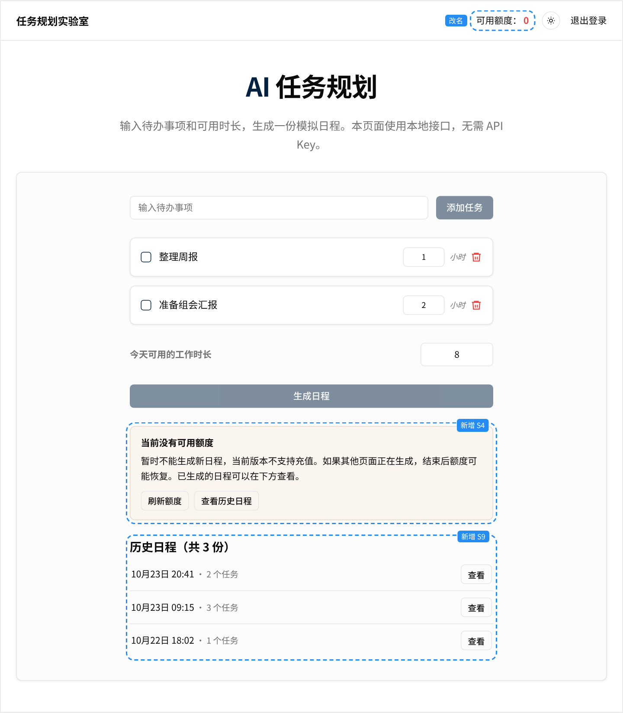
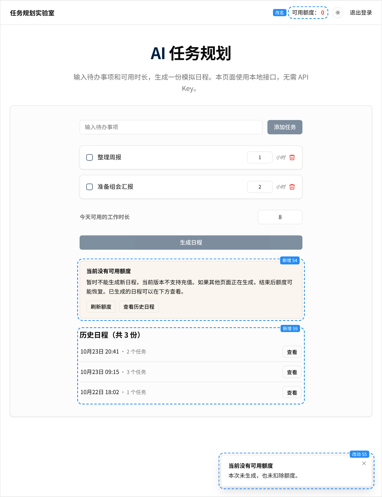
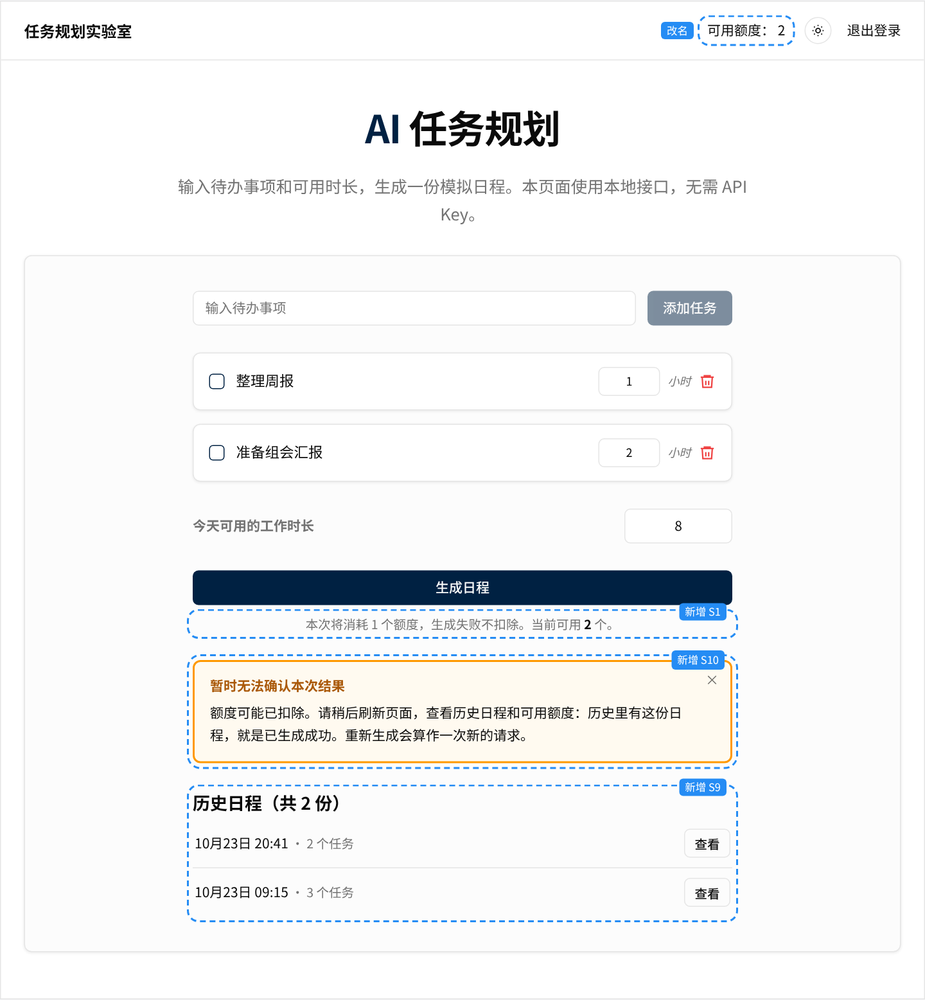

# 界面原型

静态原型，只用来示意各状态的界面和文案。文案（包括弹出提示的标题和正文）以[方案](../01-solution.md#界面状态与文案)为准。

- 交互版：用浏览器打开 [index.html](index.html)，顶部按钮切换各个状态。
- 截图中的蓝色虚线框是相对现有界面新增或改动的部分，标签注明对应的状态。
- 联系管理员的入口要等渠道确定后才加入，所以原型里没有画（见方案的[待确认](../01-solution.md#待确认)）。

| 状态 | 截图 | 要点 |
|---|---|---|
| S1 可生成 | [S1.png](screenshots/S1.png) | 按钮下方说明本次消耗和当前可用额度；页头改称"可用额度" |
| S2 生成中 | [S2.png](screenshots/S2.png) | 按钮加载中、不可点，防止重复提交 |
| S3 成功 | [S3.png](screenshots/S3.png) | 展示日程；提示本次消耗 1 个、日程已存入历史 |
| S4 没有可用额度 | [S4.png](screenshots/S4.png) | 按钮置灰；不断言"已用完"；提供"刷新额度"和"查看历史日程" |
| S4 没有可用额度（无历史） | [S4b.png](screenshots/S4b.png) | 没有历史时，不提历史，也不显示"查看历史日程"；历史区显示空状态 |
| S5 被拒 | [S5.png](screenshots/S5.png) | 简短说明未生成、未扣额度；页面随后刷新为 S4，两处标题一致 |
| S6 生成失败 | [S6.png](screenshots/S6.png) | 退回成功后才说未扣额度；多次失败时提示检查任务内容 |
| S7 保存失败 | [S7.png](screenshots/S7.png) | 确认没有保存、退回成功后才显示 |
| S8 输入不合法 | [S8.png](screenshots/S8.png) | 时长超出 1–24 小时，就地提示，不发请求 |
| S9 历史日程 | [S9.png](screenshots/S9.png) | 刷新后仍能找回已生成的日程 |
| S9 历史加载失败 | [S9b.png](screenshots/S9b.png) | 历史区显示失败和"重试"，不影响生成 |
| S10 结果未确认 | [S10.png](screenshots/S10.png) | 常驻提示框，不会像弹出提示那样 5 秒后消失；不承诺未扣额度，引导用户去历史日程里确认结果 |

## 关键状态

S4 没有可用额度：

S5 被拒：

S10 结果未确认：

