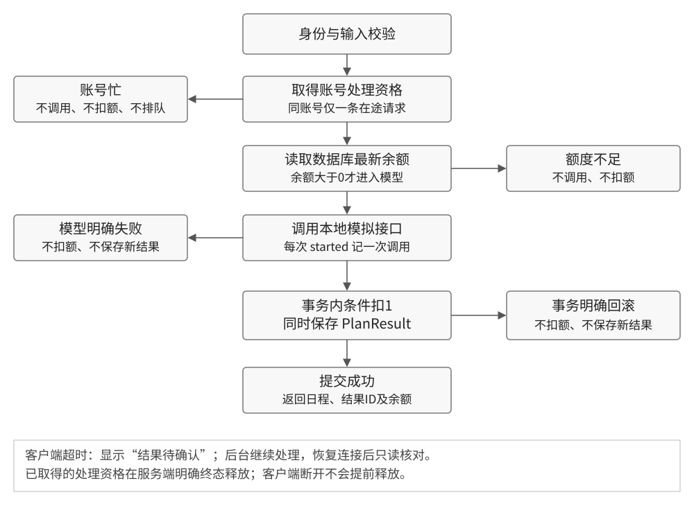

# 生成流程与界面说明

颜文慧 · 产品方向 · 2026-10-25 · v1.0

将额度检查放在模型前，并在同账号范围内限制在途请求。页面同时说明本次结果、额度变化和下一步。以下为目标设计；原版截图用于说明问题，不代表设计已经实现。

## 1. 服务端主流程



已取得的处理资格覆盖最新余额读取、模型调用和事务提交全过程。账号忙不排队，余额不足不调用；提交成功后返回结果及最新余额。客户端关闭、超时或断网不会提前释放后台资格。

准入读取异常、模型明确失败、事务明确回滚等路径均须释放已取得的资格。若服务端自身无法确认事务提交结果，不承诺未扣除；记录异常并交人工排查。本轮不设计崩溃后的自动补偿。

## 2. 余额1的双标签请求

| 时点 | 账号内先取得资格的请求 | 另一请求 | 约束 |
| --- | --- | --- | --- |
| 开始 | 读最新余额1，调用模型 | 同账号正在处理时到达 | 另一请求返回409忙，不调用 |
| 完成 | 保存1份结果、扣1、释放资格 | 等待或主动刷新 | 最终余额0，结果增量1 |
| 再次提交 | 已结束 | 用户主动再次提交 | 读余额0后返回402，不调用 |

如果第二条到达服务端时第一条已结束，应按最新余额处理，不能强制要求409。客户端请求区间重叠只是并发证据之一；需结合模型事件先后顺序确认是否同时进入调用。

## 3. 页面状态与操作

| 状态 | 页面信息 | 用户操作与系统行为 |
| --- | --- | --- |
| 空任务 | 请先添加待办事项 | 添加可用，生成禁用 |
| 可生成 | 剩余额度X；每成功生成一次消耗1额度，明确失败不扣除 | 点击生成进入处理中 |
| 生成中 | 正在生成，请稍候 | 当前页生成禁用；不提前扣减显示余额 |
| 成功 | 日程已生成。本次消耗1额度，剩余X | 显示本次日程；有额度时可主动再次生成 |
| 额度不足 | 额度已用完，当前无法生成新日程 | 禁用生成；仍可编辑任务、查看最近已保存日程；无充值入口 |
| 明确模型失败 | 本次生成失败，未扣除额度。请稍后重试 | 保留输入；可主动重试；旧结果标为上次成功日程 |
| 账号忙 | 该账号有一份日程正在生成，请等待完成后再试 | 不排队、不自动重试；回到页面时刷新余额 |
| 结果待确认 | 暂未确认生成结果，请恢复连接后刷新核对 | “刷新并核对”只查询余额与最近结果；不调用生成接口，不承诺未扣额 |
| 保存明确回滚 | 日程保存失败，本次未扣除额度，请重试 | 保留输入；用户主动重试 |

结果回执放在生成按钮下方，页面保留可回看的状态文字，不能只依赖短暂提示框。只有明确失败或确认回滚才显示“未扣除额度”。

## 4. 页面布局与结果核对

```text
任务规划实验室                              剩余额度：2
每成功生成一次消耗1额度；明确失败不扣除
待办输入与列表 / 任务时长 / 总可用时长
[生成日程]   本次状态：生成失败，未扣除额度。 [重试]
上次成功的日程 · 生成时间
[最近已保存日程]  [刷新并核对]
```

最近结果显示生成时间和内容，以`PlanResult.createdAt`降序取当前账号最新一条；同时间以ID作稳定次序。无结果时显示“暂无已保存日程”；读取失败时保留待确认状态，允许重新查询。查询不消耗额度。

余额与最近结果是分别读取的数据：若有其他标签页持续生成，暂时不一致时再次刷新，不能把二者当成某次请求的完整回执。有请求ID关联前，不使用“已找回本次结果”的文案。

## 5. 数据与回执约定

| 页面/行为 | 现有来源 | 本轮调整 |
| --- | --- | --- |
| 余额 | `User.credits` | 成功后用回执更新；页面回焦、核对时重查；服务端不信任前端缓存 |
| 日程 | `PlanResult.content`，JSON字符串 | 标明本次或最近已保存；由服务端按当前用户查询 |
| 成功回执 | 当前只返回日程 | 拟增加`planResultId`、`remainingCredits`；保持原日程可解析 |
| 错误回执 | 当前402消息或通用500 | 拟用稳定业务码区分无额度、账号忙、模型失败、保存失败 |

回执字段和错误码为拟新增，由D01确认后回填；前端使用业务码，不解析英文堆栈判断是否扣额。
