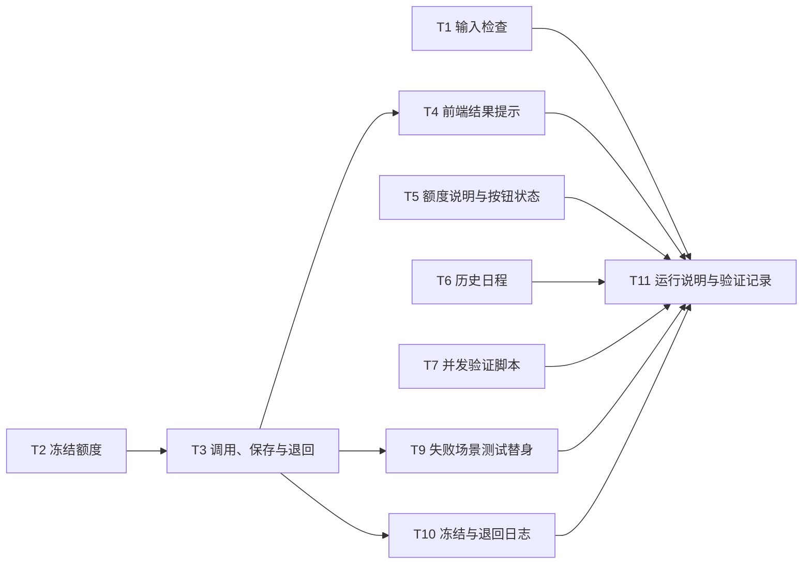

# 开发任务拆解

依据[方案](01-solution.md)拆解，完成标准是[验收案例](04-acceptance.md)。

## 实现约束

开发者和 AI 都按这几条执行：

- 完成标准是 04 的验收案例；界面文案以 01 的[界面状态与文案](01-solution.md#界面状态与文案)为准。
- 不改 `src/demo-ai-app/mockAi.ts`。它代表外部模型，`mock-ai.started` 的条数是验收依据。
- "冻结"就是直接从 `User.credits` 减 1，不新增"冻结中"之类的字段；成功后不用再写，失败时加回 1。见 01 的[术语](01-solution.md#术语)。
- 额度判断不能使用 `context.user.credits`，那是请求进入时的快照。"判断 + 扣减"必须在数据库里一步完成。
- 调用模型期间不持有数据库事务或锁。
- 只在模型失败或确认未保存时退回，每个请求最多一次；退回失败或无法确认是否保存时，不退回、不重试（D9）。
- 保存出错时这样区分：数据库明确拒绝写入（校验或约束错误）算确认未保存；连接中断、超时等算无法确认。
- 可参考 Open SaaS [PR #738](https://github.com/wasp-lang/open-saas/pull/738) 的写法；本项目另需补齐接口约定、结果无法确认时的处理、输入检查顺序、错误提示和历史日程。

## 接口约定

生成接口按下表返回。页面根据错误类型选择文案，不直接显示服务端的报错信息。

| 情况 | HTTP 状态 | 错误类型 | 页面文案 |
|---|---|---|---|
| 成功 | 200 | 无；只返回日程，不返回余额（余额由页头的查询负责） | S3 |
| 输入不合法 | 400 | `INVALID_INPUT` | S8 |
| 没有可用额度 | 402 | `NO_CREDITS` | S5 |
| 模型失败，已退回 | 502 | `MODEL_FAILED` | S6 |
| 确认未保存，已退回 | 500 | `SAVE_FAILED` | S7 |
| 退回失败，或无法确认是否保存 | 500 | `RESULT_UNCONFIRMED` | S10 |
| 其他意外错误（包括冻结这一步出错） | 500 | `RESULT_UNCONFIRMED` | S10 |

页面没收到响应（网络中断、超时），或收到表里没有的错误类型时，同样显示 S10。

## 任务

| ID | 任务 | 要点 | 依赖 | 估时 | 优先级 | 验收 |
|---|---|---|---|---|---|---|
| T1 | 输入检查前置 | 冻结之前检查：至少 1 条任务，时长在 1–24 小时之间；不通过返回 400 / `INVALID_INPUT`，不冻结、不调用 | 无 | 0.5h | P0 | AC-12、AC-13 |
| T2 | 冻结额度 | 一条"余额大于 0 才减 1"的条件更新，按受影响的行数判断成败；失败返回 402 / `NO_CREDITS` | 无 | 1h | P0 | AC-01、AC-03、AC-08、AC-09 |
| T3 | 调用、保存与退回 | 冻结成功后调用模型、保存日程。模型失败或确认未保存时退回 1 个额度，返回 `MODEL_FAILED` 或 `SAVE_FAILED`；退回失败、无法确认是否保存或出现其他意外错误时，不退回、不重试，返回 `RESULT_UNCONFIRMED`；成功只返回日程；技术报错只写日志 | T2 | 2h | P0 | AC-01、AC-05、AC-06、AC-07、AC-10、AC-14、AC-15 |
| T4 | 前端结果提示 | 按错误类型显示 S5、S6、S7、S10；没收到响应或收到未知错误类型时显示 S10，不自动重试；S10 用常驻提示框，不用会自动消失的弹出提示；成功时显示 S3 | T2、T3 | 1.5h | P0 | AC-01、AC-04、AC-05、AC-06、AC-07、AC-14、AC-15 |
| T5 | 额度说明与按钮状态 | 页头改称"可用额度"；按钮下方显示 S1；可用额度为 0 时按钮置灰并显示 S4：带"刷新额度"，有历史时才提历史，渠道确定前不显示联系管理员的入口；生成中禁用（S2）；输入不合法时就地提示 S8 | 无 | 1.5h | P0 | AC-01、AC-02、AC-11、AC-12、AC-13、AC-17 |
| T6 | 历史日程 | 使用已有查询 `getPlanResults`，补上按时间倒序；每项显示生成时间和任务数；做好加载中、没有记录、加载失败三种状态（S9）；刷新后仍可见 | 无 | 2h | P0 | AC-02、AC-16、AC-18 |
| T7 | 并发验证脚本 | 按 04 的[并发验证要求](04-acceptance.md#并发验证要求)实现，可重复执行，输出逐项比对结果；AC-10 的先后判断用 T10 的日志 | 无 | 2h | P0 | AC-08、AC-09、AC-10 |
| T8 | 数据库兜底约束 | 迁移中加入"余额不小于 0"的约束，防止其他代码路径写出负数（生成路径已由 T2 保证）；上线前检查并处理已有的负余额 | 无 | 0.5h | P1 | 自带检查：直接把余额写成 -1 会被数据库拒绝 |
| T9 | 失败场景测试替身 | 在测试里用假的结果替换保存和退回两步，制造三种情况：保存被数据库明确拒绝、保存写入后报连接错误、退回失败；不在正式代码里留故障开关 | T3 | 1h | P0 | AC-07、AC-14 |
| T10 | 冻结与退回日志 | 每次冻结尝试（记录开始时间和结果）、每次退回（成功或失败）、每次结果未确认，各记一条结构化日志，带用户和请求标识；既供验收判断先后，也供人工核对 | T2、T3 | 0.5h | P0 | AC-10、AC-12、AC-13、AC-14 |
| T11 | 运行说明与验证记录 | README 补充并发脚本和测试的运行方式；在 04 中逐条填写实测结果 | T1–T7、T9、T10 | 1h | P0 | 全部 |

估时合计：P0 共 13 小时，P1 共 0.5 小时。按熟悉本项目、环境已经搭好的开发者估算，不含安装 Node、Wasp、PostgreSQL 的时间。项目装了 vitest，但还没有任何测试和登录辅助脚本，T7、T9 的估时包含搭建这些。

## 依赖关系

T8 不依赖其他任务，随时可做。T7 可以最先写；AC-10 的先后判断要用 T10 的日志，T10 完成后再补上。

## 建议顺序

| 阶段 | 任务 | 完成标志 |
|---|---|---|
| M0 先写验证 | T7 | 在当前代码上跑出 AC-08 至 AC-10 的失败结果，与 04 的基线对照一致，确认问题可以复现 |
| M1 后端规则 | T1、T2、T3、T9、T10 | T7 跑 AC-08 至 AC-10 连续 3 次通过；AC-03，以及 AC-05、AC-06、AC-07、AC-12、AC-13、AC-14、AC-15 的接口层部分通过 |
| M2 界面 | T4、T5、T6 | AC-01、AC-02、AC-04、AC-11、AC-16、AC-17、AC-18，以及 AC-05、AC-06、AC-07、AC-12、AC-13、AC-14、AC-15 的页面部分通过 |
| M3 收尾 | T11 | 04 中每条案例都有实测结果 |
| M4 加固 | T8 | 兜底约束生效 |

先写 T7 有两个好处：改代码前就能看到问题，改完后同一个脚本就是回归测试。
