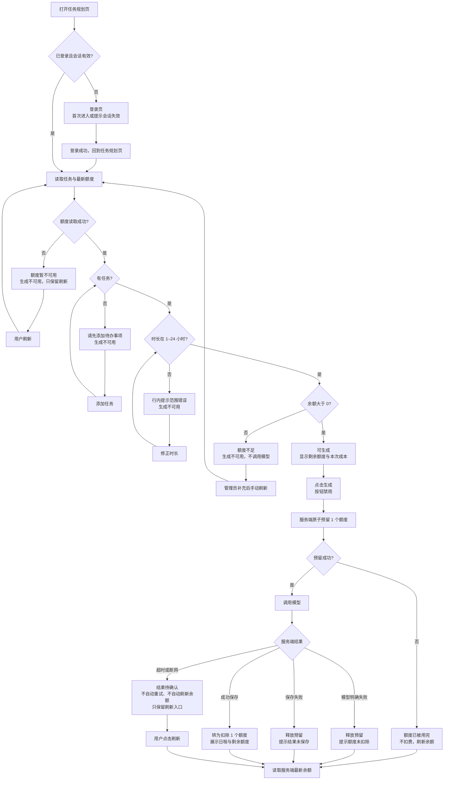

# 额度处理用户流程

> 仓库原先没有流程图或流程文档。第 0 节是依据当前代码行为重建的现状，不是项目方提供的原始流程；后续各节是本次方案的目标流程。可视线框见 [PROTOTYPE.html](PROTOTYPE.html)，验收见 [ACCEPTANCE.md](ACCEPTANCE.md)。

## 0. 现有流程及代码依据

以下步骤由代码行为还原，逐行附代码位置。若代码变化，应先复核本节，再更新目标流程和原型。

| 步骤 | 当前实际行为 | 代码依据 |
| --- | --- | --- |
| 1 | 页面只根据“是否正在生成”和“是否有任务”控制按钮，不读取、不显示额度 | [DemoAppPage.tsx](../../src/demo-ai-app/DemoAppPage.tsx#L188-L205) |
| 2 | 点击生成后直接提交 `hours` 并进入生成中状态 | [DemoAppPage.tsx](../../src/demo-ai-app/DemoAppPage.tsx#L81-L89) |
| 3 | 服务端校验登录、参数，并读取当前用户任务 | [operations.ts](../../src/demo-ai-app/operations.ts#L29-L46) |
| 4 | 在检查额度之前调用模拟模型 | [operations.ts](../../src/demo-ai-app/operations.ts#L48-L49) |
| 5 | 模拟接口先记录 `mock-ai.started`，等待 500 ms；任务包含 `[fail]` 时抛错 | [mockAi.ts](../../src/demo-ai-app/mockAi.ts#L10-L16) |
| 6 | 模型返回后，才根据登录上下文中的 `context.user.credits` 判断是否扣费 | [operations.ts](../../src/demo-ai-app/operations.ts#L57-L74) |
| 7 | 额度大于 0 时扣 1 并保存日程；否则返回 402 | [operations.ts](../../src/demo-ai-app/operations.ts#L67-L77) |
| 8 | 页面收到 402 后提示“请检查账号状态”；其他错误显示通用 `Error` | [DemoAppPage.tsx](../../src/demo-ai-app/DemoAppPage.tsx#L90-L110) |

### 现状与目标差异

| 维度 | 现状 | 目标 |
| --- | --- | --- |
| 余额可见性 | 页面不显示余额 | 首屏显示剩余次数；确定结果后自动刷新，结果待确认时手动刷新 |
| 额度不足 | 模型调用完成后才判断 | 调用前阻断，不产生模型调用 |
| 失败反馈 | 通用错误，未说明是否扣费 | 明确额度处理结果，保留输入可重试 |
| 并发 | 使用登录上下文中的旧余额判断，多个请求可能一起通过 | 调用模型前原子预留，成功次数不超过可用额度 |
| 成功反馈 | 只展示日程 | 同时说明本次消耗和剩余额度 |
| 结果不确定 | 只显示通用错误 | 显示“结果待确认”，不自动重试，只保留刷新入口 |

## 1. 目标流程

核心原则：余额可见 -> 请求前阻断 -> 请求中锁定 -> 调用前预留 -> 结果明确 -> 余额刷新。超时或断网不能被客户端伪判为“失败”或“成功”。

## 2. 页面状态

| 状态 | 进入条件 | 页面表现 | 用户可以做什么 |
| --- | --- | --- | --- |
| 未登录 / 会话失效 | 未登录或登录过期 | 跳转登录页；会话失效时提示“登录已失效，请重新登录”，首次进入不显示该提示 | 重新登录；成功后回到任务规划页 |
| 读取中 | 首次打开或刷新 | “额度读取中…”；生成按钮不可用 | 等待 |
| 无任务 | 已登录且任务为空 | “请先添加待办事项”；余额正常显示；生成按钮不可用 | 添加任务 |
| 时长非法 | 工作时长不在 1–24 小时 | 输入处显示“工作时长范围 1–24 小时”；生成按钮不可用 | 修正时长 |
| 可生成 | 有任务、时长合法、余额大于 0 | “剩余额度 N 次”；“每次成功生成消耗 1 个额度，失败不扣”；按钮“生成日程 · 消耗 1 额度” | 修改任务、生成 |
| 生成中 | 已提交生成请求 | 按钮禁用并显示“生成中…”；任务与时长保持可见 | 等待，不能重复提交 |
| 成功 | 日程已生成并保存 | 展示本次日程；“已消耗 1 个额度，剩余 N 个”；余额刷新 | 查看日程、继续调整任务 |
| 模型失败 | 模型明确失败 | “生成失败，额度未扣除”；任务与时长保留；按钮恢复 | 修改任务后重试 |
| 保存失败 | 模型成功但结果未保存 | “生成结果未保存，额度未扣除”；旧日程标注“不是本次结果”；按钮恢复 | 直接重试 |
| 额度不足 | 余额为 0 | “额度不足”“本次未生成，也未扣除额度”“请联系管理员补充额度”；按钮不可用 | 联系管理员；补充后手动刷新或重新进入 |
| 并发额度用完 | 预留时已无可用额度 | “额度已被用完，本次未扣费”；余额刷新为 0；按钮不可用 | 刷新余额；有额度后手动重试 |
| 额度不可用 | 余额查询失败 | “额度暂不可用，请刷新”；生成按钮不可用，只保留刷新入口 | 刷新页面 |
| 结果待确认 | 请求超时或网络中断 | “结果待确认”“不自动重试，请刷新后查看余额和日程；如余额减少但无日程，联系管理员核对”；生成按钮不可用，只保留刷新入口 | 刷新确认，不能再次生成 |

## 3. 边界与异常

| 场景 | 产品处理 |
| --- | --- |
| 两个标签页同时生成 | 服务端只允许余额范围内的请求成功；后失败页面刷新余额并提示“额度已被用完，本次未扣费” |
| 同一页面快速连点 | 第一次点击后按钮立即禁用，只发送一次请求 |
| 生成中刷新、关闭或离开 | 不自动重试，也不自动恢复上次结果；重新进入后显示服务端最新余额和“上次生成结果未确认”；余额大于 0 时可发起新请求，余额为 0 时按“额度不足”阻断 |
| 中断返回后发现余额减少但无日程 | 不自行重试；提示联系管理员核对，以服务端记录为准 |
| 上一个日程仍显示时新请求失败 | 保留旧日程，但明确标注“不是本次结果”，不能误导为新结果 |
| 任务列表为空 | 不扣额度、不调用模型，提示先添加任务 |
| 工作时长非法 | 不扣额度、不调用模型，在输入处提示范围 1–24 小时 |
| 余额刚好为 1 且请求失败 | 预留额度释放，余额恢复为 1，用户可立即重试 |
| 多个请求同时失败并退回 | 每个预留只释放一次，最终余额回到未成功生成时的值，不重复退回 |
| 登录过期 | 不调用模型、不扣额度；重新登录后回到任务规划页并读取最新余额 |
| 管理员补充额度后 | 用户手动刷新或重新进入，不自动轮询 |
| 结果待确认时再次点击 | 不提供再次生成；只保留刷新入口，避免重复请求扩大不确定性 |

## 4. 与 PRD 的对应关系

- 规则与固定文案：[PRD.md](PRD.md#5-产品规则)、[PRD.md](PRD.md#7-状态计费与文案)。
- 失败与扣费边界：[PRD.md](PRD.md#8-失败与扣费矩阵)。
- 可视线框：01–16 屏见 [PROTOTYPE.html](PROTOTYPE.html)。
- 可执行验收：AC-01–AC-14 见 [ACCEPTANCE.md](ACCEPTANCE.md)。
