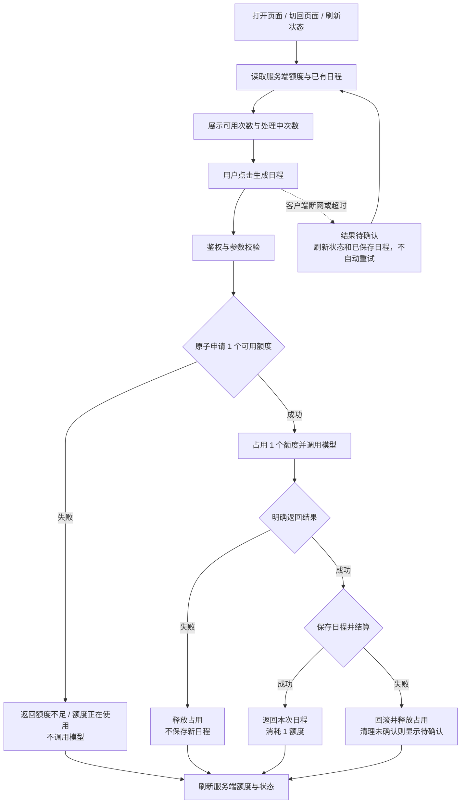

# 流程与页面状态

采用调用前占用、成功结算、失败释放的流程。以下为设计稿，不代表已实现功能。额度定义及异常边界以 [需求方案](REQUIREMENTS.md) 为准。



## 页面布局（沿用现有任务规划页）

```text
AI 任务规划
[已有任务列表与可用时长输入]

可用 2 次 · 处理中 0 次               [刷新状态]
每成功生成 1 次消耗 1 额度；处理中暂占额度，失败释放。
[生成日程 · 成功后消耗 1 额度]
[结果反馈区域：常驻文字，不只依赖短暂 toast]

本次日程 / 上次日程
[现有日程卡片]
[查看已保存日程]（就地展开，只读，按时间倒序）
```

额度与反馈位于生成按钮附近，移动端依次换行。状态文字可被辅助技术读取（动态反馈使用 aria-live）；不单靠红绿颜色区分成功失败。刷新状态不能触发模型调用。

| 状态 | 展示文案 | 生成按钮与下一步 |
|---|---|---|
| 正在读取额度 | 正在读取额度… | 禁用生成，读取完成后更新 |
| 无任务 | 请先添加待办事项 | 禁用；保留添加任务入口 |
| 可用额度 > 0 | 可用 N 次 · 处理中 H 次 | 可生成；成功后消耗 1 额度 |
| 本页提交中 | 正在生成；处理中暂占 1 额度 | 立即禁用，避免重复点击；任务输入保留 |
| 成功 | 日程已生成，本次消耗 1 额度 | 展示本次日程并刷新额度；有余额时可再次生成 |
| 模型明确失败 | 本次生成失败，未消耗额度。请检查任务后重试。 | 保留输入和上次日程；额度刷新成功后可重试 |
| 保存失败且清理已确认 | 日程未保存，本次未扣额度，请重试。 | 不展示未保存结果；允许手动重试 |
| 可用 0，处理中 > 0 | 额度正在用于生成，请等待完成后刷新状态。 | 禁用；提供“刷新状态”；不承诺一定返还 |
| 可用 0，处理中 0 | 当前额度已用完，暂时无法生成新日程。你仍可编辑任务或查看已保存日程。 | 禁用；保留任务编辑、查看日程及刷新入口 |
| 请求结果未知 | 结果尚未确认，可能仍在处理中。请刷新状态并查看已保存日程。 | 暂停本页再次生成；不自动重试、不承诺退款 |
| 状态读取失败 | 暂时无法读取额度，请刷新状态。 | 禁用生成；保留已展示内容和刷新入口 |

状态优先级：本页请求未结束或结果未知时，优先限制再次生成；其他情况下以最新服务端可用额度和任务状态决定按钮。请求成功但额度刷新失败时仍展示已确认的成功日程，额度区显示读取失败，不把整个请求改成“生成失败”。

同账号其他页面可能显示旧额度；服务端拒绝后本页应刷新并转为对应状态。已保存日程入口使用当前账号权限，不允许查看其他账号数据。请求开始后修改任务不改变已经发出的任务快照，后续生成使用新任务。
