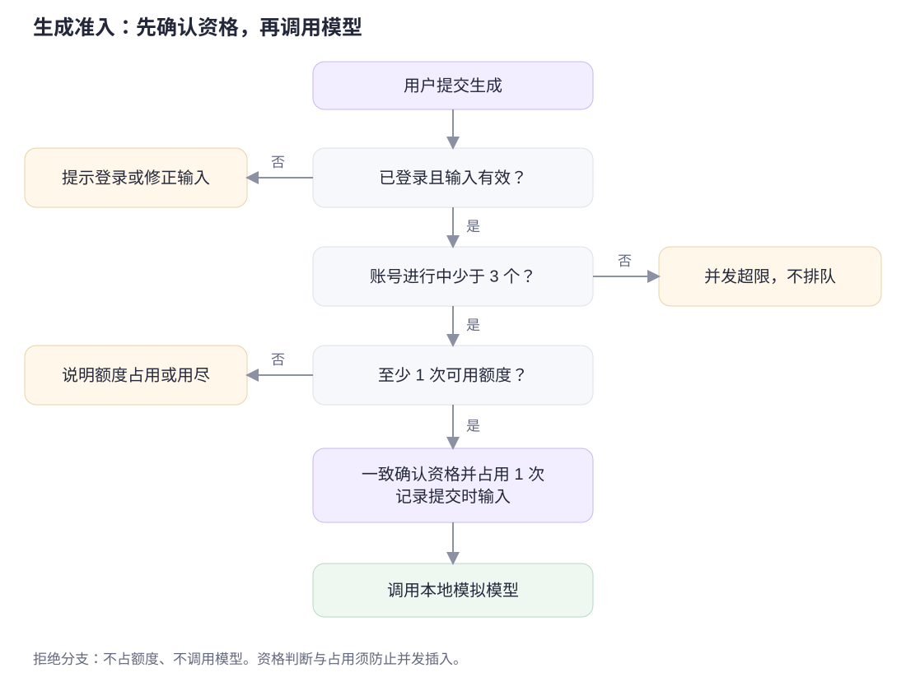
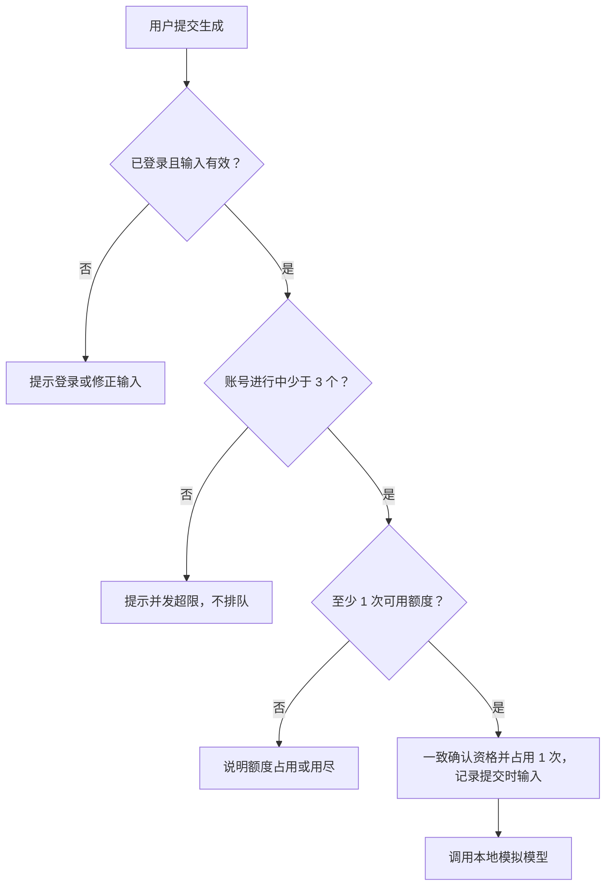
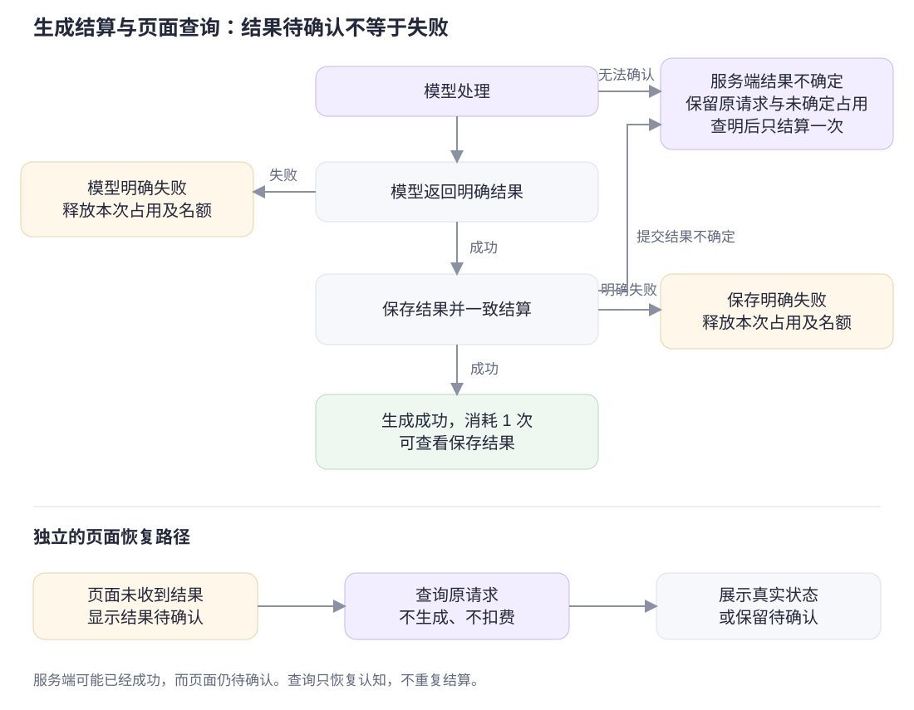
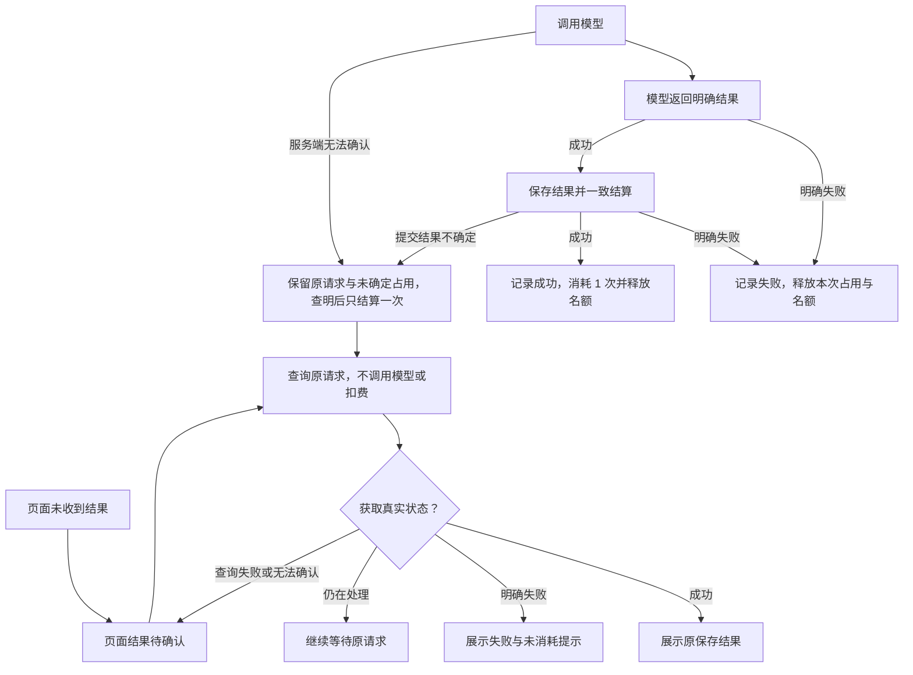

# 业务流程与状态

流程依据 [PRD](PRD.md) 的 R01—R11。调用模型前先检查额度和并发数量；页面暂时无法确认结果时，先查询原请求。

## 1. 生成前检查

额度资格检查、并发资格检查、占用与记录建立须对同时到达的请求保持一致；图中的分步判断用于解释业务，不能实现为互不保护的先查后写。

可编辑 Mermaid 源码

所有拒绝分支均不占额度、不调用模型。真正是否接受以服务端最新状态为准，不能依赖旧页面显示。

## 2. 成功、明确失败与页面待确认

| 事件 | 原请求状态与额度 | 页面下一步 |
| --- | --- | --- |
| 模型仍在处理 | 生成中，占用 1 次 | 等待，不重复提交 |
| 模型明确失败 | 明确失败，释放本次占用与名额 | 显示未消耗，可按当前输入重新生成 |
| 模型成功、保存明确失败 | 明确失败，释放本次占用与名额 | 显示保存失败、未消耗 |
| 生成并保存、结算一致完成 | 成功，占用转消耗 1 次，释放名额 | 展示对应日程 |
| 页面未收到结果或查询失败 | 页面无法判断原请求结果，不能直接改变结算 | 显示待确认，查询原请求 |
| 查询确认成功或失败 | 使用原请求的真实终态，不重复结算 | 展示原结果或明确失败提示 |
| 查询确认仍在处理 | 保持原请求生成中及对应占用 | 返回等待状态 |

可编辑 Mermaid 源码

两个分支可以同时成立：服务端已经成功，页面仍待确认。查询原请求后更新页面，不创建新请求，也不再次扣除或释放额度。

服务端本身结果不确定的情况另见 AC17/AC18：模型调用超时或数据库提交连接中断均不能直接走“明确失败释放”。保留原请求和未确定的占用，查明真实结果后仅结算一次。这个边界不要求实现服务崩溃后的自动补偿。

## 3. 主要用户路径

| 路径 | 从哪里开始 | 到哪里结束 | 对应验收 |
| --- | --- | --- | --- |
| 正常生成 | 编辑待办，确认可用次数 | 看到日程与消耗说明 | AC01 |
| 额度不足 | 提交或返回旧页面 | 看到占用或用尽原因，仍能使用原有内容 | AC02、AC05、AC10 |
| 并发超限 | 其他页面已有 3 个请求 | 新请求被拒绝，完成后可手动再试 | AC06、AC07 |
| 明确失败 | 本次生成未成功完成 | 看到未消耗，可调整当前内容重新生成 | AC03、AC04、AC11 |
| 响应丢失 | 已提交但未拿到结果 | 查询原记录，恢复真实状态或保留待确认 | AC09、AC13 |

页面分别显示“生成中占用”和“已消耗”。
