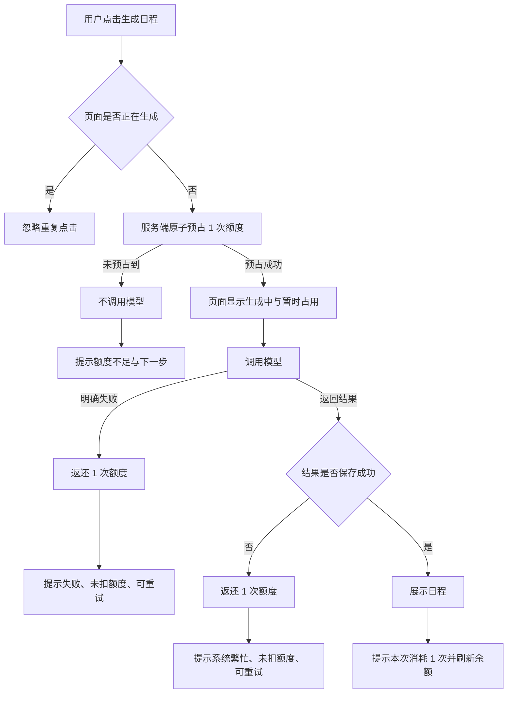

# 日程生成额度处理产品方案

## 0. 结论与完成状态

**问题判断：** 当前服务端在模型调用成功后才检查额度，额度为 0 时仍会发起一次无效调用；两个请求也可能同时读到相同余额并各自扣减，造成透支。页面只在失败后弹出提示，用户看不到剩余额度，也不知道失败是否扣费。

**方案：** 把一次生成拆成“原子预占额度—调用模型—成功确认 / 失败返还”。页面始终展示可用额度，在生成中说明额度仅被预占；结果反馈同时说明是否扣费和下一步操作。

**当前完成状态：** 已完成需求范围、状态流程、交互原型、研发任务拆解和 8 个验收案例。未修改业务代码；产品方向交付给研发后，可直接按本文拆解实现。

---

## 1. 用户问题与目标

### 1.1 当前问题

| 场景 | 当前表现 | 用户或业务风险 |
| --- | --- | --- |
| 额度为 0 | 先调用模型，之后才提示额度不足 | 浪费模型调用；用户等待后才知道不能生成 |
| 两个请求同时生成 | 两个请求可能都认为余额足够 | 额度可能小于 0，计费结果不可信 |
| 模型失败 | 页面只显示通用错误 | 用户不知道额度有没有被扣，容易重复点击 |
| 正常生成 | 页面不展示剩余额度 | 用户无法预期还能使用几次 |

### 1.2 产品目标

1. 额度不足时，模型调用次数为 0。
2. 每次成功生成只消耗 1 个额度。
3. 模型明确失败时，用户的可用额度恢复到请求前数值。
4. 并发请求最多成功到额度耗尽，余额永不小于 0。
5. 每种结果都告诉用户“发生了什么、是否扣额度、下一步能做什么”。

### 1.3 本轮不做

- 不设计购买、订阅、充值或精确 Token 计价。
- 不处理跨账号防刷和跨请求结果复用。
- 不要求解决服务进程崩溃后的自动补偿；但记录预占日志，为后续补偿机制留出排查依据。
- 不改变任务录入、时长设置和日程内容结构。

---

## 2. 核心规则与口径

### 2.1 额度状态

- **可用额度：** 用户当前还能发起的生成次数。
- **预占额度：** 请求已获得调用资格、模型仍在处理中。界面将其描述为“本次额度暂时占用”。
- **已消费额度：** 日程成功返回并可展示，扣除 1 次。
- **已返还额度：** 模型明确失败或结果无法交付，本次预占恢复，不计入消费。

首版可以继续只存 `User.credits`：服务端用一次带条件的原子更新完成预占；失败时原子加回。无需新增用户可操作的额度状态。

### 2.2 成功口径

服务端以“模型返回结构可用的日程，并成功保存生成结果”为消费成功，此时预占的 1 次额度转为已消费。客户端收到响应后展示结果，但客户端是否成功展示不作为服务端扣费条件。

如果模型已返回但保存结果失败，应返还额度并提示重试。如果网络中断导致客户端没有收到响应，客户端不直接判断是否扣费，而是重新查询余额和历史结果，再按服务端最终状态恢复页面。服务进程突然退出属于本轮明确排除的自动补偿场景。

### 2.3 并发处理原则

服务端不得采用“先查询余额，再普通扣减”的两步判断。应使用数据库条件更新：只有 `credits > 0` 的请求才能把额度减 1。更新条数为 0 时直接返回额度不足，不调用模型。

例如账号仅剩 1 次额度，同时收到两个请求：数据库只允许一个请求预占成功；另一个立即收到额度不足。因此最多发起一次模型调用，余额不会透支。

---

## 3. 用户流程



### 3.1 正常生成

1. 用户看到“剩余 3 次”，点击“生成日程 · 消耗 1 次”。
2. 按钮进入加载状态，文案改为“正在生成，本次额度暂时占用”。
3. 成功后展示日程，余额更新为 2。
4. 轻提示：“日程已生成，本次消耗 1 次，剩余 2 次。”

### 3.2 额度不足

1. 页面显示“剩余 0 次”，按钮不可用。
2. 按钮下说明：“额度不足，暂时无法生成。你仍可编辑任务；如需继续，请联系管理员补充额度。”
3. 即使用户绕过前端直接发请求，服务端也返回 `402`，且不产生 `mock-ai.started` 日志。

### 3.3 模型失败

1. 请求预占 1 次后进入生成中。
2. 模型明确失败，服务端返还额度。
3. 保留用户的任务和时长输入，不清空已有日程。
4. 提示：“生成失败，本次未扣额度。请检查任务内容后重试。”

### 3.4 并发请求

同一账号只有 1 次额度时，两次请求同时到达：

- 一个请求预占成功并调用模型；
- 另一个请求立即返回额度不足；
- 如果第一个成功，最终余额为 0；如果失败，最终余额恢复为 1。

---

## 4. 页面与交互方案

可运行的低保真原型见 [prototype.html](prototype.html)。下载或克隆仓库后直接用浏览器打开，无需安装依赖。

### 4.1 默认态

```text
┌─────────────────────────────────────────────┐
│ 今天可用的工作时长                  [ 8 ] 小时 │
│                                             │
│ 剩余 3 次                    成功生成后扣 1 次 │
│ [             生成日程 · 消耗 1 次          ] │
└─────────────────────────────────────────────┘
```

### 4.2 生成中

```text
┌─────────────────────────────────────────────┐
│ 剩余 2 次                                    │
│ [       ◌ 正在生成，请勿关闭页面             ] │
│ 本次额度暂时占用；生成失败会自动返还。          │
└─────────────────────────────────────────────┘
```

页面内按钮禁用只能减少重复点击；服务端原子预占才是并发安全的最终保障。

### 4.3 反馈文案

| 状态 | 标题 | 说明 | 用户动作 |
| --- | --- | --- | --- |
| 成功 | 日程已生成 | 本次消耗 1 次，剩余 N 次 | 查看日程 / 修改任务后再次生成 |
| 额度不足 | 额度不足 | 本次没有发起生成，也没有扣额度 | 编辑任务 / 联系管理员 |
| 模型失败 | 生成失败 | 本次未扣额度，请检查任务内容后重试 | 返回修改 / 重试 |
| 保存失败 | 暂时无法保存日程 | 本次未扣额度，请稍后重试 | 重试 |
| 网络结果未知 | 暂未确认生成结果 | 不承诺是否扣费，刷新额度和历史结果后再提示 | 刷新状态 |

“网络结果未知”不能直接写“未扣额度”，因为服务端可能已经成功。首版应在重新拉取额度和历史结果后给出最终反馈，避免文案与账务事实冲突。

### 4.4 可用性要求

- 额度不能只用颜色表达，必须同时显示数字和文字。
- 加载、成功和失败提示使用 `aria-live`，便于读屏工具及时播报。
- 生成过程中保留任务输入；失败后用户无需重新录入。
- Toast 关闭后，页面上的余额和按钮状态仍能说明当前是否可生成。

---

## 5. 数据与接口约定

### 5.1 页面需要的数据

页面首次加载及每次生成结束后，应获得：

```ts
type CreditSummary = {
  availableCredits: number;
};
```

`generatePlan` 成功返回：

```ts
type GeneratePlanResult = {
  schedule: GeneratedSchedule;
  availableCredits: number;
  chargedCredits: 1;
};
```

失败响应至少区分：

| 错误码 | 含义 | 是否调用模型 | 是否扣额度 |
| --- | --- | --- | --- |
| `CREDITS_EXHAUSTED` / HTTP 402 | 原子预占失败 | 否 | 否 |
| `PROVIDER_REJECTED` / HTTP 502 | 模型明确失败 | 是 | 否，已返还 |
| `RESULT_SAVE_FAILED` / HTTP 500 | 结果未交付 | 是 | 否，已返还 |

错误响应建议带上最新 `availableCredits`，客户端无需猜测余额。

### 5.2 日志要求

同一次请求使用同一个 `requestId`，至少记录：

- `credit.reserve.succeeded` / `credit.reserve.rejected`
- `mock-ai.started` / `mock-ai.succeeded` / `mock-ai.failed`
- `credit.committed` / `credit.released`
- `plan-result.saved`

日志用于验收“额度不足没有调用模型”和排查预占、调用、返还是否成对出现。日志中不记录任务全文或用户敏感信息。

---

## 6. 研发任务拆解

| 编号 | 任务 | 主要文件 | 具体改动 | 完成标准 | 依赖 |
| --- | --- | --- | --- | --- | --- |
| BE-1 | 提供额度查询 | `src/demo-ai-app/operations.ts`、`main.wasp.ts` | 新增或扩展查询，返回当前账号 `availableCredits` | 登录用户能获取非负整数；未登录返回 401 | 无 |
| BE-2 | 原子预占额度 | `src/demo-ai-app/operations.ts` | 在模型调用前执行 `credits > 0` 条件扣减；未更新到记录则返回 402 | 并发下预占成功数不超过初始额度；拒绝请求无 `mock-ai.started` | BE-1 |
| BE-3 | 成功确认 | `src/demo-ai-app/operations.ts` | 模型成功且结果保存成功后返回日程、最新余额和扣费数 | 每个成功响应对应 1 条结果且只扣 1 次 | BE-2 |
| BE-4 | 失败返还 | `src/demo-ai-app/operations.ts` | 捕获模型明确失败和结果保存失败，原子加回 1 次并返回可识别错误 | 失败前后余额相同；重复执行测试不产生负数 | BE-2 |
| BE-5 | 结构化日志 | `src/demo-ai-app/operations.ts`、`src/demo-ai-app/mockAi.ts` | 为预占、调用、保存、返还增加同一 `requestId` | 单次请求可以通过 `requestId` 串起完整链路 | BE-2～4 |
| FE-1 | 展示余额 | `src/demo-ai-app/DemoAppPage.tsx` | 在生成按钮上方显示剩余次数及扣费规则 | 页面加载后即可看到；生成结束自动刷新 | BE-1 |
| FE-2 | 完善按钮状态 | `src/demo-ai-app/DemoAppPage.tsx` | 生成中禁用；0 额度禁用并显示下一步 | 不依赖 Toast 也能理解当前状态 | FE-1 |
| FE-3 | 结果反馈 | `src/demo-ai-app/DemoAppPage.tsx` | 按错误码展示成功、额度不足、失败返还、未知结果文案 | 每类提示包含“是否扣费”和明确动作 | BE-3～4 |
| QA-1 | 自动化验收 | 新增额度处理测试或脚本；复用 `src/demo-ai-app/mockAi.ts` 的 `[fail]` 场景 | 覆盖成功、0 额度、模型失败、保存失败、并发和重复点击 | 验收案例 AC-01～AC-08 可重复执行 | 全部 |

建议实现顺序：BE-1 → BE-2 → BE-4 → BE-3/BE-5 → FE-1～3 → QA-1。先保证服务端额度事实正确，再接页面反馈。

---

## 7. 验收案例

### AC-01 成功生成并扣减 1 次

- **前置条件：** 用户额度为 3；至少有 1 条普通任务。
- **操作：** 点击一次“生成日程”。
- **预期结果：** 页面展示日程；余额变为 2；提示“本次消耗 1 次”；日志恰有一组 `mock-ai.started` 和 `mock-ai.succeeded`；数据库新增 1 条 `PlanResult`。

### AC-02 额度为 0 时不调用模型

- **前置条件：** 用户额度为 0；至少有 1 条普通任务。
- **操作：** 页面观察按钮；再绕过前端直接请求 `generatePlan`。
- **预期结果：** 页面按钮不可用并说明下一步；直接请求返回 402；余额仍为 0；没有新增 `mock-ai.started` 和 `PlanResult`。

### AC-03 模型明确失败时返还额度

- **前置条件：** 用户额度为 1；存在包含 `[fail]` 的任务。
- **操作：** 点击“生成日程”。
- **预期结果：** 显示“生成失败，本次未扣额度”；任务输入保留；最终余额仍为 1；存在 `mock-ai.started`、`mock-ai.failed` 和 `credit.released`；没有新增 `PlanResult`。

### AC-04 结果保存失败时返还额度

- **前置条件：** 用户额度为 1；模拟 `PlanResult.create` 失败。
- **操作：** 发起生成。
- **预期结果：** 提示“暂时无法保存日程，本次未扣额度”；最终余额为 1；没有残缺结果；日志包含返还记录。

### AC-05 1 次额度下的 2 个并发请求

- **前置条件：** 用户额度为 1；至少有 1 条普通任务。
- **操作：** 使用测试脚本同时发起 2 个请求。
- **预期结果：** 1 个请求成功、1 个返回 402；只有 1 条 `mock-ai.started`；最终余额为 0；新增 1 条 `PlanResult`。

### AC-06 3 次额度下的 5 个并发请求

- **前置条件：** 用户额度为 3；至少有 1 条普通任务。
- **操作：** 同时发起 5 个请求。
- **预期结果：** 恰有 3 个请求进入模型调用并成功，2 个返回 402；最终余额为 0；余额从未小于 0；新增 3 条结果。

### AC-07 前端重复点击

- **前置条件：** 用户额度为 3；网络被限制为慢速。
- **操作：** 快速连续点击生成按钮。
- **预期结果：** 第一次点击后按钮立即禁用；浏览器只发出 1 个请求；生成中提示额度暂时占用。

### AC-08 失败后可以直接重试

- **前置条件：** 用户额度为 1；先添加 `[fail]` 任务并生成失败。
- **操作：** 删除失败任务，保留其他输入，再次生成。
- **预期结果：** 第一次失败不扣额度；第二次成功生成并将余额扣至 0；用户无需重新录入普通任务和时长。

---

## 8. 数据观察与上线判断

本题是本地项目，不需要接入真实埋点平台；如果进入真实产品，建议观察：

- 额度预占成功数、拒绝数、确认消费数、返还数；
- 模型调用成功率及失败原因；
- `预占成功 - 确认消费 - 已返还` 的差值，正常情况下应接近 0；
- 用户失败后的重试率和成功率。

上线门槛：AC-01～AC-08 全部通过，并确认 `credits` 在压力测试中始终不小于 0。若出现未闭合的预占记录，应先排查，不能只依赖前端显示。

---

## 9. 待办与交接

1. 本方案未实现代码，也未声称完成运行验证。
2. 服务崩溃可能造成预占额度未返还，是题目明确排除的自动补偿范围。后续可增加额度流水与超时补偿任务。
3. 当前项目没有购买入口，因此额度不足只提供“编辑任务 / 联系管理员”的真实动作，不设计无法完成的充值按钮。
4. 技术实现若改变错误码或接口返回结构，需要同步更新第 5 节和对应验收案例。
5. 首版无需修改 `schema.prisma`；继续使用 `User.credits` 完成原子预占和失败返还。只有后续增加额度流水或崩溃补偿时，才需要新增数据模型。
