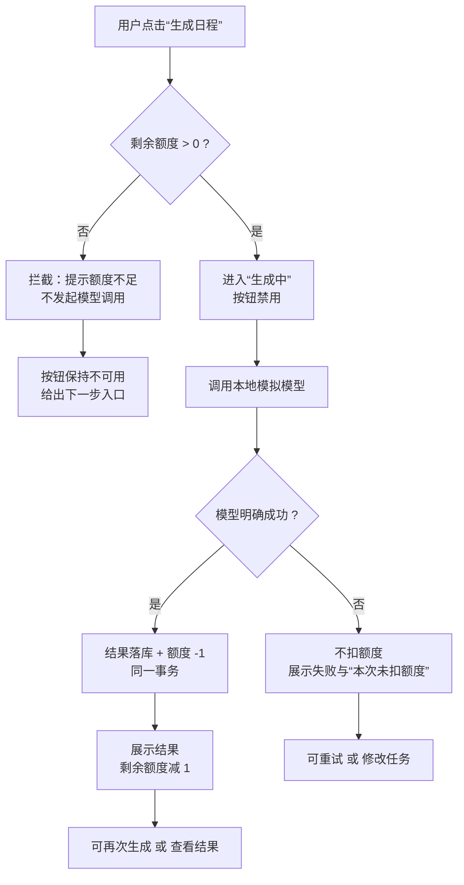

# 02 流程与原型：日程生成的额度处理

## 判断、方案与状态

- **判断**：额度问题本质是“调用模型前后，用户看到的状态是否一致”。流程要保证：不足不调用、失败不扣、并发不透支、每个结果都有出口。
- **方案**：用一条主流程 + 三条异常分支表达；原型以“页面状态”为单位，每个状态对应一个可观察的界面和按钮行为。
- **状态**：[流程图与文字线框已完成；前端视觉稿未做，本期以线框和状态表为准]。

> 规则定义见 01-需求与方案.md 第二节；文案定稿见 01 第五节。本文只描述流程走向和页面状态。

---

一、主流程



关键节点说明：

| 节点 | 用户可见行为 | 不可见但必须成立 |
|---|---|---|
| B 额度检查 | 无感知，瞬时完成 | 检查在调用模型之前；≤0 直接走 C |
| C 拦截 | 出现不足提示，**不出现“生成中”** | 不产生模型调用 |
| D 生成中 | 按钮禁用，显示进行中 | 防止重复点击 |
| G 成功扣减 | 结果出现，剩余额度 -1 | 扣减与结果落库同事务 |
| I 失败 | 失败提示，剩余额度不变 | 不扣减 |

---

二、四条分支流程

F1 正常成功

1. 额度 > 0，用户点击生成。
2. 页面进入“生成中”，按钮禁用。
3. 模型返回成功。
4. 页面展示日程结果，剩余额度减 1。
5. 用户可查看结果或再次生成。

用户看到：结果 + 剩余额度 + “生成成功，已消耗 1 额度”。

F2 额度不足

1. 额度 = 0，用户点击生成。
2. 页面不进入“生成中”，直接提示额度不足。
3. 按钮不可用，或点击后只弹提示、不发起请求。
4. 提供下一步入口（查看额度规则 / 联系管理员）。

用户看到：额度 0 + “额度已用完，本次未发起生成” + 下一步入口。
可观察证据：此时不应出现任何模型调用记录。

F3 模型失败

1. 额度 > 0，用户点击生成。
2. 页面进入“生成中”。
3. 模型明确返回失败。
4. 页面提示失败，剩余额度不变，文案说明“本次未扣额度”。
5. 用户可重试或修改任务。

用户看到：失败提示 + 剩余额度原值 + 重试入口。

F4 并发请求

1. 同一账号在额度仅够 1 次时，快速发起两个生成请求（如双击、双标签页）。
2. 两个请求都通过“额度 > 0”的检查。
3. 最终只有一个请求成功扣减并展示结果。
4. 另一个请求按“未成功、未扣额度”处理，给出“当前请求未成功，请稍后重试”。

用户可观察结果：

· 成功生成次数 ≤ 可用额度；

· 剩余额度不为负数；

· 被拒请求有明确提示，不出现“扣了额度却没有结果”。

> 并发下如何保证上述结果，由技术方向在 SPEC.md 说明；本文只约束用户侧可观察行为。

---

三、页面状态与线框

状态清单

| 状态 | 剩余额度区 | 主按钮 | 结果区 | 提示区 |
|---|---|---|---|---|
| 空闲·充足 | 剩余 N（N>0） | 生成日程，可用 | 空或上次结果 | 无 |
| 生成中 | 剩余 N | 禁用 | 加载态 | 正在生成… |
| 成功 | 剩余 N-1 | 可用 | 展示日程 | 生成成功，已消耗 1 额度 |
| 额度不足 | 剩余 0 | 禁用/提示 | 空 | 额度已用完，本次未发起生成 |
| 模型失败 | 剩余 N（不变） | 可重试 | 空 | 生成失败，本次未扣额度 |
| 并发被拒 | 实际剩余 | 可重试 | 空 | 当前请求未成功，本次未扣额度，请稍后重试 |

线框（文字版）

空闲·充足

```
┌─────────────────────────────┐
│ 剩余额度：3                  │
│ [ 生成日程 ]                 │
│                             │
│ （结果区为空）               │
└─────────────────────────────┘
```

生成中

```
┌─────────────────────────────┐
│ 剩余额度：3                  │
│ [ 生成日程 ]（禁用）         │
│ 正在生成，请稍候…            │
└─────────────────────────────┘
```

成功

```
┌─────────────────────────────┐
│ 剩余额度：2                  │
│ [ 生成日程 ]                 │
│ 生成成功，已消耗 1 额度      │
│ ┌─────────────────────────┐ │
│ │ 日程结果…                │ │
│ └─────────────────────────┘ │
└─────────────────────────────┘
```

额度不足

```
┌─────────────────────────────┐
│ 剩余额度：0                  │
│ [ 生成日程 ]（不可用）       │
│ 额度已用完，本次未发起生成   │
│ [ 查看额度规则 ] [ 联系管理员 ] │
└─────────────────────────────┘
```

模型失败

```
┌─────────────────────────────┐
│ 剩余额度：1                  │
│ [ 重试 ]                     │
│ 生成失败，本次未扣额度       │
└─────────────────────────────┘
```

并发被拒

```
┌─────────────────────────────┐
│ 剩余额度：0                  │
│ [ 重试 ]                     │
│ 当前请求未成功，本次未扣额度，│
│ 请稍后重试                   │
└─────────────────────────────┘
```

线框只表达信息层级和状态，不代表最终视觉样式。

---

四、交互规则

| 编号 | 规则 | 目的 |
|---|---|---|
| I1 | 生成中禁用主按钮 | 减少重复点击引发的并发 |
| I2 | 额度不足时点击只提示，不发请求 | 保证不调用模型 |
| I3 | 失败后可重试，重试成功只扣 1 次 | 避免重复扣减 |
| I4 | 每个异常状态都有明确下一步入口 | 满足“用户知道接下来做什么” |
| I5 | 成功、失败、不足、并发被拒提示文案互不相同 | 用户能区分结果 |

---

五、与验收的对应

| 流程 | 验收编号 |
|---|---|
| F1 正常成功 | AC1 |
| F2 额度不足 | AC2 |
| F3 模型失败 | AC3 |
| F4 并发 | AC4 |
> 验收细节见 04-验收案例.md。

---

六、待确认

· 并发被拒时，页面是“保持原状 + 提示”还是“刷新为最新额度”，需与实现对齐后回写。

· 额度不足时的下一步入口，取决于 01 中 A4 的最终选择。

· 生成中是否允许离开页面，离开后返回的状态处理未定义。
