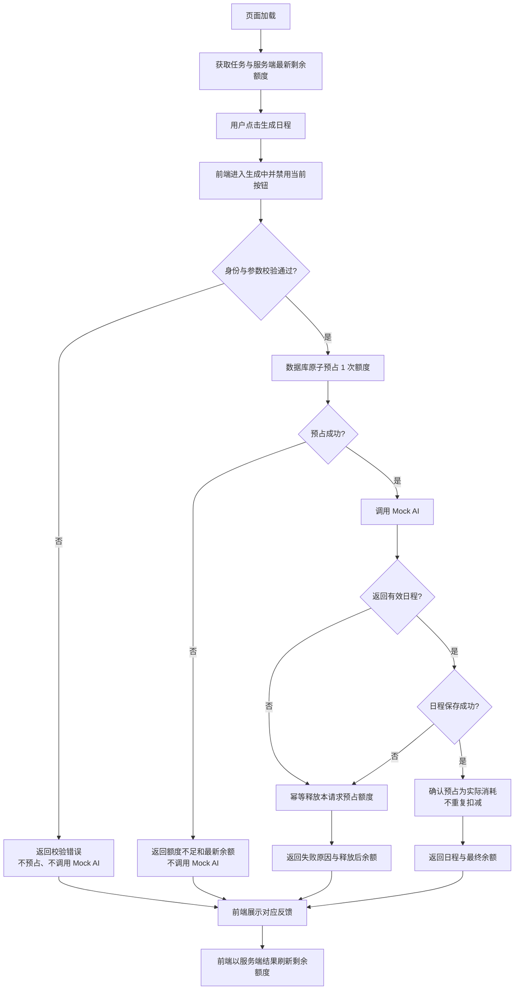

# 日程生成额度业务流程与交互设计

**文档版本：** V1.0
**对应需求：** `01_REQUIREMENTS.md` V1.1
**应聘方向：** 产品
**项目名称：** 任务规划实验室
**需求模块：** 日程生成额度管理

## 1. 流程目标与边界

本流程用于保证日程生成、保存结果与额度变化一致：新账号初始拥有 3 次额度；每成功生成并保存一份日程消耗 1 次；额度不足时不得调用 Mock AI；明确失败时释放本次预占额度；并发请求不得造成透支。

本次不涉及额度购买、支付、订阅、复杂风控及服务进程崩溃后的自动恢复或补偿。

## 2. 端到端用户流程

1. 用户进入任务规划页面，前端从服务端获取任务数据和最新剩余额度。
2. 用户填写或调整任务后，点击「生成日程」。
3. 前端进入生成中状态，禁用当前页面的生成按钮并提交请求。
4. 服务端先完成现有身份与参数校验；校验未通过则直接返回，不预占额度、不调用 Mock AI。
5. 校验通过后，服务端以原子条件更新预占 1 次额度。
6. 若预占失败，服务端返回额度不足；前端提示“剩余额度不足，本次未生成”，且 Mock AI 不得被调用。
7. 若预占成功，服务端调用 Mock AI：
   - Mock AI 成功返回有效日程，且日程保存成功：确认本次额度消耗，不再重复扣减；返回日程和最新剩余额度。
   - Mock AI 明确失败，或日程保存失败：仅释放本请求预占的 1 次额度；返回失败信息和最新剩余额度。
8. 前端按服务端结果展示日程或失败提示，并以服务端返回值刷新剩余额度。

## 3. 服务端额度生命周期

| 阶段 | 服务端动作 | 额度结果 | Mock AI |
|---|---|---|---|
| 请求校验 | 校验身份与现有请求参数 | 不变 | 不调用 |
| 原子预占 | 仅当可用额度 ≥ 1 时，将可用额度减 1 | 成功则进入预占；失败则不变 | 预占成功后才可调用 |
| 成功结算 | Mock AI 返回有效日程且日程保存成功 | 预占转为实际消耗，不二次扣减 | 已调用 |
| 失败释放 | Mock AI 明确失败或日程保存失败 | 本请求额度返还 1 次，且只返还一次 | 可能已调用 |

额度变更必须与具体生成请求关联，并保证结算和释放具有幂等性：同一请求只能从“已预占”进入“已结算”或“已释放”之一。具体数据表或事务实现由研发设计，本流程不预设新增表结构。

## 4. 并发行为

- 服务端是额度正确性的最终控制点；前端禁用按钮仅用于减少重复操作，不能替代服务端控制。
- 原子预占必须在单次数据库条件更新中完成，判断条件为可用额度至少 1 次；不得采用“先查询余额、再单独扣减”的非原子流程。
- 同一账号的并发请求共享同一可用余额，不同账号独立计算。
- 成功预占的请求数不得超过请求到达前可用额度，任何时刻可用额度不得小于 0。
- 示例：余额为 1 时，请求 A 与 B 并发到达。只有一个请求可预占成功并调用 Mock AI；另一请求返回额度不足且不得调用 Mock AI。
- 若先成功预占的请求随后失败并释放额度，已被拒绝的并发请求不会自动恢复执行；用户可在看到最新余额后重新发起请求。

## 5. 前端状态与反馈

| 状态 | 触发条件 | 页面表现 | 剩余额度表现 | 可执行操作 |
|---|---|---|---|---|
| 可生成 | 页面加载完成且余额 ≥ 1 | 正常展示任务与生成按钮 | 展示服务端最新余额 | 编辑任务、生成日程 |
| 生成中 | 请求已提交、结果未返回 | 加载提示；当前页面生成按钮禁用；提示“本次额度预占中” | 不由前端自行减 1；如服务端支持中间状态，则展示服务端确认的预占后余额 | 等待结果 |
| 额度不足 | 原子预占失败 | 提示“剩余额度不足，本次未生成” | 展示服务端返回的最新余额 | 返回编辑；不可继续生成 |
| 生成成功 | Mock AI 成功且保存成功 | 展示新日程和“已消耗 1 次额度” | 刷新为服务端返回的最终余额 | 查看日程；有余额时可再次生成 |
| 生成失败 | Mock AI 明确失败或保存失败 | 区分失败原因；提示“本次预占额度已返还” | 刷新为释放后的服务端余额 | 修改任务或重试 |
| 请求校验失败 | 身份或现有参数校验未通过 | 沿用对应校验提示，不表述为模型失败 | 保持服务端确认的余额 | 按提示修正或重新登录 |

页面刷新后必须重新从服务端读取额度；前端不持久化、不自行推算额度。额度不足与模型失败必须使用不同提示，避免用户误解是否调用模型及是否消耗额度。

## 6. 关键异常处理

| 异常 | 处理规则 |
|---|---|
| 身份或参数校验失败 | 不预占额度，不调用 Mock AI，返回现有校验错误 |
| 额度不足 | 原子预占失败后立即结束，不调用 Mock AI |
| Mock AI 明确失败 | 释放本请求预占额度，仅执行一次；返回失败原因与最新余额 |
| Mock AI 返回无效日程 | 按未成功生成处理；不保存无效结果，释放预占额度 |
| 日程保存失败 | 本次不计为成功，释放预占额度，不展示未落库结果 |
| 释放或结算收到重复执行 | 通过请求级状态保证幂等，不重复返还或扣减 |
| 多页面或多请求并发 | 均由服务端原子预占裁决，不能依赖前端按钮状态 |
| 服务进程崩溃、结果不明 | 不在本次自动补偿范围内；不得在本方案中承诺自动恢复 |

## 7. Mermaid 流程图

## 8. 假设与待确认事项

以下内容不改变已确认范围，但需要研发在实现前结合现有仓库确认：

1. **生成中余额展示：** 若现有生成接口在 Mock AI 完成后才一次性返回，前端在生成途中无法获得服务端确认的预占后精确余额。此时仅展示“额度预占中”，最终按服务端响应刷新；不得由前端乐观减 1。若必须实时显示精确余额，需要现有接口支持中间状态，是否调整接口需另行确认。
2. **请求级关联方式：** 结算与释放需要能识别同一次生成请求，以实现只结算或释放一次；具体使用请求标识、记录字段或其他方式由研发根据现有数据结构确定。
3. **无效日程判定：** “Mock AI 成功返回有效日程”的最低有效性标准沿用现有数据校验，不在本需求中新增内容质量规则。
4. **失败文案与错误码：** 本文定义用户应理解的语义，不强制具体接口状态码或最终文案措辞；前后端需能稳定区分校验失败、额度不足、模型失败和保存失败。
