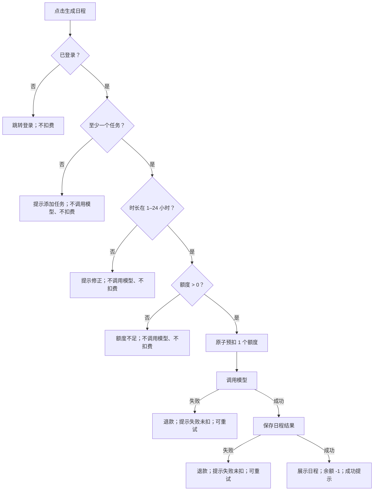
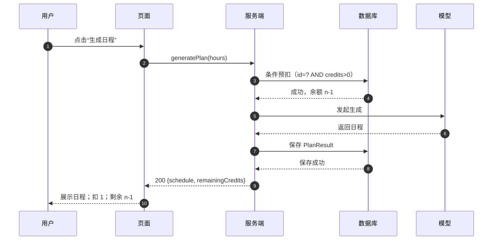
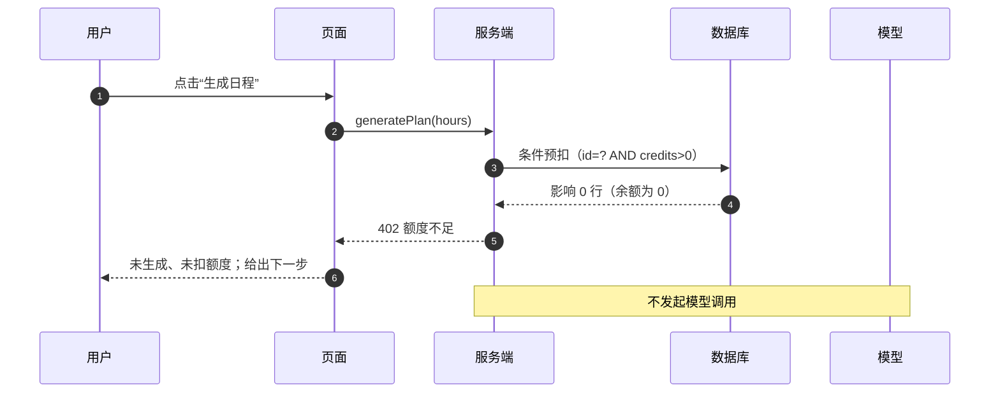
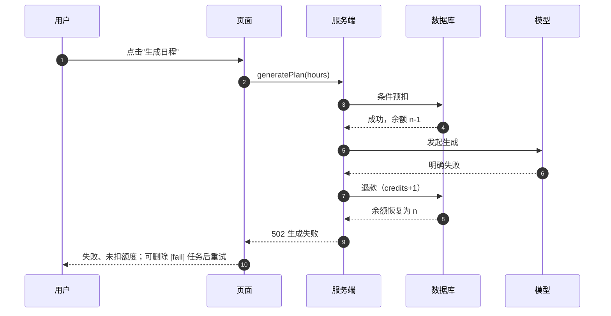
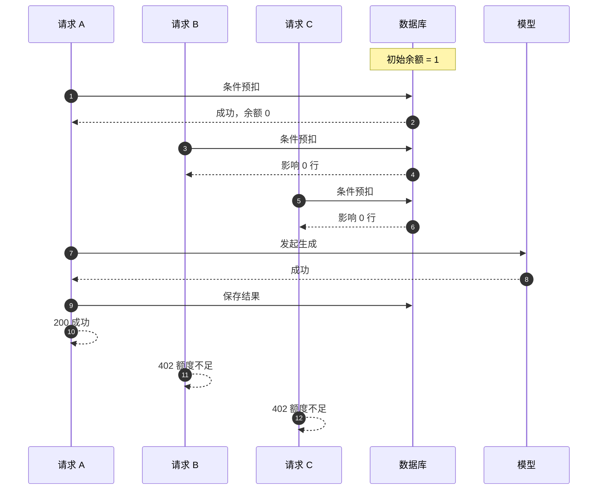

# 额度处理流程与并发时序

- 关联：[PRD](PRD.md) · [可交互原型](prototype/index.html) · [验收案例](ACCEPTANCE.md)
- 说明：图中的“预扣”是服务端行为，用户不需要理解；用户只看到“生成中 / 成功 / 额度不足 / 失败”。

## 1. 端到端流程

校验顺序固定为：**登录 → 任务 → 时长 → 额度 → 模型**。因此 0 额度且含 `[fail]` 任务时，先得到额度不足，不会调用模型。

## 2. 成功流程

用户可见结果：日程 + “本次扣除 1 个额度，剩余 N 个” + 下一步“可调整任务后再次生成”。

## 3. 额度不足流程

用户可见结果：余额保持 0；提示“本次没有生成日程，也没有扣除额度”；下一步为联系管理员或使用其他账号。

## 4. 模型失败流程

用户可见结果：余额不变；提示“模型没有返回可用日程，本次未扣除额度”；下一步为删除含 `[fail]` 的任务或稍后重试。

## 5. 并发时序

### 5.1 余额 1，3 个并发请求

| 指标 | 预期 |
| --- | --- |
| 成功请求 | 1 |
| 额度不足请求 | 2 |
| 模型调用次数 | 1 |
| 最终余额 | 0 |
| 日程结果数 | 1 |

### 5.2 余额 3，5 个并发请求

| 时刻 | 请求 A | 请求 B | 请求 C | 请求 D | 请求 E | 余额 |
| --- | --- | --- | --- | --- | --- | --- |
| t0 | 预扣成功 | 预扣成功 | 预扣成功 | 预扣失败 | 预扣失败 | 2 / 1 / 0 |
| t1 | 调用模型 | 调用模型 | 调用模型 | 返回 402 | 返回 402 | 0 |
| t2 | 成功 | 成功 | 成功 | 未调用 | 未调用 | 0 |

| 指标 | 预期 |
| --- | --- |
| 成功请求 | 3 |
| 额度不足请求 | 2 |
| 模型调用次数 | 3 |
| 最终余额 | 0 |
| 日程结果数 | 3 |

### 5.3 一个必须说明的取舍

预扣发生在模型调用之前，所以在 500ms 左右的生成窗口内，余额会暂时减少。若先到的请求最终失败并退款，后到的并发请求可能已经因为看到 0 而收到额度不足。

这是有意为之：

- 不会透支；
- 不会在 0 额度时超发模型调用；
- 用户重试即可，最坏情况是多一次“额度不足”的提示，而不是账实不符。

## 6. 用户可见状态

| 状态 | 进入条件 | 页面表现 | 离开方式 |
| --- | --- | --- | --- |
| 可生成 | 有任务、时长合法、余额 > 0 | 按钮可用，显示余额 | 点击生成 |
| 生成中 | 请求已发出 | 按钮禁用，显示“生成中…” | 成功/失败/额度不足 |
| 成功 | 模型和保存都成功 | 日程、成功横幅、余额 -1 | 再生成或离开 |
| 额度不足 | 余额 0 或并发预扣失败 | 余额 0 高亮，提示未生成/未扣 | 补充额度或换账号 |
| 模型失败 | 模型失败或保存失败 | 失败横幅，余额不变 | 删除 `[fail]` 任务或重试 |
| 无任务 | 任务列表为空 | 空状态引导 | 添加任务 |
| 时长非法 | 不在 1–24 | 输入提示 | 修正时长 |
| 网络未知 | 超时/断网 | 黄色警示 | 刷新确认余额 |

## 7. 原型场景对应

| 场景 | 原型入口 | 预期看到 |
| --- | --- | --- |
| 成功 | “场景 1：成功生成” | 日程；余额 3→2；日志有 `started` + `succeeded` |
| 额度不足 | “场景 2：额度不足” | 余额 0；提示未生成/未扣；日志无 `started` |
| 模型失败 | “场景 3：模型失败” | 余额 3；失败提示；日志有 `started` + `failed`，随后退款 |
| 并发 1 额度 | “场景 4：并发 1 额度” | 1 成功、2 额度不足；最终 0；1 次 `started` |
| 并发 3 额度 | “场景 5：并发 3 额度” | 3 成功、2 额度不足；最终 0；3 次 `started` |
| 重置 | “重置演示” | 恢复 3 额度、默认任务、空日志 |

打开方式：直接双击 [prototype/index.html](prototype/index.html)，无需安装依赖。
