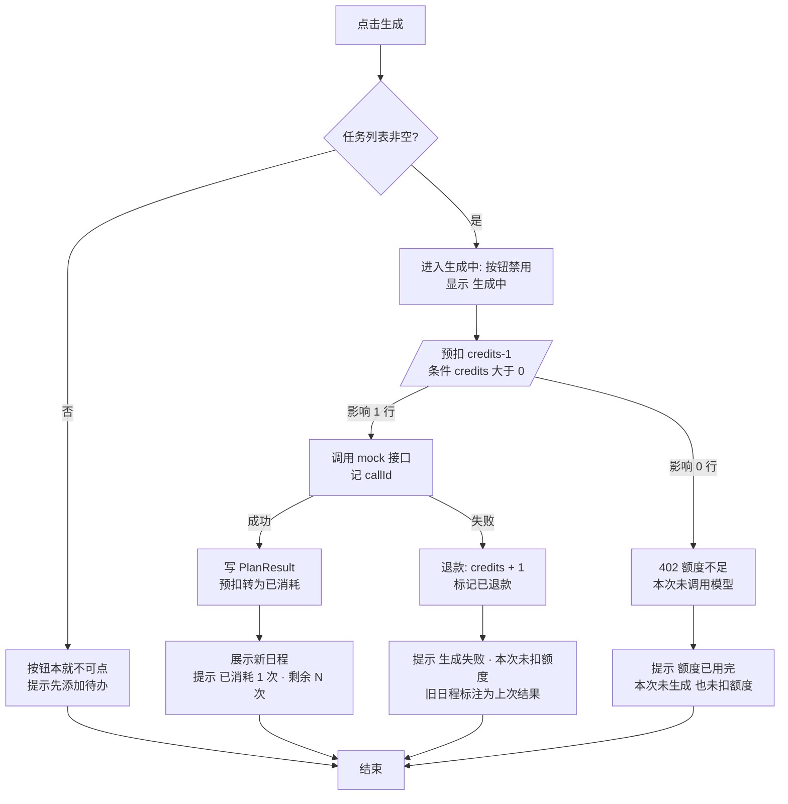
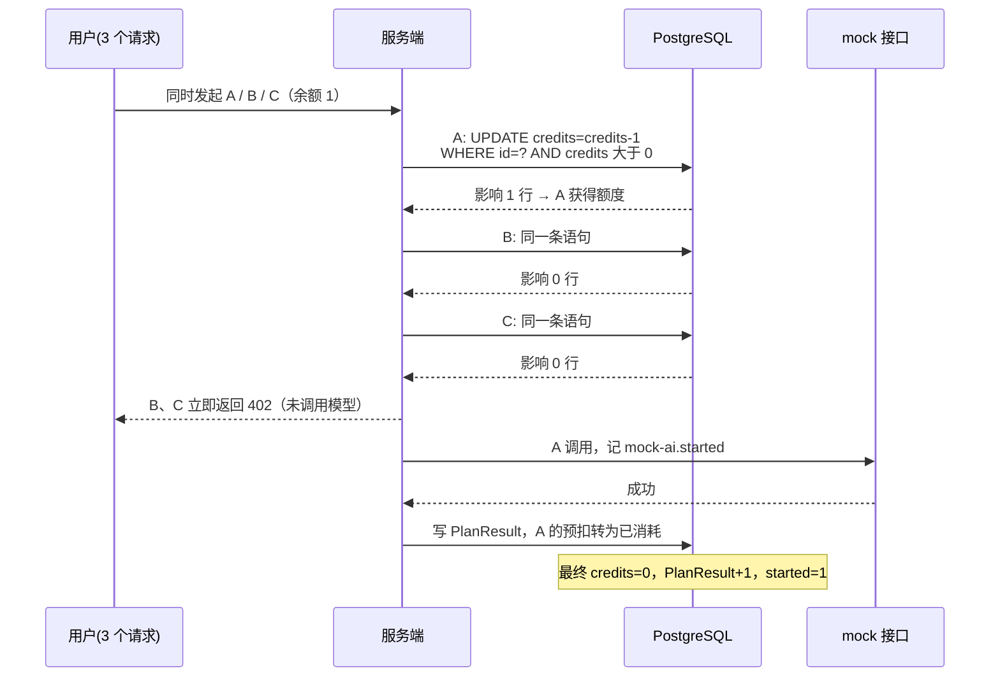

# 额度处理改进 · 需求方案

> 方向：产品 ｜ 状态：方案、流程、原型、拆解、验收案例均已完成；**未改动应用代码**（产品方向不交实现）
> 同目录交付：[tasks.md](tasks.md) 开发任务拆解 ｜ [acceptance.md](acceptance.md) 验收案例 ｜ [prototype.html](prototype.html) 可点击原型

## 1. 结论先行

**判断**：这不是"扣减那行写错了"，而是三个独立缺陷叠在一起——顺序错、并发不安全、结果不可解释。只修其中一个，其余两个仍会以别的方式暴露。

**方案**：把额度从"调用完顺手扣一下"改成 **预扣 → 调用 → 结算** 三段式。额度是否可用，由一次带条件的原子更新在调用之前裁决；模型失败走退款；前端把额度变成一直可见的状态，并给三种结果各自一套"发生了什么、还剩几次、接下来能做什么"的文案。

**当前完成状态**：需求与规则、主流程与异常流程、六种界面状态的可点击原型、8 个可独立验收的开发任务、12 条验收案例已就绪。代码实现不在本次范围，见 [tasks.md](tasks.md) 与 [SUBMISSION.md](../SUBMISSION.md) 的待办部分。

## 2. 现状缺陷与证据

证据来自代码走查（文件与行号见下）。**本次未在本地启动应用复现**，原因见 [acceptance.md](acceptance.md#1-观察方法)；所有"现状"描述均可由下列代码位置直接核对。

| # | 缺陷 | 位置 | 可观察后果 |
| --- | --- | --- | --- |
| D1 | **先调用模型，后判断额度**。取任务、调用 `generateMockSchedule` 在前，`credits > 0` 的判断在之后 | [operations.ts L40-L49](../src/demo-ai-app/operations.ts#L40-L49) 调用 → [L67](../src/demo-ai-app/operations.ts#L67) 才判断 | 额度为 0 的账号点一次生成，服务端照样打一条 `mock-ai.started`，用户白等约 500ms 才收到 402。直接违反"额度不足时不应发起模型调用" |
| D2 | **判断与扣减不是原子操作**。判断读的是请求开始时的 `context.user.credits` 快照，扣减是一次无条件的 `decrement` | [L67-L71](../src/demo-ai-app/operations.ts#L67-L71) | 余额 1、三个请求并发：三个都判定"有额度"，三次 `decrement` → `credits = -2`，产出 3 份结果 |
| D3 | **失败路径没有产品表达**。`generatedSchedule === null` 是死代码（`mockAi` 失败走的是 `throw`）；前端只对 402 写了专属文案 | [L50-L55](../src/demo-ai-app/operations.ts#L50-L55)、[DemoAppPage.tsx L90-L110](../src/demo-ai-app/DemoAppPage.tsx#L90-L110) | 模型失败弹 `Error: Mock provider explicitly rejected the request`；用户不知道这次到底扣没扣额度 |
| D4 | **成功也不说明代价**。生成后没有任何地方显示扣了 1 次、还剩几次，额度在页面上从头到尾不可见 | [DemoAppPage.tsx](../src/demo-ai-app/DemoAppPage.tsx) 无额度展示 | 用户只能靠"再点一次看会不会报错"来推断余额 |
| D5 | **失败后旧结果仍留在页面**。`response` 状态在失败时不清空 | [DemoAppPage.tsx L64-L114](../src/demo-ai-app/DemoAppPage.tsx#L64-L114) | 生成失败，屏幕上还是一份旧日程，容易被当成这次的结果 |
| D6 | **空任务也能发起调用**。按钮禁用条件写成 `tasks?.length === 0`，`tasks` 为 `undefined`（加载中）时不成立 | [DemoAppPage.tsx L190](../src/demo-ai-app/DemoAppPage.tsx#L190) | 任务列表还没加载出来时点生成，可能白扣一次额度、拿到空日程 |

D1 与 D2 违反题目里的硬规则，D3-D6 违反"用户能理解操作结果，并知道接下来可以做什么"。D6 属于边界，优先级低于前五项。

## 3. 目标与范围

**目标**

1. 额度只有在"成功生成"时才减少，且任何情况下不为负。
2. 额度不足时，模型调用次数为 0。
3. 模型明确失败时，净消耗为 0。
4. 同一账号并发请求时，成功次数不超过余额。
5. 每次操作结束，用户能说出三件事：成了没有、扣没扣、还剩几次。

**不做（本范围外，题目已明确）**：支付与订阅、跨账号防刷、按 Token 精确计价、服务崩溃后的自动补偿、跨请求复用生成结果。

**特别注意的取舍**：预扣之后、结算之前服务崩溃，额度会停在"已扣"状态。本范围不做自动补偿，作为已知问题记录（见 §8），由对账或人工处理。这是选择"预扣"必须承认的代价，不能含糊过去。

## 4. 规则

| 编号 | 规则 | 判定标准 |
| --- | --- | --- |
| R1 | 一次成功生成消耗 1 次额度，与任务条数、时长的取值无关 | 成功后 `credits` 恰好 -1 |
| R2 | 额度 ≤ 0 时不发起模型调用 | `mock-ai.started` 不新增；直接调用后端返回 402 |
| R3 | 模型明确失败时净消耗 0 | 失败前后 `credits` 相同；不新增 `PlanResult` |
| R4 | 并发安全：`credits` 永不为负，成功次数 ≤ 可用余额 | 余额 0 时任意并发，`credits` 仍为 0 |
| R5 | 额度以服务端为准。前端展示是镜像，不做本地累加，操作后以服务端返回值为准 | 刷新页面后显示的余额与数据库一致 |
| R6 | 同一账号并发时先到先得，超额请求立即拒绝，不排队 | 余额 1、3 个并发 → 1 个成功、2 个 402 |

**为什么是"立即拒绝"而不是排队**：本环境没有队列设施，排队会让用户停在"不知道排第几、不知道要等多久"的状态，比明确失败更难解释。余额只有一个数字，先到先得是用户能自己推演出来的规则。

## 5. 流程

### 5.1 主流程

关键顺序只有一句：**预扣在调用之前**。D1 的根因就是这两步反了。

### 5.2 并发

**防止透支的只有一步**：判断与扣减合成一条带 `credits > 0` 条件的 `UPDATE`，由数据库的行锁保证同一份余额只被一个请求扣到。影响行数为 0 就是"没抢到"，立即 402。判断和扣减之间不再有时间窗口，D2 消失。

## 6. 交互与文案

额度徽标常驻生成按钮上方，形如 `剩余额度 2 / 3 次`。三种结果各自一套文案：标题说结论，说明说代价（扣没扣、还剩几次），并给出下一步。

| 场景 | 界面表现 | 文案 | 下一步引导 |
| --- | --- | --- | --- |
| 生成中 | 按钮禁用、转圈、`生成中…`；额度徽标**不预减** | — | 等待，不重复点击 |
| 成功 | 新日程替换旧日程，徽标 -1 | **日程已生成** ／ 本次消耗 1 次额度，剩余 2 次 | 勾选子任务开始执行；可再次生成 |
| 额度不足（已知余额 0） | 按钮置灰不可点，徽标 `0 / 3` | 按钮文案：额度已用完 | 悬停说明：调整任务后可稍后再试 |
| 额度不足（被服务端拒绝 402） | 保持原页面，不清空输入 | **额度已用完** ／ 本次未生成，也未消耗额度（剩余 0 次） | 调整任务后稍后再试 |
| 模型失败 | 旧日程保留，上方加一行 `以下为上次成功生成的结果（14:20）` | **生成失败，本次未扣额度** ／ 剩余额度 2 次不变 | 可直接重试；若反复失败，检查任务描述 |
| 未登录 | 跳转登录页 | — | 登录后回到本页 |
| 空任务 | 按钮不可点 | 请先添加待办事项 | 输入框获焦 |

**文案的三条约束**（供实现时校验，也是验收时的检查项）：

1. 成功必须报出剩余次数，失败必须明确"未扣额度"——否则用户无法判断代价。
2. 额度耗尽时**不出现购买、升级、充值入口**。本范围没有支付能力，放一个假入口比不提示更糟。
3. 不使用"系统繁忙""出错了"这类无信息量的措辞，说清是额度问题还是生成问题。

## 7. 假设

| 编号 | 假设 | 若假设不成立的影响 |
| --- | --- | --- |
| A1 | 额度单位是"次"，一次成功生成 = 1 次，与任务数、时长无关 | 若改为按时长或 Token 计价，R1 与预扣金额需重算 |
| A2 | 新账号初始 3 次，`credits` 可能被运维直接改库 | 前端必须每次读服务端，不能本地累加（R5 由此而来） |
| A3 | `[fail]` 任务代表"模型明确失败"；超时与网络错误在本地模拟中不出现，但实现应按失败处理并退款 | 若区分"明确失败"与"未知结果"，需要两套文案 |
| A4 | 单服务、单库，`prisma.$transaction` 可用 | 多实例部署时预扣仍成立（靠数据库），但退款对账需要额外机制 |
| A5 | 额度耗尽后没有自助恢复路径 | 文案不能承诺"充值后继续" |

## 8. 已知风险

| 风险 | 影响 | 处置 |
| --- | --- | --- |
| 预扣后进程崩溃，未走到结算 | 额度少 1 次，用户看到"没结果但扣了" | 本范围不自动补偿；建议加一张预扣流水表以便对账、人工退款（见 tasks.md T2 备注） |
| 前端禁用按钮挡不住脚本直调 | 只能靠服务端兜底 | 服务端 402 是唯一可信边界，UI 只是体验层 |
| 生成耗时随任务数增长 | 长任务列表下并发窗口变长 | 当前 mock 固定 500ms；真实接口需加超时与退款 |
| `[fail]` 是全账号生效的开关 | 测试成功场景前必须删掉该任务，否则整轮失败 | 验收案例里已写明前置条件 |

## 9. 拆解与验收

- 8 个开发任务、依赖顺序与最小可交付切片：[tasks.md](tasks.md)
- 12 条验收案例（前置条件 / 操作 / 可观察预期 / 证据方式）：[acceptance.md](acceptance.md)
- 六种界面状态的可点击走查：[prototype.html](prototype.html)（下载后用浏览器打开，或 `python -m http.server` 后在浏览器访问）
