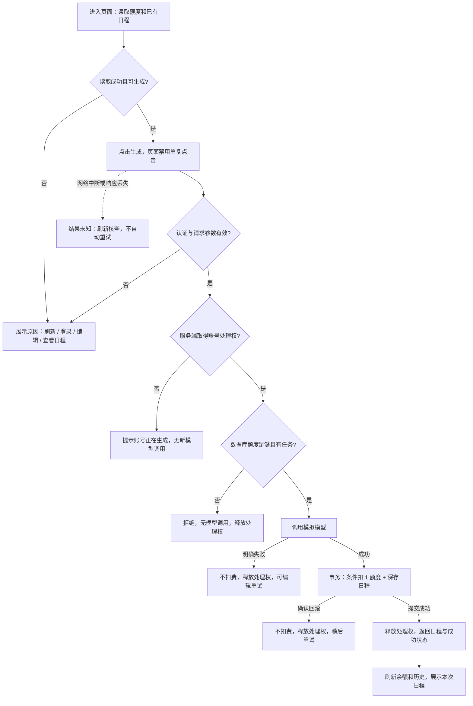

# 日程生成额度体验改进 · 产品需求方案

当前问题是额度检查发生在模型调用之后，且使用可能过期的账号额度：既浪费调用，也可能在并发时透支。方案是在生成前由服务端控制准入，同一账号只允许一个生成任务处理中，成功保存日程时才扣 1 额度，并用清晰状态告诉用户结果和下一步。产品文档与交互原型已交付；原型是本地演示，不代表真实应用已实现或验收。

- 作者：李晗亮；应聘岗位：AI 产品经理；提交方向：产品。
- 版本：v1.1（二次审查修订），2026-10-22。题目依据：[TASK.md](../TASK.md)，运行背景：[README.md](../README.md)。
- 阅读顺序：本需求 → [交互原型](prototype.html) → [开发拆解](DELIVERY.md) → [验收案例](ACCEPTANCE.md)。

## 1. 问题判断与目标

用户期待的是“生成成功才花一次额度，没成功能知道怎么办”。当前风险不只是余额显示不准确，而是调用、扣费、结果保存和用户感知之间不一致。

| 观察依据 | 问题 | 用户/业务影响 |
|---|---|---|
| [原生成入口](https://github.com/bybzhwbzhh88/task-planner-interview/blob/114aeb28f6368e96c08a25627ac094b8d102fd1b/src/demo-ai-app/operations.ts#L49)在模型返回后检查 context.user.credits | 0 额度仍可能调用模型 | 浪费接口调用，等待后才被拒绝 |
| [额度判断](https://github.com/bybzhwbzhh88/task-planner-interview/blob/114aeb28f6368e96c08a25627ac094b8d102fd1b/src/demo-ai-app/operations.ts#L67)使用认证上下文中的余额快照 | 两个请求可能使用同一份旧余额 | 额度透支，计费可信度下降 |
| [页头已有余额](https://github.com/bybzhwbzhh88/task-planner-interview/blob/114aeb28f6368e96c08a25627ac094b8d102fd1b/src/client/App.tsx#L15)，[生成区](https://github.com/bybzhwbzhh88/task-planner-interview/blob/114aeb28f6368e96c08a25627ac094b8d102fd1b/src/demo-ai-app/DemoAppPage.tsx#L190)缺少本次扣费说明和明确的余额读取失败状态 | 余额有展示，但费用规则、刷新反馈与结果核查不完整 | 误解扣费、失败后盲目重试 |
| [模拟接口](https://github.com/bybzhwbzhh88/task-planner-interview/blob/114aeb28f6368e96c08a25627ac094b8d102fd1b/src/demo-ai-app/mockAi.ts#L13)用 [fail] 抛出明确错误 | 错误需要转成用户可理解的反馈 | 用户不知道是否扣费、如何恢复 |

原代码已经用数据库事务一起保存结果与扣减额度，本方案保留这一基础，重点把额度校验前移并增加条件扣减；不是从零引入事务。已有getPlanResults查询也可复用为历史入口，补充最近20份排序限制即可。页头余额的自动刷新时机需在实际Wasp环境复验，不仅凭静态源码断言它一定不刷新。

以上为代码阅读结论，不是用户访谈或线上数据。目标是满足题目五条规则，并降低重复生成和错误重试，不以本地模拟延迟推导线上转化提升。

## 2. 范围与假设

**P0 本轮交付范围**：额度展示、生成前校验、账号级并发准入、成功扣费与保存一致、明确失败不扣费、结果反馈、最近日程核查、对应日志与验收。

**不做**：支付/订阅、充值入口、Token 计价、跨账号防刷、多服务部署、崩溃自动补偿、跨请求结果复用。不同生成请求可以代表不同任务；本方案不会把两个独立请求合并成同一份结果。

假设：单服务、单数据库，模型为仓库提供的本地 mock，通常约 500ms。新账号初始 3 额度。沿用现有任务选择规则，不顺带重做优先级和已完成任务筛选。无任务不生成；工作时长限制 1–24 小时，输入以 0.5 小时为步长，前后端都拒绝1.25等非半小时时长。

“成功”定义为：模型返回有效日程，且结果与扣费一起成功持久化。仅出现 mock-ai.succeeded 不足以判定用户侧业务成功。网络响应丢失不意味着业务失败。

## 3. 用户场景与优先级

| 用户情境 | 用户需要 | 对应需求 |
|---|---|---|
| 第一次生成 | 先知道费用，再得到可查看的日程 | R1、R2、R4 |
| 剩余 0 额度 | 不白等，知道还能做什么 | R2、R5 |
| 模型明确失败 | 确认未扣费，有具体恢复方式 | R4、R5 |
| 连点、多标签页或直接并发请求 | 不透支，不悄悄排队生成多份 | R3 |
| 网络断开或响应超时 | 不被误导，先核查再重试 | R6 |

## 4. 业务规则与验收约束

### R1 额度透明（P0）

保留已有余额能力，布局上将余额与“每次成功生成消耗 1 额度”放在生成操作附近，原型采用该位置。页头若仍保留余额，必须与操作区使用同一个最新服务端查询快照，不能同时显示两个不同数值。余额以服务端数据库为准，不使用前端自减值作为事实。首次加载、生成结束、手动刷新及页面重新获得焦点时查询最新余额；加载失败显示“额度读取失败，请刷新重试”，不能把未知余额显示为 0。

生成中显示“正在生成，成功后消耗 1 额度”。此方案不预扣，余额在成功提交后更新。按钮禁用只是体验措施，服务端仍必须独立校验。

### R2 生成前准入（P0）

校验顺序固定为：认证 → 时长等请求参数校验 → 取得账号处理权 → 读取数据库任务与余额 → 调用模型。只有用户已登录、有任务、时长有效、账号无进行中的生成、数据库余额至少 1，才允许调用模型。未登录要求登录；无任务/时长错误定位到对应输入；额度不足返回明确业务原因且不产生 mock-ai.started。

页面余额为 0 时禁用生成，展示“额度已用完，可查看已有日程或继续编辑任务”。不放没有实现的充值、申请额度或自动恢复倒计时。测试人员通过数据库 Studio 修改额度是测试手段，不进入普通用户流程。

### R3 同账号并发准入（P0）

同一账号最多一个生成请求处于处理中。服务端在读取最新余额之前取得账号级处理权，持续到模型调用与保存/扣费结束；重叠请求立即返回“该账号正在生成，请稍后刷新查看”，不调用模型、不扣费、不自动排队。不同账号可以同时生成。

选择“拒绝重叠请求”而非“后台排队”：用户点击生成通常期待一个结果，静默排队会把误触变成多次扣费。本轮宁可明确提示稍后再次发起，也不隐式创建待执行任务。当前任务完成后，用户可主动提交新请求；新请求成功仍独立扣费。这是产品取舍，不是题目强制要求的唯一技术方案。

客户端同页面连点只发一个请求；多标签页和绕过按钮的请求靠服务端处理权拦截。处理权必须在成功、模型失败、保存失败后释放，不能因一次失败永久阻塞账号。单进程内账号互斥可作为开发实现参考；扩容多进程需重新设计，本轮不涉及。

### R4 扣费与结果一致（P0）

| 结果 | 模型调用 | 额度 | 保存结果 | 用户结论 |
|---|---|---|---|---|
| 成功保存 | 1 次 | -1 | 新增 1 份 | 生成成功 |
| 生成前额度不足/重叠请求/参数错误 | 0 次 | 不变 | 不新增 | 本次未生成 |
| 模型明确失败 | 1 次 | 不变 | 不新增 | 生成失败，未扣费 |
| 模型成功、结果保存失败且确认回滚 | 1 次 | 不变 | 不新增 | 保存失败，未扣费 |
| 响应丢失、提交状态未知 | 不能仅凭客户端判断 | 以数据库为准 | 需核查 | 暂时无法确认 |

开发约束：保留现有扣费与保存日程的同一数据库事务；条件扣减要求当时余额大于 0，未扣成功不能保存为成功。账号处理权覆盖“读余额 → 模型 → 提交”，事务仅覆盖数据库写入，不要求等待模型期间长期占用事务。

管理员在请求处理中修改额度不是正常业务流程；测试设置额度必须在账号无进行中请求时执行。若发生外部改值，条件扣减仍必须避免负数，但不承诺撤销已经开始的模型调用。

正常业务下应保持：最终余额 = 初始余额 − 成功保存份数 ≥ 0。模型失败次数不影响余额；成功响应只能在提交完成后发出。不要在未知结果时自动退款或自动再次调用模型。

### R5 反馈与恢复（P0）

| 状态 | 页面文案 | 下一步动作 |
|---|---|---|
| 成功 | 生成成功，已消耗 1 额度，日程已保存 | 查看日程；有额度时可再次生成 |
| 额度不足 | 额度已用完，可查看已有日程或继续编辑任务 | 查看已有日程、编辑任务、刷新 |
| 同账号处理中 | 该账号正在生成日程，本次未发起新的生成 | 等待完成后刷新查看 |
| 模型明确失败 | 生成失败，本次未扣费。请调整任务后重试 | 保留任务和时长，可编辑后重试 |
| 保存失败且已确认回滚 | 日程保存失败，本次未扣费，请稍后重试 | 稍后重试；不设置尚不存在的客服入口 |
| 网络异常/未知 | 暂时无法确认结果，请先刷新额度与已有日程；重新生成成功会再次扣费 | 刷新核查后再决定是否重试 |

测试专用说明可在验收材料中告诉测试者删除含 [fail] 的任务；普通用户界面不展示错误堆栈、数据库或 HTTP 状态码。提示不能只靠颜色，使用可读文字与状态区域；生成中禁用按钮、保留任务输入，不清空之前的有效结果。

### R6 结果核查（P0）

页面展示最近 20 份已保存日程，按生成时间倒序，可展开查看任务内容。列表包含时间与结果编号，严格按当前账号隔离。生成后刷新额度和历史；刷新失败时保留成功结论，同时提示“最新额度或历史暂未刷新，请重试”，不能把成功改写成未扣费。

新生成一开始，原本次结果切换为“上次已保存日程 / 历史结果·非本次”；失败或未知时继续保留该标识，新请求确认为成功后才改回“本次日程”。用户通过时间和内容核查；本轮不保证自动定位每个断网请求，不自动重试、不承诺精确核对完成。若有多次相近生成难以辨别，继续提示等待并刷新；本轮不虚构客服渠道。请求编号精确恢复可列为后续增强。

未知状态下先禁用生成，提供刷新。查询成功只表示读取到当前快照，不能判定之前请求已结束；无新增记录也不等于没有扣费或以后不会成功。核查后有额度时，用户可选择“我已核对，需要生成一份新日程”，再主动点击生成；这不是自动重试，也不将原请求标记失败，服务端仍做忙碌和余额校验。编辑任务或时长不得解除待核查状态或改变余额快照。

## 5. 用户流程与页面状态

空任务、非法时长、额度未知及额度耗尽，都在按钮附近给出可见原因。最后1额度生成成功后也必须显示“额度已用完”，不能只禁用按钮。

状态不等于余额：余额 0 是不可生成状态，网络错误是未知状态，不能互相替代。锁在服务端跟随实际请求完成释放；客户端断开不意味着可立即释放并允许重叠调用。

## 6. 衡量与日志

本地验收要求的正确性指标：0 额度准入后的 started 数为 0；透支账号数为 0；明确模型失败扣费数为 0；成功保存数与扣费数一致。阈值是验收条件，不是已测线上成绩。

沿用 mock-ai.started/succeeded/failed 与 callId。建议增加请求级 requestId、拒绝原因、提交成功/失败日志，以区分“模型成功”与“业务成功”；不要记录密码、手机号或完整任务文本。只为可观测性增加日志，不引入复杂埋点平台。

后续观察生成成功率、失败后重试率、并发拒绝比例、未知结果比例和 P95 等待时间。先测基线再定改善目标，不虚构提升百分比。高并发拒绝比例可能说明多页面误触，也可能是用户确有批量生成需求，需要结合使用行为判断是否新增显式任务队列。

## 7. 已确认决策与后续事项

| 事项 | 本轮决定 | 影响/后续 |
|---|---|---|
| 同账号并发 | 拒绝重叠请求，不排队 | 以并发测试验证“忙碌拒绝”和后续可恢复 |
| 扣费时点 | 模型成功且日程保存提交成功时 | 保存失败必须一起回滚 |
| 额度耗尽 | 查看历史/编辑，不虚构补充渠道 | 如后续有真实额度发放规则再增加入口 |
| 网络未知 | 不自动重试、不保证未扣费 | 使用历史核查，精确请求恢复为后续增强 |
| 历史范围 | 最近 20 份 | 不做检索、分页管理或删除能力 |
| 服务崩溃补偿 | 不做 | 真实生产化前另行评估 |

以上取舍可直接交给开发实现。产品交付不要求先完成应用代码；真实应用验收应在开发落地后执行，记录要求见 [验收文档](ACCEPTANCE.md)。

## 8. 题目覆盖索引

| 题目要求 | 方案决策 | 开发任务 | 验收 |
|---|---|---|---|
| 每次成功扣1 | R4：提交结果与扣费同时成功 | D4 | AC03、AC09 |
| 不足不调用 | R2：服务端准入；页面快照不是授权 | D3、D5 | AC02、AC07 |
| 明确失败不扣费 | R4/R5：不写结果、不扣费，可恢复 | D4、D6 | AC04 |
| 同账号并发不透支 | R3：忙碌拒绝；余额条件扣减 | D3、D4、D7 | AC05、AC06、AC08 |
| 理解结果及下一步 | R1/R5/R6：费用说明、状态与核查 | D2、D5、D6 | AC01、AC10、AC12、AC13 |
