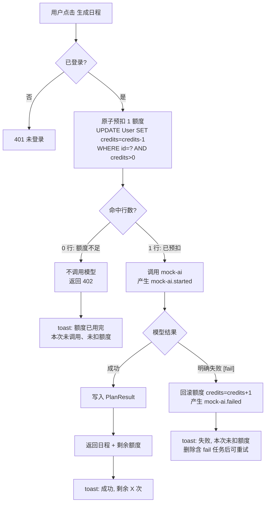
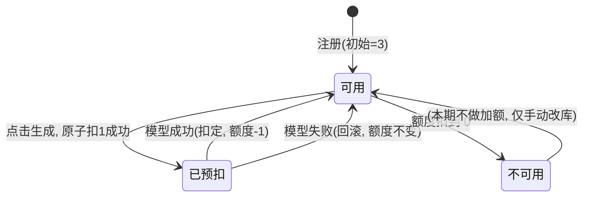

# 流程与原型

> 需求规则见 [requirements.md](./requirements.md)。本文只画流程和页面，不重复规则。

## 1. 一次"生成日程"的端到端流程



关键不变量：**只有"命中 1 行"之后才会出现 `mock-ai.started` 日志**；只要出现了 `mock-ai.started`，成功则额度 -1，失败则额度回滚不变。

## 2. 额度状态机（单账号）



并发视角：同一时刻多个请求进入"已预扣"时，数据库 `WHERE credits>0` 保证只有 N 个请求能拿到预扣（N=当前额度），其余直接停在"可用→402"，不会出现负数。

## 3. 页面原型（文字线框）

页面顶部已有标题"AI 任务规划"。改造点集中在任务列表卡片下方与按钮区。

### 3.1 主界面

```
┌─────────────────────────────────────────────┐
│              AI 任务规划                      │
│   输入待办事项和可用时长，生成一份模拟日程      │
│                                              │
│  [输入待办事项...........]  [添加任务]        │
│                                              │
│  ☑ 写简历                    [ 2 ] 小时       │
│  ☐ 投3个简历                 [ 1 ] 小时       │
│                                              │
│  今天可用的工作时长           [ 8 ] 小时      │
│                                              │
│  剩余额度：2 次                               │  ← 新增：实时展示
│  ┌─────────────────────────────────────────┐ │
│  │            生成日程                       │ │  ← credits=0 时整按钮置灰
│  └─────────────────────────────────────────┘ │
└─────────────────────────────────────────────┘
```

- "剩余额度：X 次"与按钮同区，字号略大于正文，颜色用主题色，让用户点按钮前就看得到。
- 额度为 0 时按钮文案变为"额度已用完"且禁用，不允许点击后再转圈报错。

### 3.2 三种提示（toast）

| 触发 | 标题 | 描述文案 | 类型 |
| --- | --- | --- | --- |
| 生成成功 | 生成成功 | 本次已消耗 1 次额度，剩余 X 次 | 默认 |
| 额度不足 | 额度已用完 | 本次没有调用模型、也没有扣额度。当前暂无自助加额入口。 | 警告 |
| 模型失败 | 生成失败 | 本次未扣额度。请检查是否有任务带了 [fail] 标记，删除后重试。 | 错误 |

### 3.3 成功后

日程卡片上方追加一行小字："本次已消耗 1 次，剩余 X 次"，与 §3.1 的额度数字保持一致（都来自服务端同一次返回）。

## 4. 异常与边界一览

- 用户没加任何任务就点生成：按钮本就禁用（现有逻辑保留），不进入额度流程。
- 连续快速点 N 次：按钮在 `isPlanGenerating` 期间禁用（现有），但同一账号多标签页/多客户端并发时，由 §1 的原子扣兜底。
- 模型 500ms 内尚未返回时，用户又开一个标签页再点一次：第二个请求按当时真实额度决定能否预扣，不会读到旧值。
