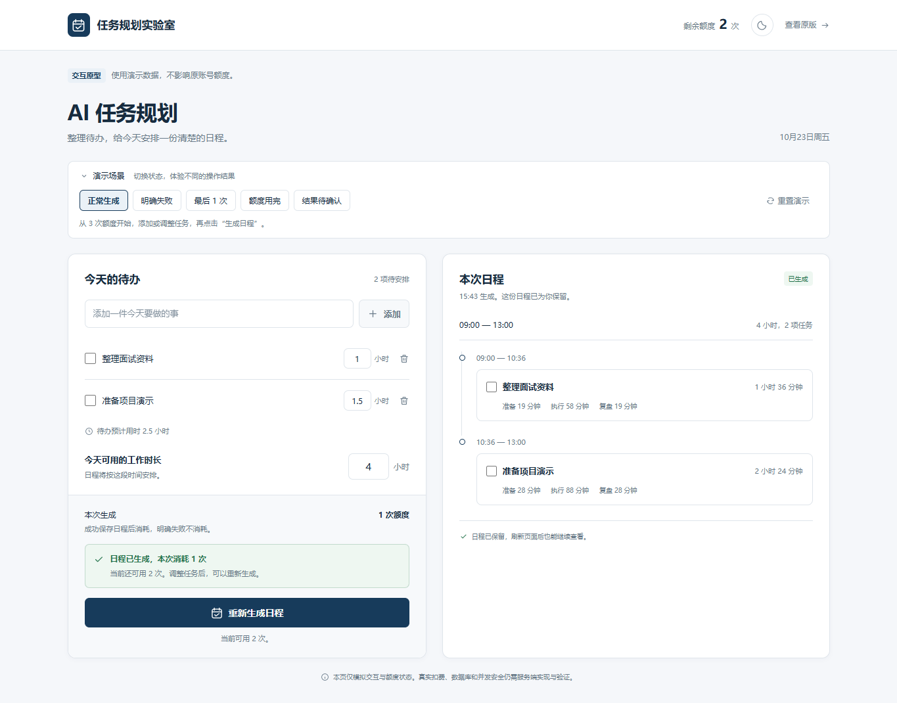

# 额度体验改版原型

这是产品方向的独立可点击原型，用来评审额度和结果反馈。页面使用演示数据，所有操作留在当前浏览器标签页，不连接原应用的账号、模型或数据库。原版 `src/`、Wasp 配置与数据库模型保持原样。

## 本轮设计

- 延续原版白底、深蓝操作按钮和任务列表。颜色：文字 `#172b3e`、主操作 `#173b5b`、背景 `#f5f7fa`、边线 `#dfe5eb`、成功 `#23734b`、错误 `#b8423c`。
- 使用系统中文无衬线字体，标题 32px、主要内容 13–16px，辅助文字 10–12px。桌面左侧编辑任务、右侧查看日程；手机按任务、生成、结果顺序排布。
- 把计费规则放到按钮旁；成功和失败都有持久反馈。保留上一份日程，未知结果必须先核对。
- 场景切换属于评审工具，收在独立的“演示场景”区域；正式产品界面不出现这些控制项。
- 右上角太阳／月亮按钮借鉴用户提供的 Sonilo 录屏：新主题从按钮中心以圆形铺开，浅色与深色都沿用本原型配色。



## 启动

只需 Node.js 24+，运行页面无需安装依赖：

```sh
cd prototype
node serve.mjs
```

打开终端打印的地址，默认 `http://localhost:4310`。也可以直接打开 `dist/index.html` 体验；HTTP 模式更适合浏览器验证。数据仅在当前标签页会话中保留，刷新可以找回已生成的演示结果。

“查看原版”指向本机的 `http://localhost:3000`，需要另按仓库 [README](../README.md) 启动原应用；原型自身不依赖它。

## 建议体验顺序

1. 默认场景生成一次，观察生成中提示、剩余 3 → 2 和新日程。
2. 选择“明确失败”，再生成，观察额度保留和上一次日程保留；主动重试可成功。
3. 选择“最后 1 次”，成功后额度为 0，按钮禁用并解释下一步。
4. 选择“额度用完”，直接观察拦截态。
5. 选择“结果待确认”，生成后先看到待核对状态；点击“核对结果”找回模拟保存的结果，不重复消耗。

场景切换重置演示额度和本次状态，保留任务及上一份日程；“重置演示”回到初始示例。界面模拟验证不能证明服务端原子预留、真实扣费、跨标签页并发或数据库故障恢复正确。

顶部“剩余额度”显示尚未消耗的次数；生成中用按钮旁的提示说明其中 1 次已预留。结果未知时隐藏推算余额，改为“待核对”。本原型未模拟其他标签页正在占用额度的情况。

## 主题切换

点击右上角图标体验圆形扩散，动画为 500ms。当前标签页刷新后保留主题，切换主题不重建任务或日程。图标及悬浮提示表示下一步切换目标，键盘 Enter / Space 也可操作。

使用原生 [View Transitions API](https://developer.chrome.com/docs/web-platform/view-transitions/same-document#animating_with_javascript)，无需额外动效依赖。连续点击会跳过旧过渡，按最新选择显示；浏览器不支持、系统启用“减少动画”或使用键盘操作时直接切换。参考仅来自所提供录屏的视觉观察，未取得或使用 Sonilo 登录后的源码。

## 浏览器检查

2026-10-23 已通过 10 项额度与任务交互检查，以及 8 项主题专项检查，实际结果与边界见 [VALIDATION.md](VALIDATION.md)。原产品方案的 AC01–AC14 属于真实应用的开发验收，本原型不将它们标为通过。

保持预览服务运行，在另一终端执行：

```sh
cd prototype
npm ci
npx playwright install chromium
npm run check
npm run verify
npm run verify:theme
```

脚本优先使用已安装的 Edge 或 Chrome，再回退到 Playwright Chromium；全程使用独立的无头浏览器。额度交互结果写入 `evidence/browser-qa.json`，主题交互结果写入 `evidence/theme-qa/`，失败时退出码非 0。自动验证仅使用演示数据；`evidence/` 已忽略，不随提交交付，可重新生成验证记录。
