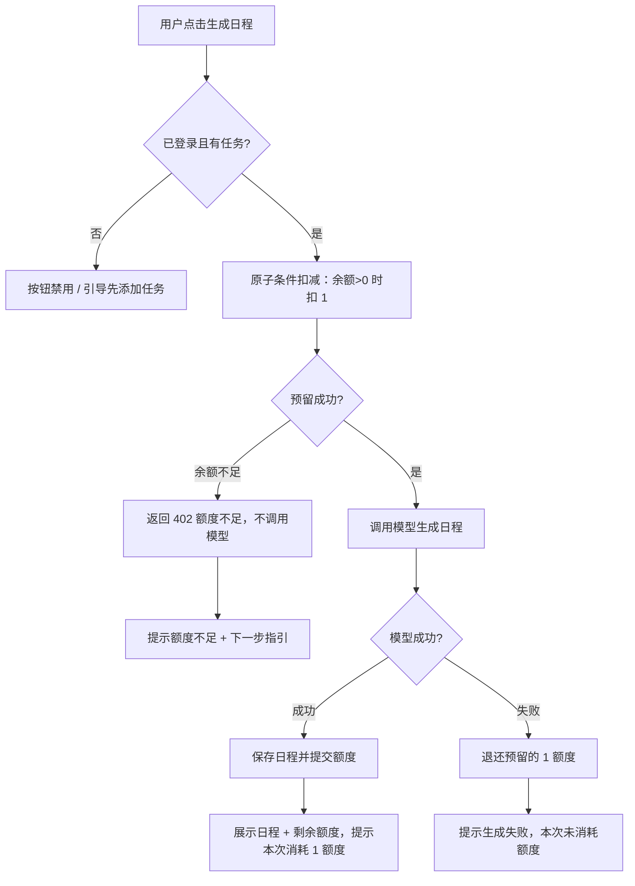

# 任务规划工具 · 额度处理（产品方案）

> 面向人 + AI 的交接文档。正文用短段落、清单、表格与流程，具体行为落在编号需求（R）与验收案例（A）上。

## 1. 问题判断与结论

额度处理是"付费/受限能力"的最小实现。当前版本存在三类缺陷，均违反 TASK.md 的目标规则：

1. **额度校验顺序错误**：额度判断发生在模型调用**之后**，余额为 0 的用户仍会触发一次模型调用，随后才被拒绝。→ 违反「额度不足时，不应发起模型调用」。
2. **并发会透支**：生成时用「先读缓存余额、再无条件 `decrement`」的方式，多个并发请求可能同时读到同一余额并各自扣减，导致余额为负。→ 违反「并发不超发」。
3. **结果反馈不清**：仅区分「额度不足」和「其它错误」，成功无额度反馈，页头余额不随操作刷新。→ 违反「用户能理解结果并知道下一步」。

**目标方案**：采用「**先预留 → 后调模型 → 失败退还**」的顺序，并用**原子条件扣减**作为预留原语，一次动作同时满足「不足不调模型」「失败不消耗」「并发不超发」三条规则。

**完成状态**：需求、流程、低保真原型、开发任务拆解、验收案例已完成；本方向不写代码，实现与验证交由技术方向。

---

## 2. 需求

编号为唯一引用，供任务拆解与验收案例回溯。

| 编号 | 需求                                | 可观察行为                                                   |
| ---- | ----------------------------------- | ------------------------------------------------------------ |
| R1   | 每次成功生成一次日程，消耗 1 个额度 | 生成成功且保存日程后，余额 -1                                |
| R2   | 额度不足时不发起模型调用            | 余额为 0 时，点击生成立即返回「额度不足」，服务端`mock-ai.started`日志数不变 |
| R3   | 模型明确返回失败时，不消耗额度      | 模型失败后余额不变，返回可区分的失败提示                     |
| R4   | 同一账号并发请求不造成额度透支      | 余额为 N 时并发发起 M 次请求，最多 N 次进入模型调用，余额不低于 0 |
| R5   | 用户理解操作结果与下一步            | 生成成功/失败/额度不足三种状态均有明确提示；页面实时展示最新剩余额度 |

### 范围与假设（非目标）

- 只考虑**单服务、单数据库**运行环境；不同请求可代表不同任务，不跨请求复用结果。
- 不实现：支付/订阅、跨账号防刷、精确 Token 计价、服务崩溃后的自动补偿。
- 「一次 `mock-ai.started` 日志」视作「一次已发起的模型调用」，作为 R2/R4 的可观测证据。
- **额度用尽无恢复途径**：当前版本额度耗尽后不提供重置/充值/订阅等恢复方式；额度相关指引仅作状态说明，删除任务不恢复额度。
- 已知风险（记录备查）：若在「预留成功后、模型调用前」服务崩溃，可能出现少退 1 额度的残留，属范围外，暂不做自动补偿。

---

## 3. 流程

### 3.1 生成日程主流程



文字版关键顺序（与技术实现一致）：

1. 校验登录与是否存在任务（不存在则不发起）。
2. **预留（原子条件扣减）**：仅当余额 > 0 时扣 1；扣减成功才能继续。
3. 调用模型生成日程。
4. 成功 → 保存日程，余额保持已扣减；失败 → 退还 1 额度。
5. 返回结果与最新剩余额度。

### 3.2 并发一致性

- 「预留」必须是**原子条件扣减**：`余额 = 余额 - 1 且要求扣减前余额 > 0`，数据库行锁保证多个并发请求串行化，只有前 N 个能看到并扣减，后续请求余额不足被拒绝。
- 因此余额为 N 时，最多 N 个请求进入模型调用；余额永不出现负数。
- 失败退还只是 +1，不会造成透支；退还与并发预留均为原子写，冲突可控。

---

## 4. 原型（低保真线框）

生成区核心布局（通用示意）：

```text
┌───────────────────────────────────────────────┐
│ 任务规划实验室                     剩余额度：3  │ ← 页头（余额实时刷新）
├───────────────────────────────────────────────┤
│ ☐ 写周报 ···························· 1 小时  │
│ ☐ 准备评审材料 ······················ 2 小时  │ ← 任务列表
│ 今天可用的工作时长   [ 8 ]                     │
├───────────────────────────────────────────────┤
│              [  生成日程  ]                    │ ← 主按钮（生成中→禁用）
├───────────────────────────────────────────────┤
│ 提示区：成功 / 失败 / 额度不足 三类 toast        │
│ 成功时：本区域展示「本次日程」                   │
└───────────────────────────────────────────────┘
```

5 个关键状态（差异见下表）：

| 状态           | 页头余额  | 主体                                | 提示（toast）                            | 下一步指引                                         |
| -------------- | --------- | ----------------------------------- | ---------------------------------------- | -------------------------------------------------- |
| 默认（有任务） | 3         | 任务列表 + 生成按钮                 | 无                                       | 可点击生成                                         |
| 生成中         | 3         | 按钮转圈「生成中…」并禁用           | 无                                       | 等待                                               |
| 成功           | 2         | 展示本次日程                        | 「生成成功，本次消耗 1 额度，剩余 2 次」 | 可再次生成或调整任务                               |
| 额度不足       | 0         | 生成按钮禁用 + 常驻「额度不足」提示 | 「额度不足，无法生成」                   | 额度用尽无恢复途径；可更换账号；删除任务不恢复额度 |
| 模型失败       | 3（不变） | 无新日程                            | 「生成失败，本次未消耗额度」             | 重试或检查任务（如移除 `[fail]`）                  |

**决策：余额为 0 时禁用生成按钮 + 常驻提示**，而非"按钮可点但请求被拒"。理由：① 用户不会因反复点击被拒而挫败；② 反馈更前置，一眼可知是额度问题而非功能异常；③ 后端仍保留额度校验兜底（原子条件扣减），即便绕过前端也会拒绝且不发起模型调用。

**页头余额需实时刷新**（生成成功后从 3→2），避免展示过期额度。

---

## 5. 开发任务拆解

| 编号 | 任务             | 要点 / 改动                                                  | 验收案例   | 依赖   |
| ---- | ---------------- | ------------------------------------------------------------ | ---------- | ------ |
| T1   | 额度预留顺序重构 | 把额度判断与扣减移到模型调用之前；使用原子条件扣减（余额>0 才扣 1），返回是否成功 | A2, A3     | -      |
| T2   | 失败退还         | 模型失败（含保存失败）时退还已预留额度，净消耗为 0           | A4         | T1     |
| T3   | 错误语义         | 额度不足返回 402 + 剩余额度；模型失败返回失败信息；成功返回剩余额度 | A1, A2, A4 | T1, T2 |
| T4   | 前端三态反馈     | 成功/失败/额度不足三种 toast，成功含剩余额度，失败标注「未消耗额度」 | A6, A7     | T3     |
| T5   | 页头余额同步     | 生成后刷新展示最新剩余额度                                   | A1, A7     | T3     |
| T6   | 并发验证         | 提供并发场景可重复执行的测试/脚本，断言 `mock-ai.started` 次数与余额 | A5         | T1     |
| T7   | 文档交接         | 更新 README 运行说明、验证记录，标注未验证项                 | A1–A7      | -      |

---

## 6. 验收案例

> 每条含前置条件、操作与可观察预期结果。`mock-ai.started`/`succeeded`/`failed` 为服务端日志（同一次调用共享同一 `callId`）。
>
> **余额前置设置方式**：通过 `wasp db studio` 将测试账号的 `User.credits` 改为 0 / 1 / 3，随后刷新页面生效（见 README「模拟接口」一节）。

| 编号 | 场景                 | 前置条件                           | 操作                             | 预期结果                                                     |
| ---- | -------------------- | ---------------------------------- | -------------------------------- | ------------------------------------------------------------ |
| A1   | 成功消耗额度         | 新账号余额 3；已添加 ≥1 个普通任务 | 点击生成                         | 约 500ms 后展示日程；余额 3→2；页头/提示显示「剩余 2」；日志 `mock-ai.started` 恰 1 次且同 `callId` 出现 `mock-ai.succeeded` |
| A2   | 额度不足不调模型     | 余额设 0；已有任务                 | 观察前台状态 + 直接调用生成接口  | 生成按钮禁用并常驻「额度不足」；后端接口被直接调用时返回 402；余额仍 0；日志**不新增** `mock-ai.started` |
| A3   | 边界：余额 1         | 余额 1；已有任务                   | 先成功生成一次，再观察生成区状态 | 第一次成功、余额 1→0 并展示日程；第二次生成按钮禁用 + 常驻「额度不足」提示，不调用模型 |
| A4   | 模型失败不消耗       | 余额 3；任务含一条 `[fail]`        | 点击生成                         | 约 500ms 后提示「生成失败，本次未消耗额度」；余额仍 3；不保存日程；日志 `mock-ai.started` 后同 `callId` 出现 `mock-ai.failed` |
| A5   | 并发不超发           | 余额 1；已有任务                   | 同一账号并发发起 2 个生成请求    | 恰 1 个成功（余额→0、展示日程），1 个被拒额度不足；余额不为负；`mock-ai.started` 恰 1 次 |
| A5+  | 并发不超发（强化）   | 余额 3                             | 并发发起 5 个生成请求            | 恰 3 个成功、2 个额度不足；余额为 0；`mock-ai.started` 恰 3 次 |
| A6   | 额度不足提示含下一步 | 余额 0                             | 观察生成区/提示                  | 明确显示剩余额度 0 并提示「额度不足」；告知额度用尽无恢复途径，可更换账号（不暗示删除任务能恢复额度） |
| A7   | 成功结果可理解       | 余额 2，生成成功                   | 观察成功反馈                     | 提示含「本次消耗 1 额度，剩余 1 次」；页头与主体余额同步为 1 |

---

## 7. 已知风险 / 待办

- 服务崩溃导致「预留后未退还」的残留额度，属范围外，建议后续用幂等/对账补偿。
- 本方向不涉及代码实现；A1–A7 作为可执行清单交由技术方向实现后逐项验证。
